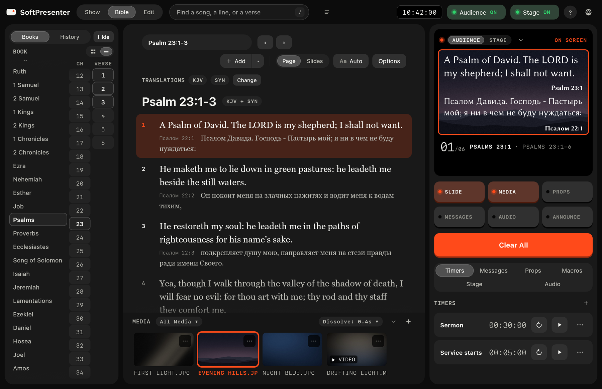
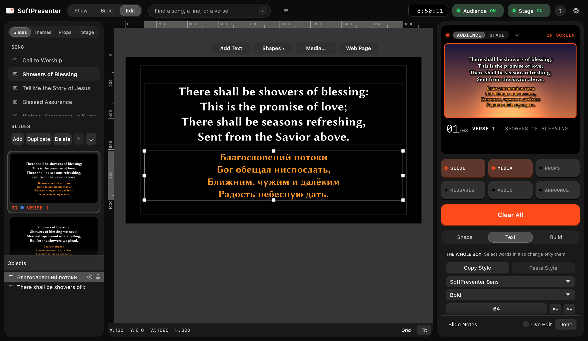

# SoftPresenter

**Fast, free, open-source software for putting songs, Bible verses and media on the screens in a
church service. Everything you can click, a script or an AI agent can do.**

Website: [softpresenter.com](https://softpresenter.com)

> **Early days: everything may change until 1.0.** SoftPresenter is young. Until version 1.0,
> anything may change without notice: how the window looks and is laid out (a redesign is
> planned), how features work, the `sp` commands, the files it saves, and the code itself. Some
> buttons still do less than they look like they should, so it isn't ready to run a Sunday
> service on its own yet. It is built in the open; bug reports and ideas are welcome in
> [Issues](https://github.com/esraell/SoftPresenter/issues).

## Why SoftPresenter

Churches put words on screens every week: songs, readings, notices. The apps that do it well cost
a lot, are heavy on older computers, and treat a service in two languages as an afterthought.
SoftPresenter is built to be:

- **Free and open.** No licence fee, no account, no subscription. Everything it needs, the Bibles
  it offers included, is hosted with this repository.
- **Made for two languages.** Every slide can carry a main language and a translation, for
  churches that sing in Russian or Ukrainian and English side by side.
- **Right about the Bible.** Translations number some verses differently (the Russian Psalms are
  the best-known case). SoftPresenter lines up the same verse across translations instead of
  pairing chapter and verse numbers blindly.
- **Fast and light.** Slides are drawn on the GPU, the audience screen never waits for the
  operator's window, and it is built to run well on a modest laptop.
- **Familiar.** Laid out the way people who run church screens expect: libraries and playlists
  on the left, slides in the middle, what is on screen on the right, media along the bottom.
- **Open to scripts and AI.** Most of what the operator does during a service, a script or an AI
  agent can do from the command line.

## Who it's for

- **A Sunday service** of songs, readings, sermon slides, notices and pictures, run by one
  volunteer with the keyboard.
- **Congregations in two languages:** both languages on every song slide, and up to four Bible
  translations on one slide, lined up verse by verse.
- **Worship teams and livestreams:** stage screens with the words now, the next slide, the clock
  and a timer; any screen sent over NDI to streaming software or a video switcher, laid out its
  own way if needed (a lower third for the stream).
- **Lobbies and automation:** loops of pictures and videos before and after the service, and a
  command line for scripts, button panels and AI agents.

## What it does

- **Songs and slides.** Songs as slides in groups (Verse, Chorus, Bridge), arrangements, one-key
  jumps, nineteen transitions, libraries of your own, and playlists with headers, shown as one
  scroll from song to song. Songs import from text, ChordPro, rich-text, Word and lyric-service
  files, in any common encoding, and whole song libraries come across from other presentation
  software. PowerPoint, Keynote and PDF files, and folders of pictures, come in as slides. Undo
  and redo.
- **Bible.** Type `John 3:16-18`, `Пс 22:1-3` or `Ів 3:16` and the slides fill as you type, with
  no need to press Return; or click through book, chapter and verse lists, or search by word.
  Up to four translations on one slide, a history of the passages shown, and book names in
  English, Russian and Ukrainian. Four Bibles come with the app and sixteen more install from
  its Bibles window.
- **Media.** Pictures and videos behind the words or on their own, media playlists, folders the
  app watches, and an announcements layer that loops by itself. Videos play as they are, never
  converted.
- **Screens.** Any number of audience screens on displays (never the one the operator works
  on), in windows, over NDI or out of a Blackmagic DeckLink card (SDI or HDMI, with the card's
  keyer), each with its own look and theme if you like (a lobby can show
  only the media, a stream a lower third); stage screens with layouts you design; test patterns
  and Identify Screens.
- **Live tools.** Timers, messages over the slides, props such as a logo, macros that do several
  things in one click, walk-in music with crossfades, and a message for the stage.
- **Editing and themes.** A slide editor with text, shapes, pictures, videos, gradients and
  builds; themes that decide where each kind of text goes, used across songs and Bible slides.
- **Command line.** `sp` (full name `softpresenter`) controls the running app: `sp status`,
  `sp next`, `sp clear all`, and slides, media, messages, timers, macros, the Bible and every
  menu item. Install it from SoftPresenter › Install Command Line Tool…;
  [docs/cli.md](docs/cli.md) has the commands.

The full list, area by area, is in [docs/features.md](docs/features.md).

<table>
  <tr>
    <td width="50%"></td>
    <td width="50%"></td>
  </tr>
  <tr>
    <td align="center">The Bible in two translations, lined up verse by verse</td>
    <td align="center">A stage screen as the band sees it</td>
  </tr>
  <tr>
    <td width="50%"></td>
    <td width="50%"></td>
  </tr>
  <tr>
    <td align="center">The slide editor</td>
    <td align="center">Audience, NDI and stage screens</td>
  </tr>
</table>

## A service from start to finish

1. **Set up the screens.** The first start opens a short setup: choose the display the
   congregation sees (the projector or TV, by the name macOS gives it) and a stage display if
   there is one. The Mac's main display, where you work, is never filled; on a Mac with one
   display, the screen opens in a window. Later, the Screens window (Option-Command-1) changes
   them and adds more, including screens sent over NDI. Identify Screens shows each screen's
   name on it, so you can check which is which.
2. **Bring in the songs.** New Song (Command-N) asks for a title and a theme and takes the words
   pasted in: a line in square brackets starts a group, a blank line starts a new slide, and a
   line with only `--` separates the main language from the translation. Songs you already have
   come in with File › Import Songs…, or by dropping their files on the window: text (see
   [the format](#song-text-files)), ChordPro, rich text, Word and lyric-service files. A whole
   library from other presentation software comes across too, from the File menu or the
   first-run setup, keeping each song's groups and arrangements.
3. **Build the running order.** Make a playlist with the + beside PLAYLISTS (say "Sunday
   Morning"), drag songs into it in order, and add headers to group them. Sermon and notice
   slides that arrive as PowerPoint, Keynote or PDF files come in with File › Import Slides…,
   or by dropping them on the window: each page becomes a slide, ready to drag into the
   playlist.
4. **Add the readings.** Control-B goes to the Bible page from anywhere. Type a reference such
   as `John 3:16-18` and the slides fill as you type (book names are offered as you go), or
   click through the book, chapter and verse lists; nothing goes on screen until you click a
   slide. Pick a second translation for the next row, set what each slide shows under Options
   (with a live preview), and add the passage to the playlist with one click. History brings
   back any passage that was on screen.
5. **Add pictures and videos.** Drop them on the window to put them in the media bin, and group
   them in a media playlist (the menu beside MEDIA). For a loop before the service, choose Play
   This Playlist, or right-click a song and choose Play on Announcements Layer. To start it every
   time the app opens, set it under Settings, Screens, When SoftPresenter Opens.
6. **Choose what the stage sees.** In the Stage tab, give each stage screen a layout: Words and
   Next, Words Only, Words and Notes, Clock and Timer, or one you design.
7. **Run it.** In the Show view (Command-1), open the playlist and click the first slide, or press
   Space. The right arrow and Space go forward, the left arrow goes back, and letters jump to a
   group (A for Verse 1, C for the chorus). With View, Continuous Playlist on, the last slide of
   a song leads into the next song. Escape clears everything, walk-in music and announcements
   included; F2 to F6 clear one layer at a time. Timers, messages and macros sit in the tabs
   under Clear All.
8. **Afterwards.** There is nothing to save: every change is written as you make it, and the
   playlist is ready for next week.

## Get started

There is no download yet: SoftPresenter is built from source, on a Mac with macOS 13 or later
(Windows and Linux are planned). You need:

- **The Xcode Command Line Tools:** `xcode-select --install`.
- **Rust through [rustup](https://rustup.rs).** `rust-toolchain.toml` pins the version
  (1.100.0), and rustup installs it by itself.

Then:

    git clone https://github.com/esraell/SoftPresenter
    cd SoftPresenter
    cargo run --release

For a proper `SoftPresenter.app`, named correctly in the menu bar and the Dock:

    scripts/macos-app.sh
    open target/release/SoftPresenter.app

The first build also downloads FFmpeg's source from ffmpeg.org (12 MB, checked against its
SHA-256) and builds the LGPL FFmpeg that plays MKV, WebM, AVI and other videos
(`scripts/build-ffmpeg.sh`, about a minute); later builds reuse it. Without it the app still
builds, and uses an FFmpeg installed on the computer.

The first start opens a short setup: the screens, bringing songs in, which Bibles to show, and
what macOS will ask permission for and why. SoftPresenter › Set Up SoftPresenter… opens it
again.

Two things are optional:

- **NDI Tools** (free, from [ndi.video](https://ndi.video)) to send a screen over NDI. Without
  it, NDI screens say NDI isn't installed and everything else works.
- **Desktop Video** 16.0 or later (free, from Blackmagic Design) to play a screen out of a
  DeckLink card. Without it there are no DeckLink outputs to choose.
- **Keynote** (free from Apple), PowerPoint or LibreOffice, to bring presentation files in as
  slides; a Keynote file needs Keynote. PDFs and pictures need none of them.

Song text files can be opened from the command line, such as the sample:
`cargo run --release -- samples/sample-song.txt`. Other options: `--list-displays`,
`--output-display N`. Running from the source, the command line is `cargo run --release --
status` instead of `sp status`.

## Using it

### Keys

| Key | Does |
|---|---|
| Right arrow, Space | next slide; with another playlist item opened, start that item |
| Left arrow | previous slide; with another playlist item opened, start that item |
| Up / Down arrow | open the playlist item above / below |
| Enter | put the open item on screen from its first slide |
| Home / End | first / last slide of the song |
| Escape (or F1) | clear everything, audio and announcements included |
| F2 / F3 / F4 / F5 / F6 | clear the slide / the media / the props / the audio / the message |
| A, S, D, F… | jump to Verse 1, 2, 3, 4… |
| C, X, Z | jump to Chorus 1, 2, 3 |
| B, N, M | jump to Bridge 1, 2, 3 |
| P, T, I, E, O | Pre-chorus, Tag, Intro, Ending, Outro |
| Cmd+N | new song |
| / or Cmd+F | find a song (title or words) or a Bible passage or verse |
| Cmd+, | Settings |
| Option+Cmd+1 | Screens |
| Shift+Cmd+1 / Shift+Cmd+2 | audience / stage screens on or off |
| Cmd+S, Cmd+B, Cmd+E | Show, Bible (ready for a reference), Edit (Control+S, B, E and T work too on a Mac) |
| Cmd+P | the playlists and libraries to choose from |
| Cmd+1 … Cmd+7, then 1 … 9 | open a tool tab and number what is in it, then start, show, run or play the one with that number |
| Shift+Cmd+M, then 1 … 9 | show that picture or video |
| Cmd+O | the menu of the slide on screen |
| ? | every key, as a list (holding Cmd shows each key beside what it does) |

The letter for each group is shown on its first slide. On Windows and Linux, Ctrl takes the
place of Cmd.

### Song text files

A song can be a plain UTF-8 text file:

    [Verse 1]
    Light rises over the quiet hills
    And the morning sings again
    --
    Свет встаёт над тихими холмами
    И утро снова поёт

    [Chorus]
    ...

- `[Name]` starts a group.
- A blank line starts a new slide.
- A line with only `--` separates the main language from its translation.

Songs made or edited in the app are saved as `.sppres` files (JSON), which also hold where each
box sits and how it looks.

### Where things are kept

Everything lives in `~/Documents/SoftPresenter/`: songs made in the app (`Songs/`), themes
(`Themes/`), pictures (`Images/`), downloaded Bibles (`Bibles/`), playlists, libraries,
screens and a few preferences, where you can see it and back it up. The log is in
`~/Library/Logs/SoftPresenter/`. A library kept in `~/Library/Application Support/SoftPresenter/`
by an earlier version is moved to Documents the first time the new one starts; the old folder is
kept beside it as "SoftPresenter (moved to Documents)".

## Where it's heading

SoftPresenter aims to be the presentation app a church never has to pay for and never outgrows:
complete enough for a large Sunday service, simple enough for a volunteer, light enough for an
old laptop, and open to scripts and AI. First on the list: bringing playlists and media across
from a church's existing software, and fixing a slide's words from the Show view. After that
come a network API with a phone remote, the whole app in a browser, an MCP server for AI
assistants, and tested Windows and Linux builds.

The full plan, about 170 features with their size and how much each matters on a Sunday, is in
[docs/roadmap.md](docs/roadmap.md). Nothing in it is promised by a date.

## For developers and AI agents

- [docs/app-map.md](docs/app-map.md) maps every view, panel and window, what each part does, the
  command-line command that does the same, where the files are, and how to try the app safely.
- [docs/cli.md](docs/cli.md) is the command line's reference.
- [AGENTS.md](AGENTS.md) is for AI coding agents: running the app without disturbing anyone,
  the testing switches, and the rules.
- [CONTRIBUTING.md](CONTRIBUTING.md) covers sending a change and the commit standard.

The code is a Rust workspace:

    crates/sp-model    slides, groups, themes, the song text parser
    crates/sp-engine   what is live and the commands that change it (no windows)
    crates/sp-render   draws slides on the GPU: screens, thumbnails, preview
    crates/sp-bible    Bible files, references, search, verse numbering
    crates/sp-ndi      NDI output
    crates/sp-decklink DeckLink output (a small C++ bridge to Blackmagic's driver)
    crates/sp-video    videos (macOS's AVFoundation, then FFmpeg), system picture formats, and
                       web pages drawn off-screen (macOS's web view)
    crates/sp-app      the app and its windows
    third_party/vello  the vello renderer's main crate, changed to size its GPU memory from
                       what is drawn (outside the workspace; its PROVENANCE.md explains)
    third_party/fontique  the font finder Parley uses, changed to map only font files nothing
                       else can change and read the rest (outside the workspace; its
                       PROVENANCE.md explains)
    third_party/decklink-sdk  the DeckLink SDK's header files, unchanged (its PROVENANCE.md
                       lists them)

[AGENTS.md](AGENTS.md#rules) says where `unsafe` code is allowed. Before sending a change:

    cargo fmt --all --check
    cargo clippy --workspace --all-targets -- -D warnings
    SOFTPRESENTER_QUIET=1 cargo test --workspace

The picture tests in `sp-render` need a GPU and the macOS system font.

## Contributing, security and conduct

Bug reports, ideas and Bible requests go in [Issues](https://github.com/esraell/SoftPresenter/issues/new/choose);
changes are welcome as pull requests, as [CONTRIBUTING.md](CONTRIBUTING.md) describes. Report
security problems privately, as [SECURITY.md](SECURITY.md) says. Everyone taking part follows
the [Code of Conduct](CODE_OF_CONDUCT.md).

## Licence

SoftPresenter is free software under the GNU General Public License, version 3 or (at your
option) any later version ([`LICENSE`](LICENSE)), with an additional permission for the NDI and
DeckLink libraries that people install themselves
([`ADDITIONAL-PERMISSION.md`](ADDITIONAL-PERMISSION.md)). Anyone may use it, change it and pass
it on; a version passed on stays under the same licence. [`NOTICE.md`](NOTICE.md) lists the
parts that are not SoftPresenter's own.

The Bibles keep their own terms ([docs/licences/bibles.md](docs/licences/bibles.md)); FFmpeg (an
LGPL build inside the app) runs as a separate program and NDI's runtime is opened at run time, never linked
([docs/licences/ffmpeg.md](docs/licences/ffmpeg.md), [docs/licences/ndi.md](docs/licences/ndi.md)).
NDI® is a registered trademark of Vizrt NDI AB.

SoftPresenter is not affiliated with or endorsed by Renewed Vision, the makers of ProPresenter.
