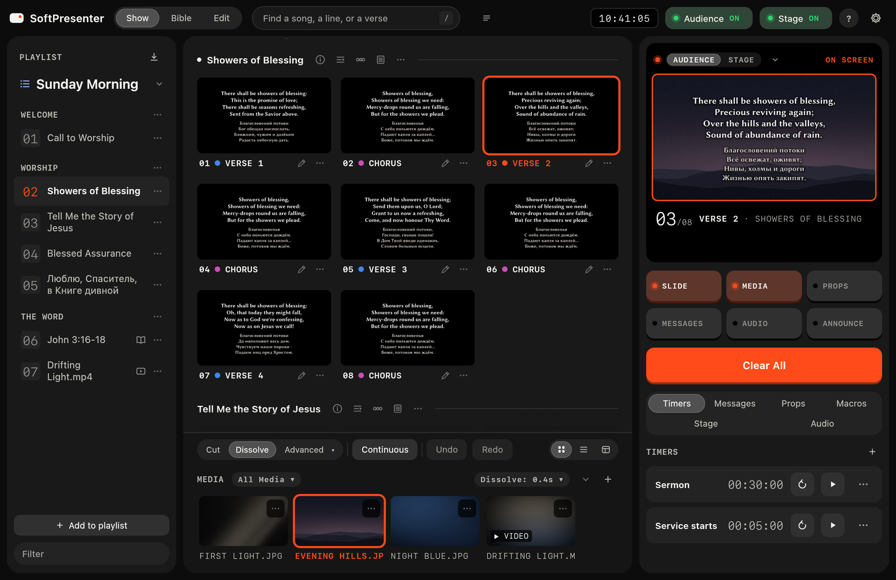
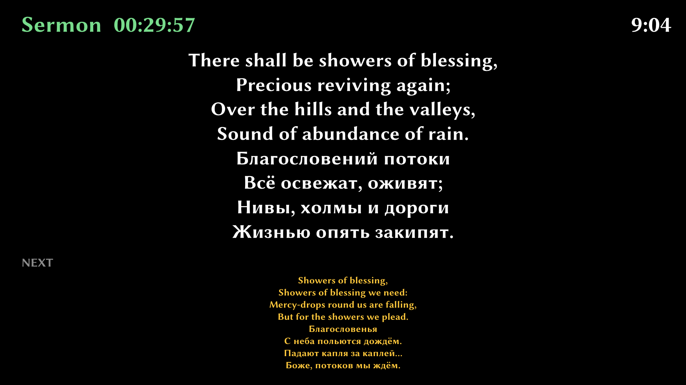
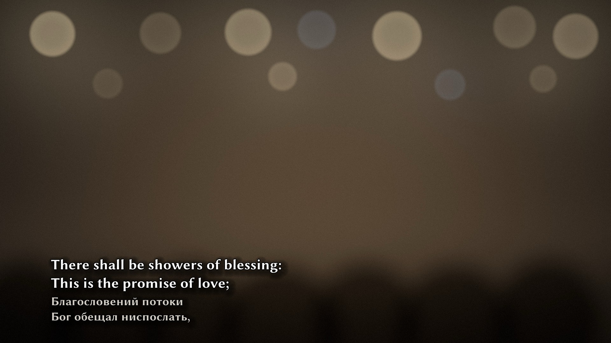
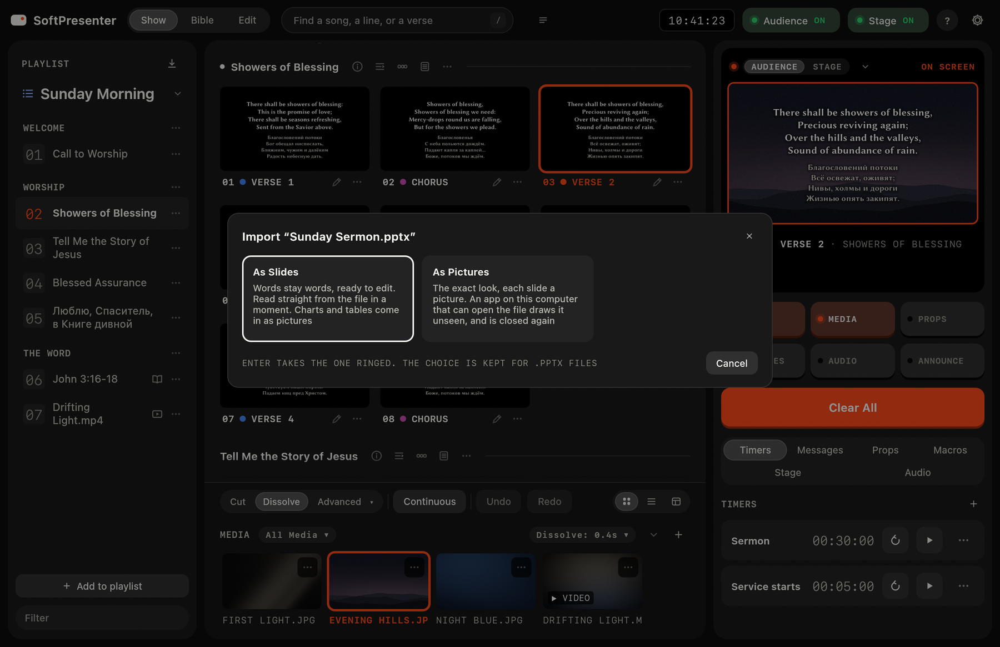
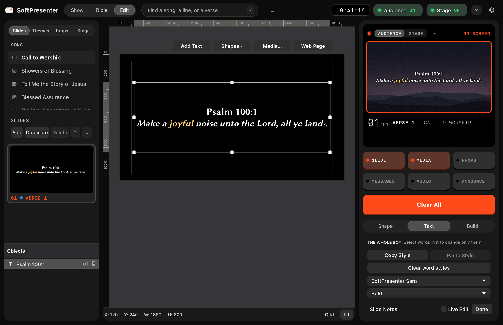

# SoftPresenter

**Free, open-source presentation software for churches: songs, the Bible and media on your screens, in two languages.**

Website: [softpresenter.com](https://softpresenter.com)

> **Early version.** Things change until 1.0, and it isn't ready to be a church's only presentation app yet. Bug reports and ideas are welcome in [Issues](https://github.com/esraell/SoftPresenter/issues).

## Why churches use it

- **Free.** No licence fee, no account, no subscription.
- **Two languages on every slide.** The main language and its translation, for churches that sing in Russian or Ukrainian and English side by side.
- **The Bible done right.** Type a reference in English, Russian or Ukrainian, and the translations line up verse by verse, even where they number verses differently.
- **Light on the computer.** Built to run well on a modest laptop; the screens never wait for the operator's window.
- **Works with your stream.** NDI, Blackmagic DeckLink, stage screens, and a screen laid out as a lower third.
- **Brings your songs and slides with you.** SoftProjector, text, ChordPro, Word, and PowerPoint files as editable slides or as pictures.

> **Coming from SoftProjector?** Its database (`spData.sqlite`), an exported songbook (`.sps`) or a downloaded one, zipped or not, comes straight across: each songbook becomes a library, each song keeps its number, its verses and choruses, and an arrangement that repeats the chorus after every verse, as SoftProjector does. Drop the file on the window.

## What it looks like

<table>
  <tr>
    <td width="50%"></td>
    <td width="50%"></td>
  </tr>
  <tr>
    <td align="center">The Bible in two translations, lined up verse by verse even where the numbering differs</td>
    <td align="center">A stage screen, as the band sees it</td>
  </tr>
  <tr>
    <td width="50%"></td>
    <td width="50%"></td>
  </tr>
  <tr>
    <td align="center">A livestream lower third, from a screen of its own (here over a stand-in for the camera picture)</td>
    <td align="center">A presentation comes in as slides or as pictures</td>
  </tr>
  <tr>
    <td colspan="2" align="center"></td>
  </tr>
  <tr>
    <td colspan="2" align="center">Words styled inside one box</td>
  </tr>
</table>

**Works with:** NDI, Blackmagic DeckLink, Canva Sync and VoxLive captions, each optional.

## Who it's for

- **A Sunday service** of songs, readings, sermon slides, notices and pictures, run by one
  volunteer with the keyboard.
- **Congregations in two languages:** both languages on every song slide, and up to four Bible
  translations on one slide, lined up verse by verse.
- **Worship teams and livestreams:** stage screens with the words now, the next slide, the clock
  and a timer; any screen sent over NDI, with the sound of what plays, to streaming software or
  a video switcher, laid out its own way if needed (a lower third for the stream).
- **Lobbies:** loops of pictures and videos before and after the service.

## What it does

The full list, area by area, is in [docs/features.md](docs/features.md), and what changed lately in [CHANGELOG.md](CHANGELOG.md). In short:

- **Songs and slides.** Groups (Verse, Chorus, Bridge), arrangements, one-key jumps, playlists
  with headers, and a slide editor with text, shapes, pictures and video. Words can be styled
  inside one box (a bold reference, an italic line, one word in a colour). SoftPresenter Sans,
  with Latin, Cyrillic and Greek, is built in, so slides look the same on every computer.
- **Presentations.** A `.pptx` comes in as slides you can edit, read straight from the file, or
  as pictures of its slides drawn by an app on the Mac that can open it; PDFs and folders of
  pictures come in as slides.
- **Bible.** Four Bibles come with the app and seventy-seven more, in 29 languages, install from
  its Bibles window; up to four translations on one slide, and book names in English, Russian
  and Ukrainian.
- **Media.** Pictures and videos behind the words or on their own, and an announcements layer
  that loops by itself. Video the Mac plays goes to the screens without being copied.
- **Screens.** Any number of audience screens on displays, in windows, over NDI or out of a
  DeckLink card, each with its own look and theme; stage screens with layouts you design.
- **Remote Control.** Run the show from a computer or tablet on the church's network: switched
  on in Settings, the app serves a page over HTTPS behind a password
  ([docs/remote-api.md](docs/remote-api.md)).

## A service from start to finish

1. **Set up the screens.** The first start opens a short setup: choose the display the
   congregation sees (the projector or TV) and a stage display if there is one. The Mac's main
   display, where you work, is never filled; on a Mac with one display, the screen opens in a
   window. Later, the Screens window (Option-Command-1) changes them and adds more, including
   screens sent over NDI. Identify Screens shows each screen's name on it.
2. **Bring in the songs.** New Song (Command-N) takes the words pasted in: a line in square
   brackets starts a group, a blank line starts a new slide, and a line with only `--`
   separates the main language from the translation. Songs you already have come in with
   File › Import Songs, or by dropping their files on the window: text (see
   [the format](#song-text-files)), ChordPro, rich text, Word, lyric-service files, and whole
   libraries from SoftProjector and other presentation software, keeping each song's groups
   and arrangements.
3. **Build the running order.** Make a playlist with the + beside PLAYLISTS (say "Sunday
   Morning"), drag songs into it in order, and add headers to group them. Sermon and notice
   slides that arrive as presentation or PDF files come in with File › Import Slides… or by
   dropping them on the window. A `.pptx` asks whether to bring it in as slides you can edit
   or as pictures; a PDF becomes a picture for each page.
4. **Add the readings.** Control-B goes to the Bible page from anywhere. Type a reference such
   as `John 3:16-18` and the chapter fills as you type, or click a book, a chapter and a
   verse; nothing goes on screen until you click a verse or press Enter on the one picked. Pick
   a second translation for the next row, and add the passage to the playlist with one click.
5. **Add pictures and videos.** Drop them on the window to put them in the media bin. For a
   loop before the service, group them in a media playlist and choose Play This Playlist, or
   right-click a song, picture or video and choose Play on Announcements Layer.
6. **Choose what the stage sees.** In the Stage tab, give each stage screen a layout: Words and
   Next, Words Only, Words and Notes, Clock and Timer, or one you design.
7. **Run it.** In the Service view (Command-1), open the playlist and click the first slide, or press
   Space. The right arrow and Space go forward, the left arrow goes back, and letters jump to a
   group (A for Verse 1, C for the chorus). Escape clears everything; the layer keys under the
   preview clear one layer at a time (on Windows and Linux, F2 to F6 do too). Timers, messages
   and macros sit in the tabs under Clear All.
8. **Afterwards.** There is nothing to save: every change is written as you make it, and the
   playlist is ready for next week.

## Get started

There is no download yet: SoftPresenter is built from source, on a Mac with macOS 13 or later
Windows and Linux builds are in testing: they compile and pass their automated tests on real machines, but nothing is released for them yet. You need:

- **The Xcode Command Line Tools:** `xcode-select --install`.
- **Rust through [rustup](https://rustup.rs).** `rust-toolchain.toml` pins the version
  (1.100.0), and rustup installs it by itself.

Then:

    git clone https://github.com/esraell/SoftPresenter
    cd SoftPresenter
    cargo run --release

For a proper `SoftPresenter.app`, named correctly in the menu bar and the Dock:

    scripts/macos-app.sh
    open target/release/SoftPresenter.app

The first build also downloads FFmpeg's source from ffmpeg.org (12 MB, checked against its
SHA-256) and builds the LGPL FFmpeg that plays MKV, WebM, AVI and other videos
(`scripts/build-ffmpeg.sh`, about a minute); later builds reuse it. Without it the app still
builds, and uses an FFmpeg installed on the computer.

For a Windows 10 or 11 (64-bit) package, built on a Mac with `brew install mingw-w64` and
`rustup target add x86_64-pc-windows-gnu`:

    scripts/windows-package.sh

It leaves `target/windows-package/SoftPresenter-Windows.zip`: `SoftPresenter.exe`, the LGPL
FFmpeg for Windows (`ffmpeg.exe`, `ffprobe.exe`), the sample backgrounds, the licences and a
READ ME. The program isn't signed yet, so Windows asks the first time ("More info", then "Run
anyway").

The first start opens a short setup: the screens, bringing songs in, which Bibles to show, and
what the system will ask permission for and why (macOS, or Windows' firewall; nothing asks on
Linux). Settings › Set Up SoftPresenter… opens it again.

Two things are optional:

- **NDI Tools** (free, from [ndi.video](https://ndi.video)) to send a screen over NDI. Without
  it, NDI screens say NDI isn't installed and everything else works. NDI Tools doesn't exist
  for Linux: there, Download NDI… in the Screens window fetches NDI's SDK from NDI, shows
  NDI's licence, and once it is accepted installs NDI's runtime for SoftPresenter alone.
- **Desktop Video** 16.0 or later (free, from Blackmagic Design) to play a screen out of a
  DeckLink card. Without it there are no DeckLink outputs to choose.
- **An app that opens presentation files**, only to bring a presentation in as pictures of its
  slides (a `.key` file needs the app that made it). A `.pptx` can come in as editable slides
  with none installed, and PDFs and pictures need none either.

Song text files can be opened from the command line, such as the sample:
`cargo run --release -- samples/sample-song.txt`. Other options: `--list-displays`,
`--output-display N`. Running from the source, the command line is `cargo run --release --
status` instead of `sp status`.

## Using it

### Keys

| Key | Does |
|---|---|
| Right arrow, Space | next slide; with another playlist item opened, start that item; with a slide picked and nothing on screen, Space puts it on and the arrows move the pick |
| Left arrow | previous slide; with another playlist item opened, start that item |
| Up / Down arrow | open the playlist item above / below; in the Bible view, pick the verse before / after |
| Enter | put the picked slide on screen (the first verse or slide of what the find box or the reference field just opened, or the verse picked); otherwise the open item from its first slide |
| Home / End | first / last slide of the song |
| Escape (off a Mac, F1 too) | clear everything, audio and announcements included |
| F2 / F3 / F4 / F5 / F6 (off a Mac) | clear the slide / the media / the props / the audio / the message; a Mac's F keys are the system's, so there the layer keys under the preview do it |
| A, S, D, F… | jump to Verse 1, 2, 3, 4… |
| C, X, Z | jump to Chorus 1, 2, 3 |
| B, N, M | jump to Bridge 1, 2, 3 |
| P, T, I, E, O | Pre-chorus, Tag, Intro, Ending, Outro |
| Cmd+N | new song |
| / or Cmd+F | find a song (title or words) or a Bible passage or verse |
| Cmd+, | Settings |
| Option+Cmd+1 | Screens |
| Shift+Cmd+1 / Shift+Cmd+2 | audience / stage screens on or off |
| Cmd+1, Cmd+2 (or Cmd+B), Cmd+3 | Service, Bible (ready for a reference), Edit (Control+T opens the themes on a Mac) |
| Cmd+P | the playlists and libraries to choose from |
| Option+1 … Option+7, then 1 … 9 | open a tool tab and number what is in it, then start, show, run or play the one with that number |
| Shift+Cmd+M, then 1 … 9 | show that picture or video |
| Cmd+O | the menu of the slide on screen |
| ? | every key, as a list; the switch at its foot (or Help › Show Keys on Buttons on a Mac) writes each button's key beside it |

The letter for each group is shown on its first slide. On Windows and Linux, Ctrl takes the
place of Cmd, and Alt of Option.

### Song text files

A song can be a plain UTF-8 text file:

    [Verse 1]
    Light rises over the quiet hills
    And the morning sings again
    --
    Свет встаёт над тихими холмами
    И утро снова поёт

    [Chorus]
    ...

- `[Name]` starts a group.
- A blank line starts a new slide.
- A line with only `--` separates the main language from its translation.

Songs made or edited in the app are saved as `.sppres` files (JSON), which also hold where each
box sits and how it looks.

### Where things are kept

Everything lives in `~/Documents/SoftPresenter/`: songs made in the app (`Songs/`), themes
(`Themes/`), pictures (`Images/`), downloaded Bibles (`Bibles/`), playlists, libraries,
screens and a few preferences, where you can see it and back it up. The log is in
`~/Library/Logs/SoftPresenter/`. A library kept in `~/Library/Application Support/SoftPresenter/`
by an earlier version is moved to Documents the first time the new one starts; the old folder is
kept beside it as "SoftPresenter (moved to Documents)".

## Where it's heading

SoftPresenter aims to be the presentation app a church never has to pay for and never outgrows:
complete enough for a large Sunday service, simple enough for a volunteer, light enough for an
old laptop, and open to scripts and AI. First on the list: bringing playlists and media across
from a church's existing software, and fixing a slide's words from the Service view. After that
come the whole app in a browser (Remote Control's API is in place; its fuller page is still
being designed) with a phone remote. Planned with
[TimelyChurch](https://timelychurch.com): setlists planned there for a service arriving in
SoftPresenter by themselves. Windows and Linux are in testing; releasing them is the other big
step.

The full plan, about 170 features with their size and how much each matters on a Sunday, is in
[docs/roadmap.md](docs/roadmap.md). Nothing in it is promised by a date.

## For developers and AI agents

SoftPresenter is open to scripts and AI: most of what the operator does during a service, a
script or an AI agent can do too. `sp` (full name `softpresenter`) controls the running app from
the command line (`sp status`, `sp next`, `sp clear all`, and slides, media, messages, timers,
macros, the Bible and every command); the app puts it where a terminal finds it as it starts,
and Settings › Integrations › Command line installs or removes it.
Remote Control sends the same commands from a page, and `sp mcp` is an MCP server through which
Claude and other AI assistants prepare services and, when the operator allows it and says yes
each time, run the screens.

- [docs/app-map.md](docs/app-map.md) maps every view, panel and window, what each part does, the
  command-line command that does the same, where the files are, and how to try the app safely.
- [docs/cli.md](docs/cli.md) is the command line's reference.
- [docs/mcp.md](docs/mcp.md) is how to connect an AI assistant, what it can do, and what is
  refused.
- [AGENTS.md](AGENTS.md) is for AI coding agents: running the app without disturbing anyone,
  the testing switches, and the rules.
- [CONTRIBUTING.md](CONTRIBUTING.md) covers sending a change and the commit standard.

The code is a Rust workspace:

    crates/sp-model    slides, groups, themes, the song text parser
    crates/sp-engine   what is live and the commands that change it (no windows)
    crates/sp-render   draws slides on the GPU: screens, thumbnails, preview
    crates/sp-bible    Bible files, references, search, verse numbering
    crates/sp-ndi      NDI output and input
    crates/sp-decklink DeckLink output (a small C++ bridge to Blackmagic's driver)
    crates/sp-video    videos (macOS's AVFoundation, then FFmpeg), system picture formats, and
                       web pages drawn off-screen (macOS's web view)
    crates/sp-app      the app and its windows
    crates/sp-mirror   softpresenter-mirror, a separate program that receives an iPhone, iPad or
                       Mac screen (unofficial; docs/licences/screen-mirroring.md)
    third_party/vello  the vello renderer's main crate, changed to size its GPU memory from
                       what is drawn (outside the workspace; its PROVENANCE.md explains)
    third_party/fontique  the font finder Parley uses, changed to map only font files nothing
                       else can change and read the rest (outside the workspace; its
                       PROVENANCE.md explains)
    third_party/decklink-sdk  the DeckLink SDK's header files, unchanged (its PROVENANCE.md
                       lists them)

[AGENTS.md](AGENTS.md#rules) says where `unsafe` code is allowed. Before sending a change:

    cargo fmt --all --check
    cargo clippy --workspace --all-targets -- -D warnings
    SOFTPRESENTER_QUIET=1 cargo test --workspace

The picture tests in `sp-render` need a GPU and the macOS system font.

## Contributing, security and conduct

Bug reports, ideas and Bible requests go in [Issues](https://github.com/esraell/SoftPresenter/issues/new/choose);
changes are welcome as pull requests, as [CONTRIBUTING.md](CONTRIBUTING.md) describes. Report
security problems privately, as [SECURITY.md](SECURITY.md) says. Everyone taking part follows
the [Code of Conduct](CODE_OF_CONDUCT.md).

## Licence

SoftPresenter is free software under the GNU General Public License, version 3 or (at your
option) any later version ([`LICENSE`](LICENSE)), with an additional permission for the NDI and
DeckLink libraries that people install themselves
([`ADDITIONAL-PERMISSION.md`](ADDITIONAL-PERMISSION.md)). Anyone may use it, change it and pass
it on; a version passed on stays under the same licence. [`NOTICE.md`](NOTICE.md) lists the
parts that are not SoftPresenter's own.

The Bibles keep their own terms ([docs/licences/bibles.md](docs/licences/bibles.md)); FFmpeg (an
LGPL build inside the app) runs as a separate program and NDI's runtime is opened at run time, never linked
([docs/licences/ffmpeg.md](docs/licences/ffmpeg.md), [docs/licences/ndi.md](docs/licences/ndi.md)).
NDI® is a registered trademark of Vizrt NDI AB.

Showing an iPhone, iPad or Mac screen is unofficial: a separate program does it
([docs/licences/screen-mirroring.md](docs/licences/screen-mirroring.md)). AirPlay, iPhone, iPad,
Mac and Apple TV are trademarks of Apple Inc. SoftPresenter is not made, licensed or endorsed by
Apple.
