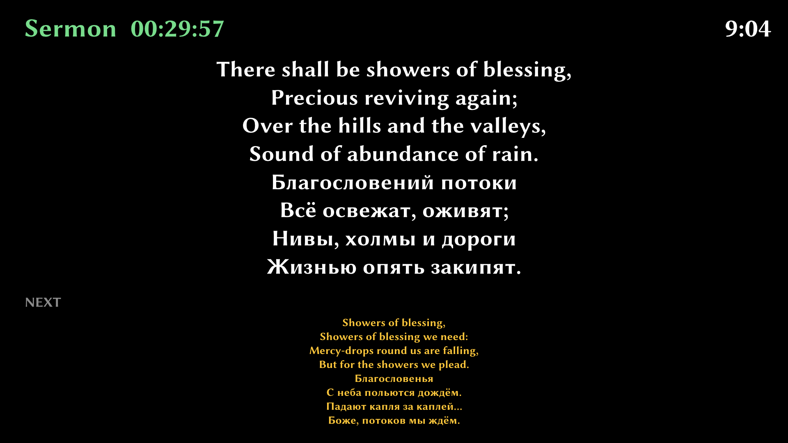
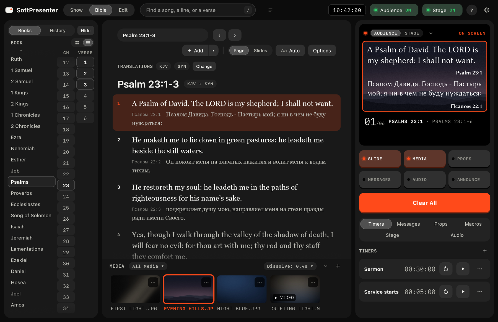
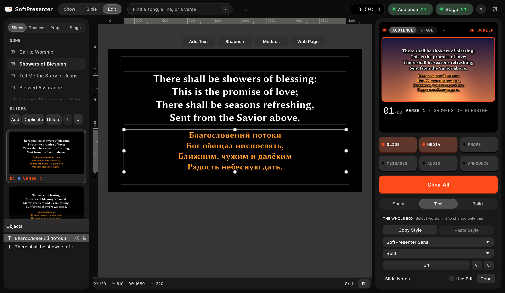
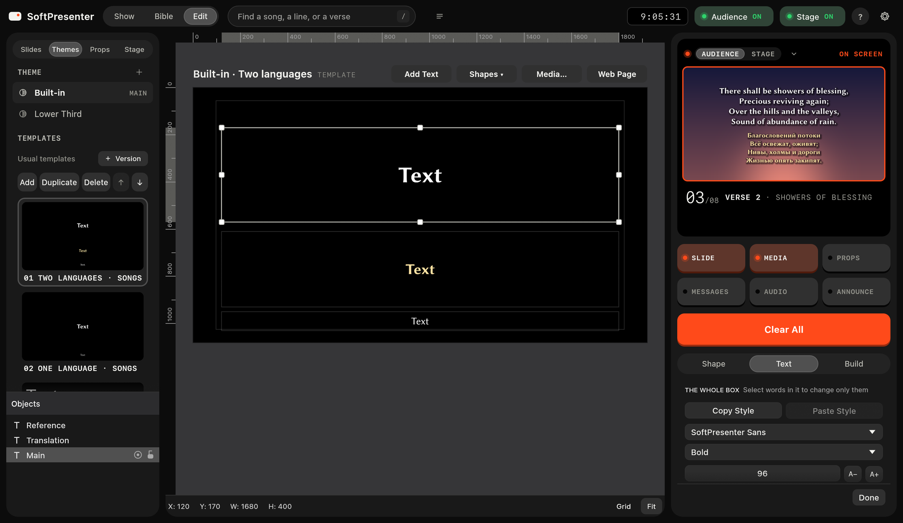

# What SoftPresenter does today

Everything that works now, area by area. The [README](../README.md) gives the overview;
[roadmap.md](roadmap.md) lists what is planned; [app-map.md](app-map.md) shows where each part
of the app is and which command-line command does the same; [cli.md](cli.md) covers the command
line.

SoftPresenter is young: some of this is rough, and file formats may still change. When a
feature changes, this page changes in the same commit.

No list, page or menu in the app shows a scroll bar: everything scrolls by the trackpad, the
mouse wheel (with Shift for sideways) or the keys, and the whole width is the content's.

## Running a service
- Songs shown as a grid of slides, a words-only view or a table (number, group, words, notes),
  with a size slider. Click a slide, or use the [keys](../README.md#keys), to put it on the
  audience screen. A slide in the grid is its picture with a strip under it: its number, its
  group's dot and name (heavier on the group's first slide), small tags for a hot key, a time
  after which it goes on, actions, a transition of its own or being switched off, then a pencil
  (the editor) and ⋯ (its menu, as a right-click). The slide on screen has an orange ring and
  orange words; slides picked out have a blue ring.
- In the Show view, ↑ and ↓ open the song above or below in the song list (with Shift, picking
  out the songs on the way), or the item above or below in a playlist (passing over headers);
  ← → and Space go on moving the slides.
- Groups (Verse 1, Chorus, Bridge…) with a dot in the group's colour and one-key jumps.
- **Renaming in place** (a playlist, a library, a song's title, a header or placeholder, a
  theme, a template, a stage layout, a group, an object, a message, a prop, a macro, an audio
  playlist or track): the name stays as it was shown, in the same letters and colour on the
  same spot, and is typed into there; only a thin grey edge round it says so, and nothing
  beside it moves. A name longer than its room scrolls inside it (it opens at its end, where the
  cursor is), and one cut short with … or set on two lines shows whole on one line while it is
  typed. A box in Edit without a name of its own is listed by its first line of words and is
  renamed from its own name. Return or a click elsewhere keeps it; Escape puts the old name back.
- **Songs changed outside the app** (in a text editor, by a script or an agent) come in when the
  song is next opened: chosen in the list or a playlist, opened in the editor, or named in an
  `sp` command. The app never saves over a song or theme file changed since it read it: a bar
  under the toolbar offers **Reload** (the file's version) or **Keep mine** (SoftPresenter's
  written over it). A song on screen, being edited, or holding changes not saved is never swapped
  unasked; the bar offers it instead. File › Reload Songs from Their Files (`sp song reload`) reads
  every changed song and theme again and adds song files put in the Songs folder (a copy of one
  already there gets an id of its own). `sp song reload SONG [--now]` and `sp song keep SONG` do
  the same for one song, and `sp songs` marks a song whose file changed. Quitting with a change
  that couldn't be saved keeps SoftPresenter's version in the library's "Not saved" folder, so
  neither version is lost.
- **Song packs** (`.sppack`), to carry songs prepared at home to the church computer by
  AirDrop, email or a USB stick. File › Export Songs… (the songs picked out, or the one shown),
  a song's or playlist's right-click Export…, or `sp song export SONG… [--playlist NAME] --to
  FILE.sppack [--no-videos]` makes one: the songs (or a playlist with its songs), the themes
  they set for themselves, and their pictures and videos (offered with their size, and left out
  on request). No path or user name from the computer goes in. Opening one (drop it on the
  window, File › Import Songs…, or `sp song import FILE.sppack`) brings the songs into the library,
  their pictures into Images and videos into Media, the themes they need as new themes (a song
  using the main theme takes on this computer's), and the playlist as a new playlist, with its
  pictures and videos (into the media bin) and its media playlists (with theirs; one this
  computer has already is used as it is; such a pack is version 2, which an older SoftPresenter
  asks to be updated to open). A song
  already here (the same id) is replaced, kept beside as a copy, or skipped (the window asks once;
  `--replace`, `--keep-both`, `--skip`, skipped by default). A slide action that points at a
  message, prop, timer or media item this computer doesn't have is kept and counted. A pack is
  untrusted: only its own kinds of entry with plain names are read, within size limits and the
  free disk space; a picture or video a song names must be one the pack holds; the app names every
  file it writes; anything else is left out and named. A pack is the same on every system
  SoftPresenter runs on (macOS, Windows, Linux): zip entries named with `/`, files the app names
  by id, songs and themes in UTF-8 JSON, and videos named inside the library rather than by a
  computer's own paths. Opening a pack again adds nothing twice: a theme the computer has (the
  same id) is used as it is, and a picture or video already in the library (the same contents)
  is reused. Fonts don't travel (their licences rarely allow it): a theme's font missing on the
  other computer falls back to one it has. A pack with videos is written or opened in the
  background; `--wait` waits for it, and `sp job N` says how it went.
- Playlists, libraries, macros, the song that starts with the app and slides' "go to song"
  actions find a library song by the id in its file, so they keep working when the library
  folder moves. A song that can't be found is kept and shown as missing (`sp playlist` and
  `sp library NAME` mark it "(missing)"). Files from before this named songs by path or title;
  the first start changes those to ids, keeping a copy of each file it changes in
  "Backup before song ids", and a song file copied in the Finder gets an id of its own.
- **Arrangements**: a song's groups in the order to sing them (Verse 1, Chorus, Verse 2, Chorus…),
  from the Arrangement icon at the right of its header or the arrangement's name at the start
  of its row (As written, the song's arrangements, New Arrangement, Rename…, Duplicate,
  Delete). Next and Previous follow it, a group can come more than once, and the stage screens
  show what comes next in it. The row under the song's bar has a pill for each piece in the
  order sung: **a group sung several times running is one pill marked ×2, ×3…** (it is saved
  as the group listed that many times, so files are as before), and while it is on screen the
  pill is orange and says which time through it is (2/3). A click on a pill goes to that point;
  its arrow (or a right-click) sets how many times (Once, ×2, ×3, ×4, or More, up to 20), moves
  it left or right, or removes it; a pill dragged along the row goes where the ink line shows;
  + adds a group at the end. **With an arrangement the slides stand in the order sung**:
  a group sung again stands again (the same slides, tagged AGAIN and a little faint), numbered
  in the order sung, and only the tile for where the song is lights up; the groups it leaves
  out wait underneath, under "Not in this arrangement", fainter and still there to click.
  Under an arrangement a slide is dragged only among its own group.
- Nineteen transitions: Cut, Dissolve, Fade, Fade Black, Fade White, Push, Move In, Reveal,
  Fly In, Zoom In, Door, Flip, Swap, Wipe, Split, Blinds, Iris, Clock and Checkerboard, with
  their direction and time (0 to 5 seconds), from Cut, Dissolve or Advanced. One is chosen for all slides from the bar under the slides; a song
  (its right-click menu) and a slide can each have their own, and the media bin has its own for
  changing from one picture or video to the next.
- New Song (Command-N, or + over the song list) asks for the song's title and theme, and takes
  its words pasted in (a line in square brackets starts a group, a blank line a new slide; a
  lyric file pasted in whole gives its sections and details, as an import does).
- **Importing songs.** File › Import Songs…, dropping files on the window, `sp song import
  FILE…`, or song files named on the command line. It reads plain text in any common encoding
  (UTF-8, UTF-16, and the older Windows ones for Russian, Ukrainian and Western European
  languages), the lyric files song services give (title, sections, and a footer whose song
  number, writers and copyright go into the song's details; a church's own licence number is
  never kept), ChordPro (sections from its directives, chords taken out), SoftPresenter's own
  song text and song files, rich text, and on macOS Word and OpenDocument files.
- **Slides from PowerPoint, Keynote, a PDF or pictures.** File › Import Slides…, dropping the
  file or a folder of pictures on the window, or `sp song import`. A PowerPoint, Keynote or
  OpenDocument presentation is turned into a PDF by a program on the Mac that opens it
  (Keynote, then PowerPoint, then LibreOffice for PowerPoint files; Keynote for Keynote files),
  so its slides look exactly as that program draws them; macOS asks once to allow it, and a
  program SoftPresenter opened is closed again. Each page or picture becomes
  a slide showing it across the whole slide, in a new presentation named after the file or
  folder. Pages are drawn at up to 1920 × 1080 on white, turned and cropped as the PDF says, and
  saved in the Images folder, so the deck keeps working when the file moves. Pictures in a
  folder go in the order people number them (Slide2 before Slide10). It happens in the
  background, so the window and keys go on working; a 60-page deck takes about ten seconds.
  With no program that opens the file, it says what to install, or to export a PDF.
- **Bringing songs across from SoftProjector.** Its database (`spData.sqlite`) or an exported
  songbook (`.sps`), dropped on the window or chosen in File › Import Songs…: each songbook
  becomes a library of its name, each song keeps its number before its title (so "123" still
  finds it), its lyricist and composer, its verses, choruses and other parts as groups (a
  "&Куплет" part as more slides of its verse), and an arrangement, "As sung", that repeats the
  chorus after every verse as SoftProjector does. Read with macOS's own SQLite tool, read-only.
- **Bringing a library across from ProPresenter 7.** File › Import from ProPresenter… opens
  its Libraries folder; choose song documents, one library, or the folder of all of them. Each folder becomes a
  library of the same name. Each song keeps its groups, slides, arrangements (and the one
  chosen), slide labels and notes, slides switched off, and its copyright details. A slide's
  text box in the largest type becomes the words, the next the translation, and a line such as
  "Psalm 133:3" the reference. `.pro` files can also be dropped on the window or given to
  `sp song import`. Documents with pictures or videos but no words are listed as not imported
  for now. A library of 4,372 songs comes across in about a third of a second.
- **Song bundles from ProPresenter 7** (`.proBundle`, one song or several, with their pictures
  and videos) come in wherever a `.pro` document does: File › Import Songs…, Import from
  ProPresenter…, a folder of them, dropping them on the window, or `sp song import`. Every
  song in a bundle comes across as a `.pro` document does, in the
  order of the bundle's entries (a bundle records no order of its own; the ones seen list their
  songs by name); each picture or video a slide shows is copied into the library's Media folder
  (or found there already, by its contents), added to the media bin once however many of the
  songs show it, and shown behind that slide's words, and a video set to loop keeps looping.
  Dropped on a playlist, all of a bundle's songs go in, in that order, where the line shows (on
  a playlist's row in the chooser, at its end). A song the library has already, word for word
  under the same title, isn't added again; the notice says how many were there. Bundles
  exported by the program (pictures kept under the paths they had on the computer they came
  from) and ones written by other tools (bare file names) are both read. A picture or video the
  bundle doesn't hold is named in the window's notice and the song's words come in all the same;
  so is everything else in the bundle that doesn't come in, and why: a song that can't be read,
  a PDF (a bundle's PDFs don't come in yet), a picture no song shows, a file of another kind.
  The bundle is read as untrusted: nothing is ever written where an entry's name says, only the
  songs (at most 500, and 256 MB of them together) and the pictures and videos they show are
  taken out, each within a size limit, and nothing in it is run. A bundle larger than 64 MB is
  read in the background; the notice says when its songs are in. Its pictures keep their own
  file names in the Media folder (numbered when the name is taken), so the media bin shows those
  names.
- **Dropping files from the Finder lands them where the pointer is.** Song files of every
  kind (song documents and bundles, text, lyric and ChordPro files, songbooks, song packs,
  folders of songs) always go to the songs, never into the media bin: dropped on a playlist (a
  row of the chooser, or the open playlist, where they go after the item under the pointer)
  they come into the library and into that playlist; on a library (a row of the chooser, or the
  song list) into that library; anywhere else into the library shown, as before. A song the
  library has already still goes into the playlist or library dropped on. A song pack's songs
  go into the library it is dropped on, or the library shown, never a playlist (a pack brings
  its own), so playlists don't light up for a pack. Pictures and videos
  go into the media bin, and into a playlist they are dropped on; in the Edit view, onto the
  slide. Several files dropped together each go their own way. While files are over the
  window, the place they would land has an ink outline (and the open playlist a line where
  they go in); while song files are over it the chooser shows above the list, as it does while
  songs are dragged in the window, and with nothing in particular under the pointer the library
  they would go to is outlined (its song list, or its row in the chooser). The media strip opens
  and lights up for pictures and videos only; songs over it go to the library shown, which is
  outlined. On macOS the window asks the system where the pointer is while files are over it
  (redrawing at most 30 times a second, for at most a minute of one drag), as the window
  library doesn't say. On Windows and Linux it can't tell, so there songs go to the library
  shown and pictures to the media bin, as before, and only those places light up.
  Sections are found from lines naming them ("Verse 1", "Chorus:", "Bridge", "Куплет 1",
  "Припев", "Приспів"…); slides break at blank lines, and more than four lines without one are
  shared out evenly (eight lines make two slides of four). A song the library already has,
  word for word under the same title, isn't added twice.
- The left column lists one thing at a time, a playlist or a library, and says which in a small
  label at its top (with a button there that imports songs or slides). Under the label is the
  name of what is listed; a click on it opens the **chooser**, which puts the list away and
  shows only things to open: the playlists first (each with how many items it has), then the
  song libraries under a line (All Songs, then libraries of your own such as Christmas or
  Youth). The one that is open has a lighter row, a heavier name and a tick. + beside each
  heading makes a new one; a row's ⋯ (or a right-click, or a double click for Rename) renames,
  exports or deletes it. Choosing puts the list back. A library lists its songs, each with how
  many slides it has (and, in All Songs, the library it is in); at the foot are the order they
  are listed in (**As listed, A–Z, Longest**, kept between runs), **New song** and a filter. A
  song's ⋯, or a right-click, opens its menu. While songs are dragged the chooser shows above
  the list, so they can be dropped on a playlist or a library; a new song made while a library
  is shown goes into it. Which of the two the column was left listing is kept between runs.
- A playlist lists its items in running order: each with its number, its title, a small mark
  for a Bible passage, a picture or video, a media playlist or a placeholder, an orange number on
  the one on screen (whose row is brought into view when it goes on screen), and ⋯ for its
  menu (for a song, the song's own menu is under Song). Headers are small capital lines. Items
  can be dragged into a new order. A click on a row only **opens** the item: it becomes the
  open one and the slides scroll to it; the screens don't change, and a Bible passage no longer
  takes the window to the Bible page (Open on the Bible Page, in its menu, does, opening it as the
  page opens any passage). A passage kept in a playlist runs as its own slides, so Next goes on
  into the next item after its last. A click on a
  header scrolls the slides to it. **Add to playlist**, at the foot, adds a song, a header, a
  placeholder, a picture or video, a media playlist or (once VoxLive is connected) the VoxLive
  item after the open item, and opens the Bible page for a passage; under it is the filter.
- **The dock** under the slides stays put while they scroll: a bar with the transition for all
  slides (Cut, Dissolve, or another from Advanced, in a switch of a fixed width), Continuous,
  Undo and Redo, the three views and the slide size, and under it the media strip ("Media",
  the menu of media playlists, how one picture or video gives way to the next, a chevron that
  folds the strip away, + to add some, then the pictures and videos with their names, each
  with ⋯ for its menu; the one showing is ringed in orange). The slides fade into the panel
  just above it. In a narrow window the bar leaves out Undo and Redo, then Continuous, then
  the size, rather than squeeze them (each is in the menu bar too). Add Slide is in a song's ⋯
  menu on its bar, and in the File menu.
- While the left column lists a playlist, the middle shows **the whole playlist as one scroll**,
  item after item, each under a bar with its name that stays at the top while its slides
  scroll under it. The open item's bar has a dot; a song's bar carries its tools (details,
  words as text, arrangement, notes, and ⋯ for the song's menu, Add Slide and its place in the
  playlist), and a song played in an arrangement has a row of pills under its bar and its
  slides in the order sung (see Arrangements above). Other items say what they are in a small label. A **Bible passage** kept
  in the playlist is shown as its slides, drawn by the Bible theme as the Bible page draws
  them; a click on one looks the passage up as the Bible page would and puts that verse on
  screen, and Next and Previous then go verse by verse. Clicking a slide of any item puts it
  on screen and makes that item the open one. The view goes to the slide that has just gone on
  screen, at once, keeping it clear of the bar at the top and of the fade at the bottom; it
  stays where it was scrolled otherwise. Only what is in view is drawn, so a playlist of
  thousands of slides scrolls like a short one, and each song's slides are drawn with that
  song's own theme. A song chosen that the playlist doesn't have (a new song, one found with
  the find box) is shown by itself, with the left column back on a library.
- **The keys act on the open item.** While the open item is the one on screen, Next (Space,
  the right arrow) and Previous (the left arrow) step through it. Once ↑, ↓ or a click on a
  row has opened another item, the next Next or Previous starts that item at its first slide:
  a song or Bible passage goes on screen, a picture or video is shown, a media playlist plays.
  ↑ and ↓ open the item above or below (passing over headers), and say so at either end;
  Enter puts the open item on screen from its first slide (with a library listed, the song
  chosen). With Continuous on (in the bar
  under the slides), Next at the end of a song goes on into the next song or **Bible
  passage**, passing over headers, placeholders, pictures and videos, and Previous at a song's
  first slide goes back into the last slide of the one before; at either end of the playlist,
  or with Continuous off, nothing changes and a notice under the top bar says why. The menu
  bar's Next Slide and Previous Slide, and `sp next` and `sp previous`, do the same; a slide
  that goes on by itself goes on into the next song or passage only with Continuous on.
- **A slide picked waits for Enter.** What the find box opens with Return has a slide picked
  (a song's first slide as sung, or the slide whose words were found; a Bible passage's first
  verse: a single verse, typed as a reference or found by its words, is the passage, and with a
  slide a verse its slides are its whole chapter's, so after Enter Next goes on through the
  chapter after it; Command-Return keeps the verse alone), and so does a passage looked up with
  Return in the reference field. In the Bible view, on the page and under Slides alike, ↓ is as
  → and ↑ as ←: with nothing on screen they move the pick to the verse after or before
  (brought into sight; the passage's first when none is picked), putting nothing on; with
  something on screen they go on with it, as → and ← do, and Enter takes the pick. The slide
  picked has a 2-point ink ring, its strip in ink and a small ink key cap for Enter after its
  label (in words only or a table, its row has the chosen grey and a fine dim ring inside); never
  orange, which is only for what is on screen, nor the blue of slides picked out to change several;
  it is brought into view, and the keyboard is the show's again. Enter puts it on screen;
  then Space, → and ← go on from it as from any slide. With nothing on screen, Space puts the
  picked slide on too, and → and ← move the pick to the next or previous slide (in the order
  sung) without putting anything on, so a reading can be looked up and the right verse picked
  by the arrows. With something on screen, Space, → and ← go on with that (a song can be run to
  its end with the reading picked), and Enter takes the pick. A click on a slide takes over from the pick, and the pick goes once a slide of its
  passage or song goes on screen, or another song, passage or view is opened. In the Bible
  view, Enter with nothing picked does nothing.
- A playlist also holds **pictures and videos** from the media bin (the countdown video),
  **media playlists** (the announcement loop) and **placeholders** (a place kept for the sermon
  slides). A picture or video goes in from its right-click menu (Add to Playlist "Sunday"), by
  dragging it from the bin onto the items (between two, where the line shows) or onto a
  playlist's name in the chooser; a media playlist from the menu beside MEDIA, or either from Add
  to playlist; a placeholder from Add to playlist, named as it is made. In the slide area each is a bar with one tile: clicking a picture
  or video's tile shows it, a media playlist's plays it round and round; opening one from the
  list only scrolls to it, changing nothing on the screens (Next, Space or Enter then shows
  it), and Continuous passes over them. A placeholder is filled with a song chosen from a list (its tile's
  Choose a Song…, or Fill with Song in its right-click menu), or with a picture or video dropped
  on it. One whose picture, video or media playlist has gone is kept and shown faint. A playlist
  holding any of these is saved as version 3 of the services file; one without is still written
  as version 2, which older SoftPresenters open.
- Songs, a playlist's items, slides and media items are picked out as in the Finder (Ctrl in
  place of Command on other computers): a click picks one (and opens it); Command-click adds or
  takes away one and is counted from after; Shift-click picks every row from the one last
  clicked to it, in place of what was picked, and Shift-↑ or Shift-↓ go on picking in the left
  column; Command-A picks everything the left column lists, with nothing being typed; dragging
  across the song list, or a box across the slides or between media items, picks everything it
  touches (picking a slide never puts it on screen). Picked rows have the lighter grey of what
  is chosen, never orange; the open item keeps its heavier name. A plain click on one of several
  picked lets the others go when the button comes up, so they can still be dragged together.
  Picked songs dragged out of the list go into a playlist or library together, in the list's
  order; several playlist items dragged move together, in their order, to the one ink line, and
  stay picked. Delete (or Backspace) acts on the list last clicked: in a playlist it takes the
  items picked (or the one open) out of it at once, asking nothing, as no song is deleted; any
  kind of item, the one on screen too, which stays on screen; only while the keyboard is the left
  column's (in the Show view, not on the Bible page, with the chooser put away). A notice says what went
  ("Removed Harbour Lights from Sunday. ⌘Z puts it back.") and Undo (Command-Z) puts them back
  where they were, picked out again; Remove from Playlist in an item's menu does the same, for all
  the items picked when it is one of them. In a song list, a media strip or the slides, Delete
  asks first, then deletes what is picked; picked slides go in one step that Undo brings back.
- Pictures and videos dropped on the window, or added with the media bin's +, go into the media
  bin, are kept between runs, and can be shown behind the words; Delete, or Delete… on an item's
  right-click menu, takes it out of the bin after asking (the file stays where it is).
  The bin keeps a small copy of each picture for its thumbnail and the Program preview; the
  full-size picture is read when the item goes on screen (a few hundredths of a second, its
  small copy standing in meanwhile), or before, for the next item of a media playlist playing
  and the media of the slide Next would show, and only the last few are kept, so a big bin
  costs little memory. At the start the window opens at once and the bin fills in as its
  pictures are read; a file that is gone or can't be read leaves the bin.
  Pictures can be PNG, JPEG, WebP, GIF, BMP, and on the Mac also HEIC (iPhone photos), TIFF,
  Photoshop, AVIF and JPEG 2000. Videos play with their sound and loop: MP4, MOV and M4V
  (including HEVC and ProRes) through macOS's own player, and everything else (MKV, WebM, AVI,
  WMV, FLV, MPEG, TS and others, or an MP4 the Mac's player can't decode) through FFmpeg,
  played as it is, never converted first. FFmpeg comes inside the app (an LGPL build of FFmpeg
  9.0.2, with its licence and source in the app's Resources), so nothing needs installing; AV1
  plays on Macs whose video hardware decodes it (M3 and later). In the preview block, a video on screen has one row of keys
  under the slide's number and name: a round Play or Pause, Start Over, Forward 10 seconds, a
  slim bar to click or drag through (the time a click goes to shows over it), the time left,
  Loop and Sound (each a lighter grey while it is on); its name is the second line of the
  readout. The row is always there, empty when nothing plays, so nothing under it moves. A tool
  tab that goes on below what shows fades out at
  its foot. An item's
  right-click menu sets its Scaling (Scale to Fill, Scale to Fit, Stretch to Fill), whether a
  video loops, and the media playlists it is in; the menu beside MEDIA shows All Media or one
  playlist, and makes, renames and deletes them.

- A media playlist can **Follow a Folder**: the pictures and videos in it join the playlist (and
  the bin) as they appear, once each has been read, and one written over (such as a fresh
  announcements export) is read again. A video playing (on the media layer or the
  Announcements layer, looping or not) is not cut or started again: the new file is opened at
  once and takes over at the end of the pass under way, where the video would go round or
  end, so the loop carries on with the new pictures and no black picture between (a video
  one of several in a media playlist going round plays the new file next time round). One that
  leaves the folder leaves the playlist, and the bin too if the folder brought it in and nothing
  else uses it (another media playlist, a slide, a playlist of the service, a macro, or the
  screens, until it is taken off them); one added to the bin by hand stays. A file that can't be
  read is tried again only once it changes, and a folder that can't be read (a drive not
  plugged in) leaves the playlist as it was. The folder is looked at every few seconds on a
  thread of its own. **Play This Playlist** shows its items in turn on the
  media layer (pictures for 8 seconds, videos to their end), round and round, until other
  media is put on or cleared.
- **Announcements layer**: anything that loops can play on it, over the slides and media and
  under props and messages, until it is cleared. **Play on Announcements Layer** is in the
  right-click (and ⋯) menu of a song, a picture or video in the media bin, a picture, video or
  media playlist in a playlist, and in the menu beside MEDIA for the media playlist shown. A
  song's slides go round by themselves (each for its Go to Next time, or 8 seconds), dissolving
  from one to the next; a picture stays; a video loops (such as the church's one announcements
  video); a media playlist shows its pictures (8 seconds each) and videos (to their end) in
  turn, round and round, and one video alone loops. A picture or video fills the screen as its
  media bin item is set to (Scale to Fill, Fit or Stretch), on black. Each screen's Look can
  show or hide the layer (a lobby screen can show only announcements); the Announce key (lit
  while it plays), Presentation › Clear Announcements and Clear All take it off; while it
  plays, the preview block's row names it with a Clear key beside it, and the same menu item
  reads Stop Announcements. **A slide going on screen** (a song's, a Bible verse, a playlist
  item's: by a click, a key, Enter, `sp`, a macro or a slide's action) takes the announcements
  off every screen that shows slides, and they stay off until someone starts them again
  (Announce, a macro step, `sp announce`): clearing the slide doesn't bring them back. A lobby
  screen showing announcements and no slides keeps them going; with none, the layer stops. A
  picture or video on the media layer, a prop, a message or a timer leaves them on. The first
  time in a run, a notice says so. So a start-up macro's loop plays before the service and goes
  the moment the first song slide goes up.
- **Media slides**: drag a media item onto a slide to have that slide show it when it goes on
  screen (an ink outline shows it will), or onto a song's bar in the slides, or the space under
  a song shown by itself, to add a slide of its own; also
  Add to Song as Slide on the item's right-click menu, and Media on a slide's. The slide's
  thumbnail shows the media behind its words.
- A slide's right-click menu: Edit, Cut, Copy, Paste (each with its key), Duplicate, Delete…, Move Up, Move Down, Group (mark where a verse, chorus
  or bridge starts), Copy and Paste Text Style, Label (Blank Slide, Instrumental, Repeat, Spoken Word), Transition (its own,
  or as all slides), Hot Key (a letter or digit that puts the slide on screen, shown on its
  picture), Go to Next (after a number of seconds, shown on its picture), Disable, Template.
  A song's menu has Loop to First Slide, for a loop of announcements. Undo and Redo (Command-Z, Shift-Command-Z) step back through
  these changes in the Show view and on the Bible page, and the audience stays on the same slide;
  items taken out of a playlist take their turn in the same order.
  `sp undo` and `sp redo` do the same from the command line whatever the window shows, and say
  which song and slides changed.
- A song's menu (its ⋯, or a right-click): Add to the playlist in front, Add to Playlist (any
  playlist, or a new one), Libraries, Rename, Duplicate, Theme (a theme of its own, or
  the songs theme), Reflow, and Delete (a song made in the app goes to the Trash).
- The tool tabs under Clear All in the right column, each a list of cards. A card's ⋯, or a
  right-click on it, opens what else it can do.
- **Timers** count down, count down to a time of day, or count up. Each is a card with its
  name, its time in the fixed-width face (green, on a green-tinted card, while it runs; a
  countdown to a time of day says when it ends until it is started), Reset, Start or Stop, and
  ⋯ with Edit… (its name, what it counts, whether it runs over) and Delete.
- **Messages** shown over the slides, with the time or a timer in them, an optional time to
  leave by themselves, and a look of their own such as a band, a box in the middle or a lower
  third. Each is a card with its name, its words on one line, Show or Hide (the card is tinted
  orange while it shows), and ⋯ with Edit…, Rename, Duplicate, Cut, Copy, Paste and Delete.
  Words once… in the tab's heading shows words typed there at once, kept as the message Quick
  message (as `sp message show --text` does).
- **Props**: things that stay over the slides until taken off, made in the editor, with an
  optional time to clear themselves. Each is a card with a small picture of it, its name, Show
  or Hide (the card is tinted orange while it shows), and ⋯ with Edit in the Editor (a
  double-click does the same), Clears Itself, Rename, Duplicate and Delete. F4 or the Props key
  takes them all off.
- **Macros**: steps done in turn, which clear layers, show or hide messages and props, start,
  stop or reset timers, switch the audience screens, go to songs, show a picture from the
  media bin, play a media playlist, a picture, a video or a song on the Announcements layer
  (Add a step… › Play on the Announcements Layer), and fetch a fresh video from Canva (Sync from
  Canva). Each is a card with its colour as a dot, its
  name, how many steps, a Run key (the only thing that runs it), a chevron that opens its steps
  (each with Earlier and Remove, then Add a step…), and ⋯ with Edit Steps…, Colour, Run When
  SoftPresenter Opens, Rename, Duplicate and Delete. A step whose song, message, prop, timer,
  picture or media playlist has gone says so, as "Play on the Announcements Layer: (a song no
  longer in the library)".
- **Start-up is a macro**: a macro with Run When SoftPresenter Opens switched on (a switch at
  the top of the opened macro, and in its menu) runs when the app opens, such as one that plays
  the announcement loop before the service. Its step Audience Screens Off takes effect before
  any screen draws, so the audience screens never flash on. Settings no longer has start-up
  choices of its own: the first start of this version turns what an earlier version's
  Settings › Screens › When SoftPresenter Opens played into a macro "When SoftPresenter opens"
  that plays it on the Announcements layer (a media playlist chosen there played on the media
  layer, behind the slides; the layer goes off when a slide goes on screen), and its Start with
  the Audience Screens Off into that macro's first step, Audience Screens Off, and says so once.
- **Audio**: playlists of tracks such as walk-in music, chosen at the tab's head (its ⋯
  renames, makes or deletes one; + makes one). First the player: whether it plays and the
  track's name, a line to drag through the track with the time gone and left, Previous (the
  start of the track first, then the one before), back 15 seconds, Play or Pause, forward 15
  seconds and Next, the volume (up to 150%) with Mute and the level in numbers, then Play
  through to the next track, Shuffle, and a crossfade of up to ten seconds from one track into
  the next. Then the tracks, with how many and Add tracks…: a click plays one, a drag moves it
  to another place, and its ⋯ has Play, Move Up, Move Down, Rename and Remove. F5, the Audio
  key or Clear All stops it.
- **Stage**: with more than one stage screen, a chooser of which (All stage screens to begin
  with); then every stage layout as a tile with a picture of what the stage would show in it
  now (drawn by the screens' renderer, again when the slide, the stage message or the clock's
  minute changes; a running timer is named without its time), the one in use outlined with a
  tick, and one click switches the screens chosen to it. A note says so when those screens are
  off. Under them the **Stage Message** for the people on stage: what is typed waits until Show
  on stage (or Return) sends it, Change it sends a change while one shows, and Clear takes it
  off.
- A slide can carry the same actions as a macro, done when it goes on screen.
- **The window** is three round panels on a dark window: the left column, the middle, and a
  right column that is the same in every view. Along the top: the views (Show, Bible, Edit), a
  find box (press `/`, or Command-F: it finds songs by title and then each slide whose words
  have what is typed, tagged with its group ("Song · Chorus"), a slide picked being brought into view and
  ringed in ink for a moment, a Bible passage when a reference is typed (named and quoted in the language it was
  typed in), and verses that hold the words, from the Bibles in use written in the words'
  alphabet, each saying which Bible it is from ("Bible · KJV"); each result has a small mark at its left, so songs and the Bible read apart at a glance: a note in the libraries' lilac for songs, with its tag in lilac too, and an open book in ink for the Bible, with its tag dim so its title reads first (slides the app makes, Bible passages and live captions, have an ink dot too; only the playlist's blue and the libraries' lilac mark a kind by colour); Return opens what is picked without putting anything on the screens,
  with its first slide or verse picked for Enter (see "A slide picked waits for Enter"), and
  Command-Return adds it to the playlist in front. Any result can also be **dragged** (a press
  that barely moves is still a click): its name follows the pointer, its row goes faint and
  the list stays open, and the chooser shows above the left column's list. Dropped on the open
  playlist's items it goes in where the ink line shows (above or below a row by which half of
  it the pointer is over), or takes a placeholder's place; on a playlist in the chooser, at its
  end; a song on a library (its row in the chooser, or its song list, outlined in ink) goes
  into it. A song found by a line of its words brings the whole song, as playlists hold songs;
  a passage or verse goes in with the Bible view's translations and choices, as
  Command-Return adds it, and no library takes one (the pointer says so). After a drop the
  search ends, the keyboard is the show's again, and what went into the playlist listed is
  opened as a click on its row opens it; nothing goes on the screens. Dropped anywhere else,
  nothing happens and the search stays open. The find box does not search playlists or media), a
  running timer's name and time just before the clock (in room nothing else uses, so nothing
  moves when it starts or stops), the clock (on a 12-hour or a
  24-hour clock as the computer is set, with the computer's own words for morning and
  afternoon), the Audience and Stage
  keys, a `?` (the list of every key, as the `?` key opens it) and Settings.
- **Keys for getting around**, the same on every computer (Command on a Mac, Ctrl elsewhere;
  they don't depend on the Mac's menu bar): **Command-1, -2 and -3** go to Show, Bible (with
  the cursor in the reference) and Edit, and Command-B to Bible as well (it stays Bold while
  editing a slide); Command-P
  opens the chooser of playlists and libraries; Command-F (or `/`) finds; Command-comma opens
  Settings; Command-O opens the menu of the slide on screen. **Option-1 to 7** (Alt on other
  computers) open a tool tab
  (Timers, Messages, Props, Macros, Stage, Audio, VoxLive) and number what is in it, and then
  **1 to 9** start that timer, show that message or prop, run that macro, switch the stage to
  that layout or play that track; **Shift-Command-M** numbers the pictures and videos in the
  media strip, and 1 to 9 shows one. The numbers stay four seconds after the last one is used,
  or until Escape, which then only puts them away. **Shift-Command-1 and -2** switch the
  audience and the stage screens on and off. **Show Keys on Buttons** (in the Help menu on a
  Mac, and a switch at the foot of the list of keys on every computer; kept with the
  preferences, off at first) writes each thing's key beside it in a small amber tag, all the
  time: Command-1, 2 and 3 on the views, Option-1 to 7 on the tool tabs, and the rest; holding
  Command or Option no longer shows them. `?` (or the `?` in the top bar) lists every key. In an open menu the arrows move
  between its choices, Right opens a group of them, Left goes back, Enter chooses and Escape
  closes; Space and the arrows don't run the show while a menu is open. After a slider or a
  menu is used, the keyboard goes back to running the show.
- **The Edit view** edits four kinds of thing, chosen by a switch at the top of its left
  column: a song's Slides, the Themes and their templates, the Props, and the Stage screens'
  layouts. View › Themes, Control-T and `sp view themes` open
  it on the themes.
- **Looking at one screen**: with more than two screens, a small arrow in the preview block's
  head opens a menu of them (What the room sees, each audience screen, the stage screens). The
  preview then shows what that one screen shows, drawn as it draws it (its own theme, layers and
  colour, or a stage screen's own layout), and the readout's second line says "Looking at"
  its name; a screen switched off or whose display is not connected says so over the picture.
  Audience or Stage goes back. The screens' thread draws the same one preview picture as
  before, for the screen chosen, so nothing it does costs more. The readout no longer names
  the video playing (the row under it has the video's keys).
- **The right column**: the preview block, six layer keys (Slide, Media, Props, Messages, Audio,
  Announce: each is lit while its layer shows, and pressing it clears that layer alone), Clear
  All (orange while anything shows, grey when nothing does), and under it the tool tabs, or in
  the Edit view and the Theme Editor the inspector. Nothing from the preview down to Clear All
  moves, whatever is on screen. In a window too short to leave room under Clear All, the
  preview's picture is less tall.
- The preview shows what the audience sees, drawn by the screens' own renderer, so a
  playing video, a fade or a build moves in it as on the screens; or (from the switch at its
  head) what the stage screens show, with the time kept up to date. Under the picture: the
  slide's number in the song as it is played, its group and the song. If a screen cannot draw
  what is live because there is far too much on the slide, or because the GPU did not answer
  in time, it keeps what it last showed, and a warning over the preview's picture says so
  until it draws again. (The warning covers those two cases. It does not see a picture the GPU dropped
  after it was worked out, or a window macOS is not showing.)
- **Stage layouts**: each stage screen shows a layout picked in the Stage tab (Words and Next,
  Words Only, Words and Notes, Clock and Timer, or your own). Edit › Stage (also Screens > Edit
  Stage Layouts… and the Stage tab's Edit layouts…) edits them with the slide editor: each thing
  a layout shows live is an object on the canvas (the current and next slide, the next label,
  the clock, a timer, the slide's notes, the song's title and group, the stage message), beside
  words of its own, shapes, pictures, videos, web pages and screen pictures, all from one Add
  menu. A video on a stage layout plays there, looping and without its sound (the room hears the
  slide's), and a web page shows live, while a stage screen shows the layout. Objects are picked (Shift or Command for several, or a box dragged round them), moved,
  resized, nudged with the arrows (10 at a time, Shift for one pixel), lined up, spread out,
  brought forward or sent back, duplicated, copied, deleted, hidden and locked, with undo, and
  listed under Objects, front first. The inspector has their place, fill, outline, shadow and
  text look, and each item's own settings: which timer (the first one running, or one chosen by
  name, running or not), the clock on a 12- or 24-hour clock and with or without seconds, how
  many lines of the notes. An item can be on a layout more than once. The layouts are listed on
  the left with + for a new one and, on each, ⋯ (or a right-click, or a double click to rename)
  for Rename, Duplicate and Delete; with nothing picked the inspector names the layout and the
  stage screens that use it. A layout saved by an earlier version opens and looks as it did,
  and keeps what it had (each item's look and place are still written where earlier versions
  read them).
- **Screen pictures on stage**: a stage layout can show, live, what an audience screen shows
  (its slide, media and video, props, messages and announcements, as that screen draws them,
  with its own theme and look), scaled into a box that has a border, round corners and a label
  of its own like any object. It shows Audience screens (main), the first audience screen
  whichever that is, or a screen chosen by name and kept by its id, so renaming the screen keeps
  it; a screen that is removed, or made a stage screen, gives way to the main one, and the
  inspector says so. A stage screen is never offered. The stage screens draw it from the very
  picture that screen's window holds (in a fade, the same mix), so it always shows the same
  moment, and fades as that screen fades. In the editor, the Stage tab's pictures and the
  preview, it stands in as a dark box with a screen in it.

## Bible
- The Bible page, in the design's look: on the left, in place of the playlist, **Books | History**
  and Hide; in the middle a bar with the reference field, a verse longer at the start (‹) or the
  end (›), **+ Add** (with ▾ for another playlist), **Page | Slides**, **Аа** (the language the
  page is read in) and Options; under it the
  translations line, the passage's title with the Bibles read, then the passage. The right
  column is the same as in every view. Hide puts the left column away (the middle takes its
  room) and Books, beside the reference field, brings it back; the choice is kept.
- The reference field takes a reference in English, Russian and Ukrainian (`John 3:16-18`,
  `jn 3:16`, `Psalm 23`, `Пс 22:1-3`, `Ів 3:16`) or words to find. A short form is read in the
  language of the first translation first ("1 Цар" is 1 Samuel to a Russian Bible, 1 Kings to a
  Ukrainian one), and a Ukrainian Bible shows its books' Ukrainian names.
- **The passage is what was asked for**, however it was looked up (the reference field, the
  find box, a verse key or row, History): John 3:16 is John 3:16. The title names it (a whole
  chapter by its number alone, `John 3`), + Add keeps exactly it, and only its verses are lit on
  the page and on the verse keys. With a slide a verse (Options), a passage within one chapter
  has its whole chapter's slides, so any verse of the chapter can be put on screen and, after
  Enter, Space and → go on through the chapter after the passage (← back the same way); its
  first verse is the one picked. Made into one slide, or running across two chapters, a passage
  has only its own slides.
- **A psalm reads as one psalm.** The title, the reference field, History, the find box's Bible
  rows, the verses found and the reference on the slides name one psalm `Psalm 23` (`Psalm 23:1-6`;
  in Russian and in Ukrainian `Псалом 22`), and a run across psalms `Psalms 23–24` (Ukrainian
  `Псалми`; Russian keeps the book's own name, `Псалтирь`). What a playlist keeps and each
  slide's name stay as the Bible names the book (`Psalms 23:1-6`, `Псалтирь 22:1-6`); every one
  of these names reads back as the same psalm.
- **Page** (the first look) shows the passage's whole chapter to read: a verse to a row, its
  number at the left, the words in a book face, the same verse in the second Bible under them;
  the passage's verses bright, the rest of the chapter dimmer, the verse on screen tinted orange
  and the verse picked for Enter in a well with a ring. A click on a verse that has a slide (any
  verse of the chapter, with a slide a verse; the passage, made into one slide) puts that slide
  on screen, as a click on the slide does, and the passage stays as it is; a click on a verse
  with none looks that verse up (Shift: the passage from the verse clicked before) and picks it,
  without putting anything on screen. Only the verses in view are drawn, so the longest psalm
  costs no more than a short chapter. **Slides** shows the slides as the Bible theme draws them,
  at the Show view's size: with a slide a verse, the same chapter as the page, the passage's
  slides in a fine faint ring (the verse picked in its ink ring with the Enter key cap, the verse
  on screen in orange), so any verse can be clicked there too; made into one slide, that slide.
  Which of the two is kept between starts.
- **What the operator reads follows the language typed; what the screens show does not.** A
  reference typed with an English book name (`gen 1 1`) is named back in English in the
  reference field (`Genesis 1:1`), and in the find box quoted from the first English Bible in
  use; typed in Russian (`Быт 1 1`), in Russian; in Ukrainian, in Ukrainian. A name spelt alike
  in Russian and Ukrainian (`Пс`, `1 Кор`) stays with whichever of the two the operator was
  reading. A language with no Bible in use falls back to the first translation. The slides are
  the same whatever language the reference was typed in: which Bible goes in which box, and the
  reference on them, are as the translations are set. **Chapter and verse numbers follow the
  language typed**, whichever Bible is listed first: `Psalm 23` typed in English is the English
  (and King James) 23rd psalm, which the Russian Synodal numbers 22, so its slides show the
  Synodal's Пс 22 beside it; `Пс 22` typed in Russian is the Synodal's 22nd, the King James
  Psalm 23. Ukrainian follows the numbering of the Ukrainian Bible in use; with none, the first
  translation's. A verse found by its words is numbered as the Bible it was found in. A name the
  operator reads is numbered as its language numbers (never a Russian name with an English
  number), so it reads back as the same passage. The page reads the operator's language first,
  and the next Bible in use under it.
- **The Bible page uses one numbering: the language it is read in** (the Аа choice, or on Auto
  the language last typed). The keypad's and the lists' chapters and verses (how many verses a
  chapter has too), the page's verse numbers and the title are all numbered as that language's
  Bible numbers them, so the key lit always agrees with the title: `Psalm 23` typed in English
  lights 23; `Пс 22` typed, or Аа on Русский, lights 22 and is titled `Псалом 22`; key 23 clicked
  while reading in English opens the English 23rd psalm. Where the Bible under it numbers a verse
  otherwise, that line begins with its own reference in small faint figures (`Псалом 22:1` under
  Psalm 23:1; `Psalm 51:1` under the Synodal's 50:3, whose title is two verses). Changing the
  language read in numbers the keypad, the lists, the title and the page again for the same
  passage; it never puts anything on screen or changes the passage's verses. The slides, and
  what + Add, Command-Return and History keep, are as before.
- With nothing typed to go by (the Bible page opened fresh, a book or verse clicked, a passage
  from History or a playlist), the operator reads in the language last typed this session; at
  the start of a session, in the computer's: Russian if its first language is Russian,
  Ukrainian if Ukrainian, otherwise English (falling back to the first translation when that
  language has no Bible in use).
- **Аа**, between Page | Slides and Options (76 wide, saying Auto, EN, RU or UK, so nothing
  moves), chooses the language the operator reads the Bible page in: Auto (the rule above, as it
  was), English, Русский or Українська; a language with no Bible in use is greyed in its menu
  ("no Bible in use"). A language chosen names the books (keypad and lists), the passage in the
  reference field and the title, reads that language's Bible first on the page, and names and
  quotes the find box's Bible rows and the verses words were found in (tagged with the Bible
  quoted, such as `BIBLE · SYN`). Typing in another language still finds the passage, read in
  the language chosen; the session still follows what is typed, so Auto carries on from the
  language typed last. It never changes the slides: they follow the translations line, and
  choosing a language makes nothing again and puts nothing on screen. The language typed still
  says which verses are meant, and the title and the field name them in the language chosen,
  numbered as it numbers (with English chosen, `Пс 22` typed reads `Psalm 23:1-6`; with Russian
  chosen, `Psalm 23` typed reads `Псалом 22:1-6`). The choice is kept between starts; a language
  chosen whose Bible is taken out of the translations counts as Auto until one is back.
- Words typed in the reference field that are no reference and no book's name begun are looked
  for in the Bibles in use written in their alphabet (Cyrillic words in the Russian and the
  Ukrainian Bibles, the session's language first; Latin letters in the English ones), or in the
  first translation when none is; each verse found is named in its Bible's language and, when
  they come from more than one Bible, says which. The verses are listed in place of the page as
  the words are typed (from three letters, found on a thread of their own so typing never
  waits, only the newest words answered), with no need for Return; a click opens a verse, Whole
  chapter its chapter with the verse picked, and emptying the words brings the page back. (The
  page's separate Search field is gone; `sp bible search` still lists verses for words.)
- The page follows what is typed in the reference field a moment after typing stops, without
  waiting for Return (nothing goes on screen until a verse or slide is clicked, or picked and
  Enter pressed). While a book's name is being typed, the books it could be are offered under
  the field (arrows pick, Tab or Return takes one). Return looks the passage up, picks its first
  verse and gives the keyboard back to the show, so Enter puts the verse on screen, Space and →
  go on to the next, ← back, and ↑ and ↓ pick another without putting it on (on the page,
  once something is on screen, ↓ and ↑ go on with it as → and ← do) (a reference not
  understood keeps the keyboard in the field instead). In the Bible view a letter or number
  typed with no field taking the keyboard starts the next reference in the field (so "ps 23"
  typed after Return goes there); it never jumps the song on screen to a group, as letters do in
  the Show view. Command-2 or Command-B (Ctrl elsewhere), from anywhere, goes back to the field
  with its words selected, ready for the next reference.
- History, the other side of the left column, lists the passages that were on screen, newest
  first, named in the operator's language, with the time (or the day, for earlier ones): the
  passage asked for, not the chapter its slides were made from. One click brings a passage back,
  its first verse picked. It is kept between starts, holds the last hundred, and Clear
  history empties it.
- Up to four translations on one slide, lined up by verse using the standard versification
  tables. As this is set once and seldom changed, it is folded into one line, TRANSLATIONS with
  each Bible's short name (where it goes, on hover); Change opens it as rows, each a Bible (or
  None), the box its verse goes in and the box its reference goes in, with its licence and ×
  to take it off; + Another translation adds one (up to four), Manage Bibles… opens the Bibles
  window, and Done folds them again. The app remembers which.
- Options opens a panel: what each slide shows (one verse, or the whole passage), verse numbers,
  the translation's name, where the reference goes (on every slide, the whole passage on every
  slide or the last, or none) and the theme, beside a preview of the first and last slides that
  changes as they are clicked (the passage showing, its own slides, or two sample verses). Manage Bibles… opens
  the Bibles window. ‹ and › make the passage a verse longer at either end.
- The books, two ways, chosen with a small switch at the right of the Book heading (a grid of
  keys, or lines), kept between starts. The **keypad**, the first look: all 66 books as small
  keys, every one a click away, named short in the operator's language (`Gen`, `Exo`…; `Быт`,
  `Исх`…; `Бут`, `Вих`…; the whole name on hover), a little room between the Testaments, those
  the first translation lacks darker; under them the chapters of the book open, then the verses
  of the chapter open ("⇧ for a passage"); the column scrolls. The book and chapter open, and
  the verses of the passage, are lit in the lighter grey every choice that is on has, with its
  faint inner edge. The **lists**: book, chapter and
  verse side by side, each scrolling on its own and opened on what is chosen, the books named in
  full under Old Testament and New Testament (a long name ends in an ellipsis), the chosen row a
  well with a faint ring. Both do the same: a click on a book loads its first chapter, and a
  single click on a chapter that chapter, the whole chapter being the passage; a click on a verse
  then makes that verse alone the passage, Shift-click makes a passage from the verse clicked
  before, and a double-click opens the whole chapter with that verse picked. What a click loads
  has its first verse (or the verse double-clicked) picked, so Enter puts it on screen and Next
  goes on through its chapter; nothing goes on screen from them. The
  passage showing is lit, however it was looked up. Chapters and verses are numbered as the page
  is read (see above), and what a click opens is kept named in that language.
- Four Bibles ship with the app (King James, World English, Berean Standard, Russian Synodal)
  and sixteen more can be downloaded. Options › Bibles opens the Bibles window: a search box,
  the Bibles installed (each with Remove, but for the four built in), and every Bible that can
  be downloaded, grouped by language and written in it, with its terms and an Install button
  that shows the download going on.
- One click keeps a passage: + Add puts it in the playlist in front (its tooltip names the
  playlist; the ▾ beside it picks another), to be brought back with the same settings: the
  passage asked for (John 3:16), never the chapter round it, named in the language it was typed
  in with that language's numbering, which is kept beside it, so it opens as the same verses
  whatever the Bibles' order or the language chosen (so does the find box's Command-Return, and
  History). A passage kept before this opens in the first translation's numbering, as it did.

## Editing
- **Edit always opens something.** Command-3, the Edit key in the top bar and View › Edit open
  the song chosen in the Show view (at the slide picked out, or the slide on screen when it is in
  that song). When that song can't be edited (it has no slides, or it is a Bible passage or the
  VoxLive item, which the app makes), Edit opens the song on screen, then the first song of the
  playlist in front, then the first song there is; with no song at all a notice says how to make
  one. On a Mac, Command-3 had stopped reaching the menu bar's Edit; it does again.
- **Moving slides.** Drag a slide to another place in its song, in the Show view's grid or the
  Edit view's list; an ink line shows where it will go (before or after the slide it is dropped
  on, by which half of it the pointer is over, in that slide's group), the slides being moved go
  faint, and the list scrolls when the drag nears its top or bottom. A press that barely moves
  is a click. Under an arrangement a slide moves only among its own group. Pick out
  several (Command or Shift) and drag one of them to move them all, in their order. In the Edit
  view, a slide dropped on a group's name goes at its start, and its right-click menu has Move
  Up and Move Down. The slide on screen stays on screen; Undo puts them back. A drag between
  slides still draws a box to pick them out.
- The Edit view lists the song's slides as cards, as the Show view does: each picture with a
  bar in its group's colour under it, its number, and the group's name on its first slide.
  ↑ and ↓ open the slide before or after (with no object selected). Shift-click picks out the
  slides from the one open to the one clicked, Command-click picks one out or puts it back, as
  in the Show view and the lists of songs and media; the slides picked out move together when
  one is dragged, and Cmd-C copies them.
- An editor for a song's slides: move, resize and restyle text boxes, with alignment guides
  and a safe-area edge, multi-select (Shift or Command, or drag a box around them), copy and
  paste, undo, renaming by clicking a name, font search, and typing straight on the slide.
- Character spacing, line height, paragraph spacing, baseline and margins for a text box, under
  the gear beside B I U S.
- Text and shape fills can be a colour or a linear (at any angle) or radial gradient to a second
  colour. Every colour well opens a grid of swatches with the full colour picker under it.
- Shapes (rectangle, rounded rectangle, ellipse, triangles, rhombus, polygon, star, arrows) from
  the Shapes menu or a single key; fill, stroke, shadow and flip for any object; spreading
  objects out evenly.
- **Media** on slides (Media… above the slide, Insert > Media…, Shift-Command-I, or dropped on
  the editor from the Finder, several at once if you like): a picture,
  copied into the app's Images folder, or a video, which stays where it is and plays in its box,
  looping with its sound, while the slide is on screen (several videos on one slide all play); each can fit, fill or stretch to its
  box. The Insert
  menu also adds a text box or any shape.
- **Web pages** on slides (Web Page above the slide, or `sp slide web SONG N URL`): a box that
  shows a live web page, laid out at the box's size and see-through where the page has no
  background, so it can sit over the slide's background or under its words. Only addresses
  starting with https:// open. The page of a song open in the window is loaded ahead, so it has
  loaded and drawn by the time its slide goes on screen; nothing shows on the screens until it
  has, and a page shown again isn't loaded again. Once loaded and drawn for the thumbnails, a
  page off the screens rests (no animation, next to no work) until its slide goes on screen,
  when it runs again at once; it keeps running while a slide is being edited, and a VoxLive
  display kept warm after leaving the screens keeps running too. On the screens, a page is
  copied as often as the screens show a picture while it moves, ten times a second once it has
  looked the same for a second (a caption page between lines), and a copy the same as the last
  doesn't make the screens draw again. The editor and the slide thumbnails show it
  too (a see-through globe until it has loaded). A page can't download anything, open a window,
  use the camera or microphone, or keep anything between pages; one whose own process stops is
  loaded again. Songs with a web page are saved as version 3 of the song file; older
  SoftPresenters say to update. Pages are drawn by macOS's own web view on the Mac (moving
  content such as a scrolling ticker can look uneven; a smoother engine is planned), and not
  yet on other systems.
- **Builds** (the inspector's Build tab): an object can come on with a Dissolve, Fly In from
  any side, or Zoom, with the slide (after its transition and a delay) or on a click of Next,
  and leave with a Dissolve, Fly Out or Zoom on a click. Next sets a slide's click builds going
  in order before it moves on; Previous takes them back. Text can be delivered By Paragraph:
  one paragraph each click, or one after another with the slide.
- A plus tile after the last slide adds a slide laid out like the one before it.
- Text can have a background colour behind its lines (under each line's words, or across the
  box), bullets or numbers before its lines, and can scroll through its box like a ticker
  (left, right, up or down), from the Text tab.
- **Linked Text**: a text box can show the clock, the date, a timer, the song's title, the
  slide's group, label or notes, the next slide's words, the stage message or the copyright line
  instead of its own words; the screens keep the time and timers up to date.
- In the Edit view: rulers numbered in the slide's pixels, showing the selected object's
  extent; Zoom (Fit, 25% to 200%, or pinch) with two-finger scrolling around a zoomed slide; and
  Grid, which shows a grid that boxes snap to.
- **Reflow** (Control-R, or Reflow beside a song's title): the song's words as text, to type
  into; the slides are rebuilt from them and keep their looks, labels and notes.
- **Cmd+N** makes a new song.

## Themes
- A theme decides where each kind of text goes and how it looks. It has any number of
  templates, each a set of named boxes, and each says what it is for: **Songs** (a song's slide
  uses, of these, the one that suits it, two languages or one, unless you pick one from the
  slide's right-click menu) or **Bible** (the one Bible slides use). Right-click a template to
  change what it is for.
- Songs and Bible slides are drawn with the **main theme**, tagged Main in the list;
  right-click a theme to make it the main one, or to duplicate it.
- **A theme for each screen.** An audience screen (a display, a window or NDI) can draw with a
  theme of its own: the same words, laid out its way (a lower third for the stream, say), with
  that theme's Bible template for Bible slides. Set it in Settings › Screens › Theme, or
  right-click a theme › Use on. A theme is tagged with the screens set to it; the others use
  the main theme (or a song's own).
- The built-in theme has a template for each: two languages and one for songs, and one for
  Bible slides (the Russian Synodal verse and its reference on top, the King James Version and
  its reference below, in Linux Biolinum on black; its settings live in
  `crates/sp-model/themes/bible.sptheme`). It can be changed and saved, and not deleted.
- Themes from before templates said what they were for keep working: the template Bible slides
  used is brought into the main theme as its Bible template, looking as it did, the first time
  the app starts.
- The theme editor works as the song editor does: Add Text, Shapes, Media… and pictures or
  videos dragged from the Finder. A template's shapes, pictures and videos (a logo, a bar, a
  moving background) are drawn behind the words on every slide that uses it, and a video in
  one plays while such a slide is on screen.
- Templates can be added, duplicated, renamed and deleted. Changes save as you make them.
- A theme can have a background colour and a picture behind all its slides (shown while no
  media is on), set when no box is selected in the theme editor.

## Getting started
- The first start on a Mac (and the first start after updating, on a Mac set up before there
  was a setup) opens a short setup: which display the congregation sees (by name, never the
  main display; the screen goes there at once, and Identify shows each screen's name) and an
  optional stage display, or a window or NDI on a Mac with one display; bringing songs in (one
  click for a ProPresenter library found on the Mac, or song files); which Bible goes on top
  and which below; and what macOS will ask permission for and why. SoftPresenter › Set Up
  SoftPresenter… opens it again.

## Screens
- Any number of audience screens, each sent to a display, a window, the network over NDI, or
  a Blackmagic Design DeckLink card's output (SDI or HDMI), all showing the same picture, set up in the
  Screens window (**Option-Command-1**).
- **DeckLink outputs** (SoftPresenter for Blackmagic Design DeckLink). With Blackmagic's driver,
  Desktop Video 16.0 or later, installed, each output the card offers is a choice for any
  audience or stage screen, named as the driver names it ("DeckLink Duo (1)": a DeckLink Duo 2
  shows its four SDI connectors as four), with the format it plays in: 720p, 1080i or 1080p at
  every rate the device has. A new DeckLink screen starts in the format the card is set to play
  out in by default in Desktop Video Setup, where SoftPresenter offers that format on the output
  and can play it; else in 1080i59.94, the usual HD format for SDI where power is 60 Hz (else
  1080i50, else the device's first 1080-line format). Set it to what the switcher or projector
  expects; a screen keeps the format it has, whatever Desktop Video Setup is changed to later.
  Under the format, the Screens window says where it comes from ("1080p30, as Desktop Video
  Setup has it"; "1080i59.94, the usual HD format: Desktop Video Setup sets none"; or for
  another, "720p50, set in SoftPresenter: Desktop Video Setup has 1080p30"), and so do `sp
  screens`, `sp decklink` and `decklink-check`. The devices, with each one's own default
  format, are found on a thread of their own when the app starts (the driver can be slow), and
  found again when one is plugged in or taken away, or `sp decklink` is run. Without the driver there are no DeckLink choices and nothing else changes; a driver
  older than 16.0 is said to be too old. The screen is drawn at 1920 x 1080 with the NDI
  pictures and read back from the GPU once, and handed to the output's own thread, so the card
  never holds up the screens. That thread plays it on the card's own clock, a few frames
  ahead, as 8-bit BGRA (or 8-bit YUV 4:2:2 where a format can't take BGRA), scaled down for
  720p, and gives the card the last picture again whenever no new one has come, so the picture
  never freezes or drops to black because the computer was busy. A new slide goes at once,
  with no dissolve, as it does over NDI. A device that stops, is taken away or has its profile
  changed in Desktop Video Setup is opened again every two seconds until it plays; the operator
  is told when one stops, the Screens window and `sp screens` say what each is doing, and the
  log has a line each minute for each output: frames played, late and dropped. A quiet run (a
  test) never opens a card. Windows has no DeckLink outputs yet.
- **Keying with a DeckLink card.** Where the card can key (a DeckLink Duo 2 can once Desktop
  Video Setup pairs its connectors: one sub-device, full duplex), a DeckLink screen's Keyer
  can be Fill and key, the card sending the picture on one connector and its key on the one
  paired with it (on a Duo 2, fill on SDI 2 and key on SDI 1), in step, for a switcher's
  keyer; or Over its input, the card laying the picture over the video coming into it. Only
  the choices the card has in its present profile are offered. The screen is made see-through
  (under Look) so that only the words are keyed: a see-through screen's picture goes to the
  card with its alpha, straight or premultiplied as its Soft edges say; a solid screen's key is
  all white, which the Screens window points out. Without a keyer, another screen on a second
  DeckLink output (or an NDI name) can be the first one's key, as with NDI: the two are made
  from the same picture, read back once, though each output keeps its own clock, so the card's
  own keyer keeps them closer in step. Changing the profile is left to Desktop Video Setup:
  SoftPresenter never changes it, and lists the devices again when asked (`sp decklink`).
- **A DeckLink check from the terminal.** `softpresenter decklink-check` lists the devices,
  their formats and keying and the format Desktop Video Setup has for each (as the driver gives
  it, to check against Desktop Video Setup) without the app, and `decklink-check play DEVICE`
  sends colour bars
  with a moving bar (and with `--key`, a picture with clear parts and soft edges, through the
  card's keyer) to one named device for a few seconds, through the same output the app uses,
  after saying what it will send where and waiting for yes ([cli.md](cli.md#checking-a-decklink-card)).
- Stage screens for the people on stage: the words on screen now, the next slide's words, the
  time, a running timer and the stage message.
- A screen sent over NDI is drawn and sent only while someone is watching it. With no receiver
  connected it costs nothing; when one connects, the picture on the screens is drawn for it,
  and it has it within about a second, in the middle of a dissolve too. It is never shown a
  slide that has gone: if anything changed while nobody was watching, it sees black (all clear,
  for a see-through screen) until its picture comes. That is longer than a second only when
  the GPU is too slow to draw the picture: it is then tried again like any screen's (during a
  dissolve, when the dissolve ends, so that the room's fade is never held up for NDI), and the
  operator is told if it still cannot be drawn. A picture that was drawn and then lost on its way to NDI is drawn
  once more; if that is lost too, the operator is told, and it is drawn again every five
  seconds until one arrives. A new slide goes to NDI at
  once, with no dissolve, as it does to the stage screens. The Screens window and `sp screens`
  say how many receivers each NDI screen has, or that nobody is watching. The number is NDI's
  own (NDI's monitor app, for one, counts as two receivers); with an NDI too old to count
  them, the screen is drawn and sent all the time.
- Screens fill displays by the names System Settings shows ("3DTV", "HP 27f"). The main
  display, with the menu bar, is never offered and never filled: it is where SoftPresenter's
  own window is. A fresh start puts the first screen on the first other display, or in a
  window on a Mac with one display.
- Switching the audience (or stage) screens off closes their windows, so the display shows
  what is behind them, not black; NDI goes on sending black (all clear, for a see-through
  screen), so a stream keeps its source. A
  screen in a window opens on a display the operator doesn't work on when there is one.
- A screen keeps the display it was set to, by name. If that display isn't connected, the
  Screens window shows it as disconnected and the screen shows nothing anywhere (it never
  jumps to another display); it goes back to its display as soon as it is connected again.
  Identify Screens marks each screen with its name, a border and a wash of its own colour that
  breathes a few times to catch the eye (the Screens window shows each screen's colour beside
  it), and the Screens menu puts a test pattern
  (colour bars, a grid, or white) on the audience screens.
- Each audience screen has a look: which layers it shows (slides, media, props, messages; a
  lobby screen might show only the media), its colour where nothing is drawn, and how much of
  each edge to cover for a screen that cuts them off.
- A font is opened the first time a slide uses it, once for the screens, the thumbnails and the
  editor together; fonts no slide uses are never opened. A large font costs memory only for the
  letters used: on a Mac the emoji font and the other large fonts the computer comes with are
  used where they are, from its read-only system volume, and another font of 4 MB or more (on a
  Mac or Linux) from a private copy, an instant clone on a Mac's own disk, made in a folder of
  the caches only the user may enter, and nameless as soon as it is opened. Smaller fonts, and
  every font on Windows, are read into memory. A font file that a font manager, an update or an
  installer changes or removes while SoftPresenter runs changes nothing until the next start (it
  could once crash the app in the middle of a song). The screens never open a font file
  themselves: one not opened yet (normally the slide thumbnails have opened it already) is
  opened meanwhile and the slide drawn again once it is there, within a few thousandths of a
  second; until then its words are drawn in fonts already opened, or left out.
- **See-through screens, for a church that streams.** An audience screen's Background can be
  Solid (as usual) or See-through: clear wherever nothing is drawn, so a video switcher or
  streaming software lays the words over its camera picture. A see-through screen leaves out
  whatever would cover the whole picture: the media behind the words, every theme's background
  colour and picture (the announcements' too), and its own colour; its covered edges are cut
  away, not coloured. Everything placed on the slides stays: the words, the layout's and the
  slide's own shapes and pictures (a lower third's bar), props, messages, the copyright line and
  the announcements' words. With the audience screens off it is all clear. Its fades are true
  cross-fades (a push or a wipe would leave the old words showing under the new, with nothing
  solid to cover them), and a fade through black or white goes through clear. Over NDI the clear
  parts go with the picture (NDI's RGBA, which NDI's documentation says is not premultiplied);
  Soft edges chooses how a partly solid pixel's colour is sent, Straight (the usual, and NDI's
  own way) or Premultiplied, for whatever the switcher expects. A display or window can't show
  see-through, so there the screen shows its picture solid: the colours as they are, or
  premultiplied (as over black). The Screens window's small picture of the screen has a
  chequerboard behind it; the Program preview shows the room's picture, not the see-through one.
- **Key and fill.** For a switcher that takes the words and their shape as two inputs, another
  audience screen can be made the Key of a see-through one: it shows how solid each pixel of
  that screen's picture is, white where solid, black where clear, greys at the soft edges, while
  the see-through screen shows the colours (the fill). The key is made from the very picture its
  fill shows, so the two always show the same slide at the same moment, fades and builds
  included: on two displays or windows, from the picture painted for the fill's window as it is
  given it; on two NDI names, from the same pixels read back from the GPU once and handed to
  both together. A key whose fill is not going out, or is on the other kind of output (one NDI,
  one a display), shows black, which keys nothing in, and the Screens window and `sp screens`
  say why; the key of a solid screen is all white. Two displays, or two NDI names, still go out
  each on its own clock, so unless the outputs are locked together a switcher may get the two
  up to a frame apart; over NDI, one see-through screen (which carries its own alpha) has no
  such gap.

## Copyright and settings
- Each song's Artist, Author, Publisher, Year and CCLI Song # (the Info icon at the right of its header, beside Reflow, Arrangement and Notes), and a
  copyright line on the screens on a song's first slide, last slide or every slide, with the
  church's CCLI licence number, chosen in Settings.
- A Settings window (Cmd+,) with General, Screens, Groups, Key Mappings and Integrations panes.
- **Integrations** (Settings): the services SoftPresenter works with, each with how it stands,
  opening a page to connect it. **VoxLive** (live translation captions) is connected with an
  API key made in VoxLive (Settings › API keys, with the screens permissions), pasted on its
  page or piped to `sp voxlive connect`. The key is kept in the Mac's Keychain (a test copy
  keeps its own in its own folder) and sent only to VoxLive, with redirects off; it never goes
  into a settings file, the log, a command's reply or a song pack, and only its first
  characters (VoxLive's own handle for it) are shown. Connected, the page lists the church's
  VoxLive screens (name, language, captions or Scripture), found again every 30 seconds; a
  key VoxLive refuses stops the asking until another is given, so the church's other devices
  aren't locked out, and a "wait" answer is waited out. Disconnect forgets the key on this
  computer.
- **Canva Sync** (Settings › Integrations): keeps the announcements video fresh from the
  church's Canva presentation. It connects with an integration of the church's own, made in
  Canva's developer portal (an open-source app can't carry a secret of its own): the client ID
  and secret are typed on its page, and the sign-in happens once in the computer's browser (OAuth
  with PKCE, its answer taken on 127.0.0.1 only, at a fixed redirect URL the page shows to add
  to the integration). Or, on a computer where the old Canva sync script ran, **Use the Sign-in
  from the Old Sync Script** takes over its sign-in: read from its folder by the app itself
  while holding the lock the old script takes when it runs (so it can't refresh meanwhile;
  while it runs, the import waits to be tried again), kept in the Keychain, and its token file
  taken away so it can't refresh it; the page then says to switch the old script off, with the
  Terminal lines (every path quoted, each job's label read from its file) for the background
  jobs and menu bar plugin it finds that run it (it never removes them itself), until It's
  Switched Off is clicked. If the token file can't be taken away, the page says so and nothing
  is synced until It's Switched Off. The secret and tokens are one item in the Mac's Keychain, sent only to Canva, never
  in a file, the log, a notice or a command's reply. Canva's refresh tokens work once: each new
  one is stored and read back before anything else is asked of Canva, under a lock in the
  library folder so two copies of the app never refresh the same one (nothing is refreshed
  without it), and the access token is kept with its expiry and refreshed only when due; a
  sign-in Canva no longer takes stops the asking until the operator signs in again, and a
  refresh Canva answered in a way that can't be read is said to be in doubt ("sign in again if
  the next sync fails"). Quitting closes the screens at once; a refresh under way is then waited
  for with the window still answering ("Keeping the Canva sign-in…"), at most as long as a token
  request may take, and a sign-in that couldn't be kept before is kept. Disconnect forgets it on
  this computer.
  The presentation is chosen by pasting its link; its pages show with their pictures, and a click
  makes one the **divider page**: only the pages above it go in the video (Canva can't tell an
  app which slides are hidden, so volunteers drag old slides below it). If the divider is gone
  from the design, nothing is made and the page says so. **Sync Now** (or a macro's Sync from
  Canva step, or `sp canva sync`) exports those pages as a 1080p video, waits for Canva to render
  it (a few minutes; the page and the top bar show Exporting with the time so far, then
  Downloading with how far), downloads it outside the library, checks it (its size and an MP4
  header), and only then puts it in the library's `Media/Canva Sync` folder, named with its day
  and time ("Friday 6.00 AM - Announcements 11-20-26.mp4"). The media playlist Announcements,
  made to follow that folder when the divider is chosen, brings it into the media bin. The new
  video takes the old one's place in the bin (the same item, so playlists, macros and the
  screens keep finding it), a video playing takes it over at the end of its pass, and the old
  file is deleted once no player has it open (or lined up). Only videos Canva Sync made are ever
  deleted (it keeps their names): one the church put in the folder stays, and so does one a
  media bin item, a media playlist, a slide, a theme or a prop still names. Anything that goes wrong leaves the video as it was and
  says why on the page, in the top bar (Canva: failed, with why when pointed at) and in the log.
  One sync runs at a time, a sync goes on while the window is used, and quitting stops it
  cleanly (a refresh of the sign-in under way is waited out, so its new token is kept). Nothing
  runs while the app is closed; a macro with Sync from Canva and Run When SoftPresenter Opens
  fetches a fresh video at each start.
- **A VoxLive screen's look**, changed from Settings › Integrations › VoxLive: clicking a screen
  opens its look, with a control for each setting VoxLive describes (a menu, a colour, a tick or
  a slider within VoxLive's range; only those that apply to the screen's mode) and a preview drawn
  by VoxLive's own display page in its free preview mode, so nothing reaches the projector or
  starts a translation while adjusting. **Save to VoxLive** sends only the settings changed, and
  the screen changes at once wherever it is showing. If the screen was changed in VoxLive since
  its look was opened, nothing is written: the page says so and offers VoxLive's look or saving
  over it. Revert lets the changes go; leaving the page or closing Settings closes the preview.
- **The VoxLive item**: once VoxLive is connected and has screens, the church's VoxLive screens
  are slides, one a screen, named after it; the item follows VoxLive's list as screens are
  made, renamed or deleted there, and is never edited, saved, deleted or put in a song pack.
  It is not a row among the libraries: Add to playlist (or `sp playlist add VoxLive`) puts it in
  the playlist in front, and `sp select VoxLive` shows it by itself (the window has no other way
  to show it by itself). Clicking one of its slides puts that screen's live captions on the
  screens in place of what was there (a verse, a song); clicking the verse brings it back. The
  **VoxLive tab** beside Timers, Messages and the rest (in the right column, so on the Bible page
  too) has the same screens as cards, each with Show (On screen while it shows). A screen's live display, which can start a paid
  translation, is opened only on the real screens; thumbnails and the editor show its free test
  pattern. Once shown, it keeps running for 15 minutes after it leaves the screens, so going back
  to the captions from a verse is at once, with no reload.

## From the command line
- Preparing a service from the command line, as the window does it: `playlist new|rename|delete|
  remove|move|header|media|media-playlist|placeholder|fill`, `bible REF --add [to PLAYLIST]`, `library new|rename|delete|add|remove`,
  `song rename|duplicate|theme|transition|info`, `slide add|delete|duplicate|move|group|label|
  notes|enable|disable|hotkey|transition|template|media`, `slide frame SONG all …`, and `search
  WORDS`. Song and slide changes can be undone (`sp undo`) and are saved; each reply says what
  changed, and something that wasn't done exits 1.
- Running the show from the command line: `playlist go ITEM [SLIDE]` (opens an item as a click
  does, so the continuous playlist follows on), `group NAME|LETTER [in SONG]`, `hotkey KEY`,
  `continuous on|off`, `video play|pause|restart|seek|loop|mute`, `media next|previous`, `media
  set ITEM scaling=… loop=…`, `stage message TEXT|clear`, `stage layout SCREEN LAYOUT`, `stage
  objects LAYOUT`, `stage picture LAYOUT main|SCREEN|off` (a picture of an audience screen on a
  stage layout), `stage frame LAYOUT OBJECT x= y= w= h=`, and `test bars|grid|white|off`. `sp status` also says what is on the Announcements layer, the media
  playlist playing, the timers running, the audio, the playlist and item open, the continuous
  playlist, Identify and the main theme; `timers`, `messages`, `props` and `macros` list each
  with its state, and `slide SONG N` and `slides` show what a slide sets for itself (off, label,
  hot key, transition, template, actions, notes).
- Reading a playlist from the command line, for a script or a control page: `slides item N [in
  PLAYLIST]` lists an item's slides, a saved Bible passage's too (made as opening it would make
  them, leaving the Bible page as it is), `slide item N SLIDE` shows one of them, and `--full`
  gives every slide with its objects and looks in one reply; `playlist go N SLIDE` puts a
  passage's slide on screen. `playlist NAME --json` gives each item's kind, title, and the
  song's id and number; `status --json` names the song on screen by id and number, and the
  playlist item it came from. A song can be named by its id wherever a song is named.
- Making things from the command line: timers (`timer new NAME countdown 5:00 | to 10:30 | up
  [to M:SS]`, `timer set`, `timer delete`), messages (`message new`, `message set NAME text=…
  leaves=…`, `message delete`, and `message show --text WORDS` for words shown once), props
  (`prop new NAME [PICTURE]`, `prop delete`), macros (`macro new`, `macro add NAME STEP then
  STEP…` in the slide-action words, `macro step NAME N STEP` to change a step where it is,
  `macro move NAME N to M`, `macro remove`, `macro delete`), audio (`audio add FILE…
  [to PLAYLIST]`, `audio playlist new|delete`, `audio next|previous`, `audio shuffle|through
  on|off`, `audio crossfade SECONDS`) and media playlists (`media-playlist new`, `add ITEM… to`,
  `remove ITEM… from`, `follow NAME FOLDER|off`, `delete`). `stage layouts` lists the stage
  layouts and the screens showing each.
- The Bible page, themes and arrangements from the command line: `bible search WORDS`, `bible
  rows [BIBLE…]`, `bible options key=value…`, `bible history`, `bibles` (installed and to
  download), `bible install NAME|FILE`, `bible remove NAME --yes`; `theme templates THEME`, `theme
  main THEME`, `theme duplicate|rename|delete`, `theme box THEME TEMPLATE BOX key=value…` (the
  slide style keys and x= y= w= h=), `theme template THEME TEMPLATE for=songs|bible|both|none`;
  `song arrangements SONG`, `song arrangement SONG use NAME|none`, `set NAME GROUP…`, `delete
  NAME`.
- Screens and settings from the command line: `screen add audience|stage NAME [on display
  NAME|window|ndi NAME|automatic]`, `screen set SCREEN key=value…` (name, output, kind, layers,
  colour, edges, theme, stage layout, background solid or see-through, alpha, key of another
  screen), `screen delete SCREEN --yes`; `settings` and `settings set
  key=value…` (transitions, the copyright line and CCLI licence, the continuous playlist, the
  slide view and size; what happens at start is a macro's, `macro startup NAME on`); `view reflow
  [SONG]`; and `help COMMAND` for one command's help, without the app running. Bible downloads
  started from the command line have a job number, for `--wait` and `sp job N`.
- `sp …` (full name `softpresenter`), installed from SoftPresenter › Install Command Line Tool…,
  controls the running app from a terminal, a script or an AI agent (`sp status`, `sp next`):
  what is on screen, the lists, going to slides, clearing, media, messages, props, timers,
  macros, announcements, audio, the Bible and songs, and every menu bar item. A quick fix
  needs no editor: `sp slide SONG N` shows a slide's objects and how they look, and
  `sp slide text`, `sp slide style` (one slide or `all`) and `sp slide frame` change an object's
  words, look or place; `sp song text` reads or replaces a song's words. Each change is saved,
  can be undone, and shows on screen at once. Commands that change something are written to the
  app's log; those that only read (`status`, the lists) aren't, so a page asking every second
  doesn't fill it. Better still, `sp status --wait SECONDS --since TOKEN` answers as soon as
  something changes (what is on screen, the playlists or the library, and which of them), or
  when the time is up, so a page needn't keep asking. It reaches the
  app through a socket only the same user can open, and nothing listens on the network; the
  same on Windows, where its tests run but nobody has yet used it at a desk. See
  [cli.md](cli.md); [app-map.md](app-map.md) maps every part of the app.

## On the Mac
- The library (songs, themes, pictures, playlists, libraries, Bibles and settings) is kept in
  Documents › SoftPresenter. A library an earlier version kept in Library › Application Support
  is copied there on the first start, checked, and the old folder kept as "SoftPresenter (moved to
  Documents)"; the window says so. A folder called SoftPresenter already in Documents that isn't
  the library is never moved into, and the window says why. The command line's connection stays
  outside Documents, in Library › Caches, so `sp` works from any terminal or over ssh.
- **The library tidies itself.** Once a day, a few seconds after it starts, SoftPresenter moves to
  the Trash the pictures and videos in the library's Images and Media folders that nothing uses
  any more (the pages of a sermon deck whose song was deleted, a picture taken off a slide), and
  what a crash or a quit left behind: the folder of a song pack that was being opened, and
  settings or song files half-saved. First it reads everything that can name a picture: every
  song, theme, playlist and library, the media bin and media playlists (a folder one follows is
  left whole), props, stage layouts, macros, settings, Not saved and the backups, and songs kept
  elsewhere that a playlist, library or macro names. If any of them can't be read whole, or a
  folder such a song is in can't be reached, nothing moves and the log says why. Only files the
  app named itself go (a picture put in the folder by hand stays), never one changed in the last
  week, never while a song pack is being opened, and it stops if a song or setting is saved while
  it works. A half-saved file stays if it may be the only copy of what was being saved. The log
  names every file moved; the window says how many went, only when some did.
- A menu bar with the usual menus and shortcuts (New Song, Import Songs…, Undo, Cut/Copy/Paste, the views,
  Clear, Audience and Stage Output on/off with Cmd+1 and Cmd+2, Configure Screens), showing
  only what works.
