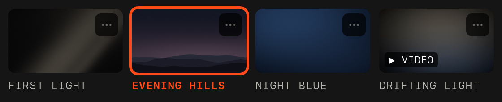

# What SoftPresenter does today

Everything that works now, area by area. The [README](../README.md) gives the overview;
[roadmap.md](roadmap.md) lists what is planned; [app-map.md](app-map.md) shows where each part
of the app is and which command-line command does the same; [cli.md](cli.md) covers the command
line.

SoftPresenter is young: some of this is rough, and file formats may still change. When a
feature changes, this page changes in the same commit.

No list, page or menu in the app shows a scroll bar: everything scrolls by the trackpad, the
mouse wheel (with Shift for sideways) or the keys, and the whole width is the content's.

## Running a service
- **Notices** come in one place: a status button in the top bar, between the find box and the
  clock, which never changes size or moves anything. With nothing new it is a quiet list icon;
  new information adds a small grey dot; trouble turns it amber with a count; a question shows
  "?". A click opens the list under it: "Notices" with Clear All, then each entry with its mark
  (an amber dot for trouble, a grey one for information, an amber "?" for a question), its
  whole text, its time and its buttons, questions first, then newest first. Closing it (the
  button, a click elsewhere, or Escape, which then clears nothing and closes nothing else)
  marks everything seen. Clear All keeps a question that waits for its answer; the list keeps
  the last 40. Only trouble (a file that couldn't be read or saved, an output or a player that
  stopped, VoxLive refusing its key or not answering), questions, and what happened out of sight (added to another playlist, a file read,
  a Bible installed, written files) earn an entry, and every one goes in the log too; what the
  operator just did and can see is never said. The show keys (← → Space Enter) still run the
  show while the list is open. `sp notices` lists it, `sp notices answer N ANSWER` answers a
  question as its button does, and `sp notices seen` and `sp notices clear` do what closing the
  list and Clear All do; a Remote Control page mirrors the button with the same commands.
- **Resizing the window** redraws the operator's window at its new size as it is dragged, so the
  layout reflows live and nothing is stretched. If setting the window up for a new size ever
  holds the graphics card long enough to risk the audience screens' pictures, the rest of that
  drag falls back to taking the size on once it has stopped changing for a moment.
- **A refusal is a brief cue, not a notice.** When nothing happens and the operator should know
  why ("That is the last slide of the playlist.", "Two is already in Sunday.", "There is no
  song to edit yet…"), a small dark chip says so for about 2.4 seconds under the place of
  action: under what was clicked, or under the preview's readout when it was a key. It never
  goes in the list (the log keeps it).
- Songs shown as a grid of slides, a words-only view or a table (number, group, words, notes),
  with a size slider. Click a slide, or use the [keys](../README.md#keys), to put it on the
  audience screen. A slide in the grid is its picture with a strip under it: its number, its
  group's dot and name (heavier on the group's first slide), small tags for a hot key, a time
  after which it goes on, actions, a transition of its own or being switched off, then a pencil
  (the editor) and ⋯ (its menu, as a right-click). The slide on screen has an orange ring and
  orange words; slides picked out have a blue ring.
- In the Service view, ↑ and ↓ open the song above or below in the song list (with Shift, picking
  out the songs on the way), or the item above or below in a playlist (passing over headers);
  ← → and Space go on moving the slides.
- Groups (Verse 1, Chorus, Bridge…) with a dot in the group's colour and one-key jumps.
- **Renaming in place** (a playlist, a library, a song's title, a header or placeholder, a
  theme, a template, a stage layout, a group, an object, a message, a prop, a macro, an audio
  playlist or track): the name stays as it was shown, in the same letters and colour on the
  same spot, and is typed into there; only a thin grey edge round it says so, and nothing
  beside it moves. A name longer than its room scrolls inside it (it opens at its end, where the
  cursor is), and one cut short with … or set on two lines shows whole on one line while it is
  typed. A box in Edit without a name of its own is listed by its first line of words and is
  renamed from its own name. Return or a click elsewhere keeps it; Escape puts the old name back.
- **Songs changed outside the app** (in a text editor, by a script or an agent) come in when the
  song is next opened: chosen in the list or a playlist, opened in the editor, or named in an
  `sp` command. The app never saves over a song or theme file changed since it read it: it asks,
  with **Reload** (the file's version) or **Keep mine** (SoftPresenter's written over it), as a
  question in the notices (the status button turns amber with "?"; the list never opens by
  itself), and for a song also in an amber-tinted strip under its title bar in the Service view:
  "This song was changed outside SoftPresenter. Read it again from its file, or keep
  SoftPresenter's version?". A song on screen, being edited, or holding changes not saved is
  never swapped unasked; the question offers it instead. Answered in either place, it goes,
  and the answer is noted in the list. File › Reload Songs from Their Files (`sp song reload`) reads
  every changed song and theme again and adds song files put in the Songs folder (a copy of one
  already there gets an id of its own). `sp song reload SONG [--now]` and `sp song keep SONG` do
  the same for one song, and `sp songs` marks a song whose file changed. Quitting with a change
  that couldn't be saved keeps SoftPresenter's version in the library's "Not saved" folder, so
  neither version is lost.
- **Song packs** (`.sppack`), to carry songs prepared at home to the church computer by
  AirDrop, email or a USB stick. File › Export Songs… (the songs picked out, or the one shown),
  a song's or playlist's right-click Export…, or `sp song export SONG… [--playlist NAME] --to
  FILE.sppack [--no-videos]` makes one: the songs (or a playlist with its songs), the themes
  they set for themselves, and their pictures and videos (offered with their size, and left out
  on request). No path or user name from the computer goes in. Opening one (drop it on the
  window, File › Import Songs › A Song Bundle…, or `sp song import FILE.sppack`) brings the songs into the library,
  their pictures into Images and videos into Media, the themes they need as new themes (a song
  using the main theme takes on this computer's), and the playlist as a new playlist, with its
  pictures and videos (into the media bin) and its media playlists (with theirs; one this
  computer has already is used as it is; such a pack is version 2, which an older SoftPresenter
  asks to be updated to open). A song
  already here (the same id) is replaced, kept beside as a copy, or skipped (the window asks once;
  `--replace`, `--keep-both`, `--skip`, skipped by default). A slide action that points at a
  message, prop, timer or media item this computer doesn't have is kept and counted. A pack is
  untrusted: only its own kinds of entry with plain names are read, within size limits and the
  free disk space; a picture or video a song names must be one the pack holds; the app names every
  file it writes; anything else is left out and named. A pack is the same on every system
  SoftPresenter runs on (macOS, Windows, Linux): zip entries named with `/`, files the app names
  by id, songs and themes in UTF-8 JSON, and videos named inside the library rather than by a
  computer's own paths. Opening a pack again adds nothing twice: a theme the computer has (the
  same id) is used as it is, and a picture or video already in the library (the same contents)
  is reused. Fonts don't travel (their licences rarely allow it): a theme's font missing on the
  other computer falls back to one it has (SoftPresenter Sans, the default, is in every copy of the app). A pack with videos is written or opened in the
  background; `--wait` waits for it, and `sp job N` says how it went.
- Playlists, libraries, macros, the song that starts with the app and slides' "go to song"
  actions find a library song by the id in its file, so they keep working when the library
  folder moves. A song that can't be found is kept and shown as missing (`sp playlist` and
  `sp library NAME` mark it "(missing)"). Files from before this named songs by path or title;
  the first start changes those to ids, keeping a copy of each file it changes in
  "Backup before song ids", and a song file copied in the Finder gets an id of its own.
- **Arrangements**: a song's groups in the order to sing them (Verse 1, Chorus, Verse 2, Chorus…),
  from the Arrangement icon at the right of its header or the arrangement's name at the start
  of its row (As written, the song's arrangements, New Arrangement, Rename…, Duplicate,
  Delete). Next and Previous follow it, a group can come more than once, and the stage screens
  show what comes next in it. The row under the song's bar has a pill for each piece in the
  order sung: **a group sung several times running is one pill marked ×2, ×3…** (it is saved
  as the group listed that many times, so files are as before), and while it is on screen the
  pill is orange and says which time through it is (2/3). A click on a pill goes to that point;
  its arrow (or a right-click) sets how many times (Once, ×2, ×3, ×4, or More, up to 20), moves
  it left or right, or removes it; a pill dragged along the row goes where the ink line shows;
  + adds a group at the end. **With an arrangement the slides stand in the order sung**:
  a group sung again stands again (the same slides, tagged AGAIN and a little faint), numbered
  in the order sung, and only the tile for where the song is lights up; the groups it leaves
  out wait underneath, under "Not in this arrangement", fainter and still there to click.
  Under an arrangement a slide is dragged only among its own group.
- Nineteen transitions: Cut, Dissolve, Fade, Fade Black, Fade White, Push, Move In, Reveal,
  Fly In, Zoom In, Door, Flip, Swap, Wipe, Split, Blinds, Iris, Clock and Checkerboard, with
  their direction and time (0 to 5 seconds), from Cut, Dissolve or Advanced. One is chosen for all slides from the bar under the slides; a song
  (its right-click menu) and a slide can each have their own, and the media bin has its own for
  changing from one picture or video to the next. Dissolve, Fade, Fade Black, Fade White, Wipe,
  Split, Blinds, Iris, Clock and Checkerboard on an ordinary screen draw each slide once and then only
  blend the two (far less work for the graphics card, so a slow one keeps up); the others, and any fade
  over a playing video, redraw both slides at each step. A slide over a playing video is drawn once and the
  video's pictures laid under it, rather than the slide drawn again for each picture.
- New Song (Command-N, or + over the song list) asks for the song's title and theme, and takes
  its words pasted in (a line in square brackets starts a group, a blank line a new slide; a
  lyric file pasted in whole gives its sections and details, as an import does).
- **Importing songs.** File › Import Songs offers them by kind of file (and so does the import
  button over the left column): **A Library Folder…** (each folder in it becomes a library),
  **A Song Bundle…** (`.proBundle` bundles and SoftPresenter's song packs, with their pictures
  and videos), **Song Files…** (songs SoftPresenter saved, `.pro` documents, ChordPro and lyric
  files, songbooks) and **Words from Text…** (plain text, rich text, Word and OpenDocument
  files, a song from each). Dropping files on the window, `sp song import FILE…`, or song
  files named on the command line take any of them. It reads plain text in any common encoding
  (UTF-8, UTF-16, and the older Windows ones for Russian, Ukrainian and Western European
  languages), the lyric files song services give (title, sections, and a footer whose song
  number, writers and copyright go into the song's details; a church's own licence number is
  never kept), ChordPro (sections from its directives, chords taken out), SoftPresenter's own
  song text and song files, rich text, and on macOS Word and OpenDocument files.
- **Imported songs are tidied** (every kind above but SoftPresenter's own songs and song packs).
  - **Titles:** a garbled title (UTF-8 read as an older code page and saved that way, such as
    "Хвала" or "life’s") is put back, but only when reading it back as bytes gives
    UTF-8 with letters. Right Russian, Ukrainian, Spanish or English titles are never changed.
    A file's ending (".docx", ".txt", ".pro"…) and a comma, semicolon or colon at the end come
    off. "Untitled", or no title, becomes the first line. A title that is only a number (a
    hymnbook's, perhaps with a counter: "100 4") becomes "100 - its first line", so the number
    still finds it.
  - **Words** (the main and translation boxes, and the reference's letters): letters typed as
    a letter and a mark (и and a breve) are joined into one (й), as Unicode's NFC does. Line
    and paragraph separators become line breaks; non-breaking spaces and tabs become plain
    spaces; zero-width characters between letters go. Runs of spaces become one, and lines
    lose the spaces at their start and end. A blank line, or a line of only "* * *", "***" or
    "---", between words parts the slide there, and the line goes; one at a box's start or end
    just goes. A slide of more than eight lines is shared out into slides of at most eight, as
    even as they can be (12 lines make 6 and 6).
  - A slide is parted only when its translation parts the same way, stanza for stanza or line
    for line; otherwise it stays whole. The first part keeps the slide's label, notes, actions
    and hot key; every part has the slide's reference, pictures and shapes. Repeat marks
    ("2x"), group names and presentation slides (boxes with no role) are left as they are.
  - **Songs already in the library:** `sp library tidy` does the same to them (see
    [cli.md](cli.md#playlists-and-libraries)). It lists every change first: each title before
    and after (number-only titles on a list of their own), each slide it would part, and the
    letters and spaces it would put right, song by song. It also lists the slides it leaves
    whole, and songs with the same words (listed only). `--apply` makes the changes through
    the app's own saving: songs keep their ids, themes, arrangements and places in playlists
    and libraries. First, each song's file is copied as it was into "Backup before tidying"
    and the date, in the data folder. `--keep-numbers` leaves number-only titles alone. Songs
    kept in step with the song catalog or TimelyChurch are left alone, and so is a song whose
    file changed outside the app. Run again, it finds nothing left to change. Done at the
    computer only: not from a remote page or an AI assistant.
- **Slides from a presentation file, a PDF or pictures.** File › Import Slides… (or Import ›
  Slides… beside the songs) opens a sheet with two cards: **Pictures as slides** and **A
  presentation** (a `.pptx`, `.ppsx`, `.key`, `.odp`, `.ppt` or `.pps` file, or a PDF). Dropping
  the file or a folder of pictures on the window, or `sp song import`, comes in the same way. A
  PDF asks nothing. Any other presentation opens the sheet **Import “Sermon.pptx”**, two cards
  side by side: **As Slides** (words stay words, ready to edit; read straight from the file, with
  no app started) and **As Pictures** (the exact look, each slide a picture, drawn unseen by an
  app on this computer that can open the file, and closed again). The way that kind of file came
  in last time is ringed and marked "Last time"; the first time a `.pptx` or `.ppsx` is ringed
  As Slides. Enter takes the ringed card, a click takes either, Escape or Cancel closes it (the
  show's keys wait meanwhile, so Escape clears nothing). A card that can't be used is greyed and
  gives its reason in place of its line ("Only .pptx and .ppsx files can come in as slides", "No
  app on this computer can open .key files to draw them"); with neither possible the sheet is
  that one paragraph and OK. Several files are asked about one at a time. `sp song import FILE
  --as slides|pictures` says it without the sheet.
  - **As Slides** maps each slide's text boxes (the font, size, bold, italic, underline, colour,
    alignment, line spacing and bullets most of a box's letters have), pictures (cropped as the
    slide crops them), solid, gradient and picture backgrounds, rectangles, rounded rectangles,
    ellipses and a few other simple shapes with their fill and outline, and lines, in their
    places, scaled from the deck's slide to SoftPresenter's (a 4:3 deck is centred, not
    stretched). What a placeholder leaves unsaid comes from its slide layout and master, and
    colours and fonts from the theme; the master's and layout's own pictures and shapes sit
    behind the slide. Speaker notes come into the slide's notes, and hidden slides come in
    disabled. A chart, table, diagram or embedded object is drawn from the picture the file
    keeps for it if it keeps one (often beside the object), otherwise left out; embedded sound
    and video aren't brought in (a video's poster picture is). A box that mixes looks takes
    the look most of its letters have, and the words whose run differs (bold, italic,
    underline, strike-through, size, colour or typeface) keep their own as styled words. Every
    slide that has a chart, table or other thing that can't be drawn is named when the import is
    done: "“Sermon” came in as 24 slides. Check slides 3 and 7: a chart came in as its picture;
    an embedded object came in as its picture." Each slide named wears an amber **Check**
    tag in its strip, with its reason as the hover; its menu has **Mark as Checked**, which takes
    the tag off (Undo puts it back; `sp slide checked SONG N` does the same). The reason is kept
    in the slide's saved data, so the tag survives a restart until the slide is marked. The
    file is read with limits: bounded sizes and numbers of parts, overlapping parts refused, no
    document types or entities, bounded nesting, and a picture over 32 MB or 64 million pixels
    left out. It takes a few milliseconds for a text deck, a fraction of a second with pictures.
  - **As Pictures** turns the file into a PDF with an app on the Mac that opens it (up to three
    are tried, best first, by the kind of file), so its slides look exactly as that app draws
    them. The app is started without a window and without coming to the front where it allows
    that; macOS asks once to allow it, an app SoftPresenter started is closed again, and one
    that was already open is left alone. With none installed the card is greyed and says so (no
    app is named: the words are "No app on this computer can open .key files to draw them"), and
    for a `.pptx` As Slides is offered.
  - **A PDF or pictures** become one picture slide each, in a new presentation named after the
    file or folder, saved in the Images folder so the deck keeps working when the file moves.
    The presentation appears at once with all its slides; the pages (drawn at up to 1920 × 1080
    on white, turned and cropped as the PDF says, several at a time on background threads) and
    the copied pictures fill in as they are ready, and the window and keys go on working. A
    slide whose page isn't drawn yet reads "Page 3…" in faint on dark in its strip. The pictures
    still to make are written down (in the data folder's "Pictures to draw") before the
    presentation is handed over, so quitting within the first second leaves no blank slides: the
    next start draws the pictures that aren't there (from the same PDF, so it must still be where
    it was), and each picture is written under another name and renamed when whole, so one cut
    short by a quit is never mistaken for a picture.
    Pictures in a folder go in the order people number them (Slide2 before Slide10). A 40-page
    PDF takes about 0.07 seconds where it took 0.4 seconds one page at a time.
- **Bringing songs across from SoftProjector.** Its database (`spData.sqlite`), an exported
  songbook (`.sps`) or a songbook downloaded for it, dropped on the window or chosen in File › Import Songs › Song Files…: each songbook
  becomes a library of its name, each song keeps its number before its title (so "123" still
  finds it), its lyricist and composer, its verses, choruses and other parts as groups (a
  "&Куплет" part as more slides of its verse), and an arrangement, "As sung", that repeats the
  chorus after every verse as SoftProjector does. It works the same on a Mac, on Windows and on
  Linux: both are SQLite files, and SoftPresenter reads them itself (`sqlite_read.rs`, written
  from SQLite's published description of the file; nothing on the computer is asked to), never
  writes them, and gives the songs in the order SQLite gives them: songbooks by name, songs by
  number. A file that is cut short or damaged is refused in a sentence saying which, and a file
  that isn't a songbook says so. A database copied while SoftProjector had it open, with
  changes still waiting in a `-wal` or `-journal` file beside it, comes in from the database
  alone, with a line saying its latest changes may be missing. Songbooks are passed around
  zipped, and a `.zip` that holds any (`.sps` or `.sqlite`, in folders or not) comes in the same
  ways without being unpacked first: every songbook in it is imported, one that can't be read
  is named with the reason while the others still come in, and a zip with no songbook in it is
  not taken for songs. The zip is read with limits (its size, how many files it lists, how
  much it unpacks to), nothing in it is written to disk, a zip inside it is not opened, and
  names in it written before zips used UTF-8 read as they were written. The songbooks
  SoftProjector offers for download (zips such as `pv3300.zip`) hold an `.sps` of an older kind,
  a text file with a song on each line, and those come in too, zipped or not: the songbook's
  title from its second line, each song's number, title, lyricist, composer and words, in the
  order of their numbers, with the same words, to the letter, as the SQLite songbook of the same
  name gives (so importing both brings each song once). A songbook saved as XML
  is not read yet, and says so.
- **Bringing a library across from ProPresenter 7.** File › Import Songs › A Library Folder… opens
  its Libraries folder; choose song documents, one library, or the folder of all of them. Each folder becomes a
  library of the same name. Each song is named as its file is ("12 - Amazing Grace", hymn
  number and all), the name kept right in the libraries seen; the name a document keeps inside
  (often its first line as first typed, a name garbled long ago, or another song's) is used
  only when the file's name has no letter or digit. Songs brought across
  before that was so are named after their files by `sp library tidy --titles-from FOLDER`,
  FOLDER being the folder they were imported from, which it only reads (see
  [cli.md](cli.md#tidying-the-library)). Each song keeps its groups, slides, arrangements (and the one
  chosen), slide labels and notes, slides switched off, and its copyright details. A slide's
  text box in the largest type becomes the words, the next the translation, and a line such as
  "Psalm 133:3" the reference. `.pro` files can also be dropped on the window or given to
  `sp song import`. Documents with pictures or videos but no words are listed as not imported
  for now. A library of 4,372 songs comes across in about a third of a second.
- **Song bundles from ProPresenter 7** (`.proBundle`, one song or several, with their pictures
  and videos) come in wherever a `.pro` document does: File › Import Songs › A Song Bundle… or
  A Library Folder…, a folder of them, dropping them on the window, or `sp song import`. Every
  song in a bundle comes across as a `.pro` document does, in the
  order of the bundle's entries (a bundle records no order of its own; the ones seen list their
  songs by name); each picture or video a slide shows is copied into the library's Media folder
  (or found there already, by its contents), added to the media bin once however many of the
  songs show it, and shown behind that slide's words, and a video set to loop keeps looping.
  Dropped on a playlist, all of a bundle's songs go in, in that order, where the line shows (on
  a playlist's row in the chooser, at its end). A song the library has already, word for word
  under the same title, isn't added again; the notice says how many were there. Bundles
  exported by the program (pictures kept under the paths they had on the computer they came
  from) and ones written by other tools (bare file names) are both read. A picture or video the
  bundle doesn't hold is named in the window's notice and the song's words come in all the same;
  so is everything else in the bundle that doesn't come in, and why: a song that can't be read,
  a PDF (a bundle's PDFs don't come in yet), a picture no song shows, a file of another kind.
  The bundle is read as untrusted: nothing is ever written where an entry's name says, only the
  songs (at most 500, and 256 MB of them together) and the pictures and videos they show are
  taken out, each within a size limit, and nothing in it is run. A bundle larger than 64 MB is
  read in the background; the notice says when its songs are in. Its pictures keep their own
  file names in the Media folder (numbered when the name is taken), so the media bin shows those
  names.
- **The song catalog** (the engine, `sp catalog`, and in development builds the find box):
  free songs from Worship Leader App, a songbook for each language, downloaded from the source
  by each church and kept in `Catalog/worshipleaderapp/<language>/` of the data folder, apart
  from the library. **In development builds only**, until Worship Leader App has answered: the
  setup's Free Songs step (after Songs) lists the songbooks, each named in its own language
  (Latin and Cyrillic names; the others in English, which every system can draw), with the
  download's size as the source gives it and the songs once downloaded; the operator's own
  language (SoftPresenter's, from the first step) is ticked to start with, and every other
  language the source publishes is a click away (Other languages…). Continue downloads what is
  ticked in the background once the setup closes (by its last button or Escape), with a notice
  when each starts and ends; Not Now downloads nothing, nor does leaving the setup before that
  step's Continue; with the source out of reach it says so, with Try Again, and nothing is
  ticked. Settings › Integrations › Worship Leader App downloads more
  later or removes one (asking first; songs already in the library stay), the recommended ones
  listed first. The languages are built in, from the source's table of 24 November 2026: it
  publishes no list to fetch. The pack is kept as downloaded (about 1.3 MB for Ukrainian, 16 MB for Russian), with an
  index made once from it: a search of 14,000 songs takes a third of a millisecond, and reading
  the index at a start under twenty. Search finds words in a title or in the first line of a
  section, in Cyrillic or Latin, whatever the case, with ё as е, stress marks and punctuation
  ignored, and leaves out songs already in the library. **In development builds, with a
  songbook on the computer, the find box looks in the songbooks too**, on a thread of its own
  (results come as they are ready; "Looking in the songbooks…" until then): after the church's
  own songs, under a quiet heading "From Worship Leader App", up to as many as the church's own
  leave room for among six songs, and always two, the operator's and the church's languages
  first. Each has its title, its first line as its slide shows it, its songbook's language
  ("Song · Español") and a note mark in a quieter ink than the library's lilac. Return or a
  click shows it in the slides area, from one of two places kept for it (never the one on
  screen, so the screens keep what they show), its first slide picked, with "Worship Leader
  App" by its title and its own tools (Add to the playlist in front, Edit Words, and a menu
  with Edit); it goes on screen like any song, and **looking at it or putting it on screen adds
  nothing to the library**. A song **joins the library** (a library
  named Worship Leader App, made the first time) as an ordinary song, marked with where it came
  from, when it is added to a playlist (Command-Return in the find box, Add on its bar), dragged
  from the find box into a playlist or a library, or edited (Edit Words, its key, or Edit on its
  bar): the song filed then takes the place of the one looked at, and a notice says where it
  went; the monthly check updates it like any other (`sp catalog add` joins one too). From the
  command line its other-language versions can go under its words, group by group by the group's name,
  and the groups with no partner are listed (a group only the other language has is left out).
  The source gives songs no number or id, so a song's key is its language, its title folded for
  searching and eight letters of its first section's words. The songs are untrusted files: the zip
  is bounded, a song file that isn't well-formed XML is left out and counted (one of the 924
  Ukrainian files), and a pack that would empty most of the catalog is not believed. About once a month,
  and never while anything is on screen, the app asks the source whether a language changed (with
  the ETag and Last-Modified of the last download, so no change means no download). Songs
  nobody has touched are brought up to date quietly; **a song the church changed in any way is
  never overwritten**: a newer version is offered (`sp catalog use-newer`, which Undo takes
  back, or `keep-mine`), with one notice for each check. A song the source drops stays in the
  library, noted as gone. Every catalog song carries the credit "From Worship Leader App" and the
  source's site. Downloading, checking and removing are done at the computer, not from the remote
  page. See [cli.md](cli.md#the-song-catalog) and [licences/song-catalog.md](licences/song-catalog.md).
- **Free songbooks shared by churches**, in every build: fifteen songbooks many people have put
  together over the years and share free on a public page (Russian: Песнь Возрождения 3300, 3055
  and 2001, Песнь Возрождения Совета Церквей 2006, Звуки неба 2010; Ukrainian: Євангельські Пісні,
  Пісні Спасенних, Псалмоспіви; Czech: Kancionály CB, Laudate, Vánoce; Slovak: Slovenské chvály;
  German: Gemeinschafts Lieder Buch; English: Christian Hymns, Worship Songs). Import Songs ›
  **Free Songbooks…** (the ↓ button over the library; File › Import… on a Mac) opens a window
  that lists them by language, the language SoftPresenter speaks and the computer's first (so a
  Czech, Slovak or German computer sees its songbooks after the English ones), each with its songs
  and download size, Install (with how far its download has got), or Remove once installed
  (asking first); under the list, that the songs belong to their writers and a church's licence
  (such as CCLI) covers showing them. The setup's Free Songs step lists them too, in every build
  (under the song catalog's in a development build), with the first songbook of the operator's
  language ticked (Песнь Возрождения 3300 for Russian, Євангельські Пісні for Ukrainian), every
  other a click away; Continue installs what is ticked once the setup closes, Not Now nothing. A
  songbook is downloaded **only when chosen**, straight from the site of the page that shares
  it (SoftPresenter keeps no copy), over HTTPS only (redirects too), on a thread of its own, and
  installed only when it is byte for byte the file this version expects: a length other than the
  one expected is refused before it is read, nothing past it is read, and its SHA-256 is checked
  before anything is written; a file that has changed on the site is refused, saying a copy the
  church trusts can be brought in with Song Files…. Its songs then come in through the songbook
  import File › Import Songs uses: a library named after the songbook, each song with its number
  before its title, a song the library has already (word for word, under the same title) not added
  twice. They come in once nothing is on screen, without choosing a song or closing anything; a
  notice says how many. Each song is marked with the songbook it came from, so an installed
  songbook isn't downloaded again (it says how to remove it first), and Remove takes back out, to
  the Trash, the songs nobody has changed and no playlist or other library uses (the rest stay as
  the church's own), and the songbook's library once empty. `sp songbooks`, `sp songbook install
  NAME` and `sp songbook remove NAME --yes`; installing and removing are done at the computer, not
  from the remote page or by an AI assistant. See [cli.md](cli.md#free-songbooks) and
  [licences/free-songbooks.md](licences/free-songbooks.md).
- **Dropping files from the Finder lands them where the pointer is.** Song files of every
  kind (song documents and bundles, text, lyric and ChordPro files, songbooks, song packs,
  folders of songs) always go to the songs, never into the media bin: dropped on a playlist (a
  row of the chooser, or the open playlist, where they go after the item under the pointer)
  they come into the library and into that playlist; on a library (a row of the chooser, or the
  song list) into that library; anywhere else into the library shown, as before. A song the
  library has already still goes into the playlist or library dropped on. A song pack's songs
  go into the library it is dropped on, or the library shown, never a playlist (a pack brings
  its own), so playlists don't light up for a pack. Pictures and videos
  go into the media bin, and into a playlist they are dropped on; in the Edit view, onto the
  slide. Several files dropped together each go their own way. While files are over the
  window, the place they would land has an ink outline (and the open playlist a line where
  they go in); while song files are over it the chooser shows above the list, as it does while
  songs are dragged in the window, and with nothing in particular under the pointer the library
  they would go to is outlined (its song list, or its row in the chooser). The media strip opens
  and lights up for pictures and videos only; songs over it go to the library shown, which is
  outlined. On macOS the window asks the system where the pointer is while files are over it
  (redrawing at most 30 times a second, for at most a minute of one drag), as the window
  library doesn't say. On Windows and Linux it can't tell, so there songs go to the library
  shown and pictures to the media bin, as before, and only those places light up.
  Sections are found from lines naming them ("Verse 1", "Chorus:", "Bridge", "Куплет 1",
  "Припев", "Приспів"…); slides break at blank lines, and more than four lines without one are
  shared out evenly (eight lines make two slides of four). A song the library already has,
  word for word under the same title, isn't added twice.
- The left column lists one thing at a time, a playlist or a library, and says which in a small
  label at its top (with a button there that imports songs or slides). Under the label is the
  name of what is listed; a click on it opens the **chooser**, which puts the list away and
  shows only things to open: the playlists first (each with how many items it has), then the
  song libraries under a line (All Songs, then libraries of your own such as Christmas or
  Youth). The one that is open has a lighter row, a heavier name and a tick. + beside each
  heading makes a new one; a row's ⋯ (or a right-click, or a double click for Rename) renames,
  exports or deletes it, where it is: the playlist in front stays in front with its open item
  (deleting the one in front opens the one before it). Choosing puts the list back, and so
  does Escape, which then clears nothing on the screens. A library lists its songs, each with
  how many slides it has (and, in All Songs, the library it is in); at the foot are the order they
  are listed in (**As listed, A–Z, Longest**, kept between runs), **New song** and a filter. A
  song's ⋯, or a right-click, opens its menu. While songs from the list are dragged the chooser
  shows above it, so they can be dropped on a playlist or a library (a result dragged from the
  find box goes only into the list shown, with no chooser); a new song made while a library
  is shown goes into it. Which of the two the column was left listing is kept between runs.
- A playlist lists its items in running order: each with its number, its title, a small mark
  for a Bible passage, a picture or video, a media playlist or a placeholder, an orange number on
  the one on screen (whose row is brought into view when it goes on screen), and ⋯ for its
  menu. A title in the left column's lists takes up to two lines (42 high for one, 48 for two), broken
  where the heavier chosen face breaks it so choosing a row moves nothing, and ends in … if it is
  still too long, when the row's hover text gives it whole; a tag after it (the library's name in
  All Songs) never shortens it: it follows the last line, takes a line of its own, or goes into
  the hover text. The ⋯ is always there, 4 from the row's end. Headers are small capital lines,
  with a ⋯ too. An item has **one menu**, the same from
  its row's ⋯, a right-click on the row, and the ⋯ (or a right-click) on its title bar over the
  slides: Add Slide and Song ▸ (the song's own menu) for a song; Play on Announcements Layer
  for a picture, a video or a media playlist; Fill with Song for a placeholder, Open on the
  Bible Page for a passage, Rename for a header or a placeholder; the Version section once a
  theme has a version; Move Up, Move Down and Remove from Playlist; and for a song, Delete Song
  from Library… last. Items
  can be dragged into a new order; Escape stops a drag, leaving them where they were. A click
  on a row only **opens** the item: it becomes the open one and the slides scroll to it; the
  screens don't change, and a Bible passage no longer
  takes the window to the Bible page (Open on the Bible Page, in its menu, does, opening it as the
  page opens any passage). A passage kept in a playlist runs as its own slides, so Next goes on
  into the next item after its last. A click on a
  header scrolls the slides to it. **Add to playlist**, at the foot, adds a song, a header, a
  placeholder, a picture or video, a media playlist or (once VoxLive is connected) the VoxLive
  item after the open item, and opens the Bible page for a passage; under it is the filter.
  **Adding is the same everywhere:** Add to playlist, a song's Add to the playlist in front,
  the find box's Command-Return and the Bible page's + Add put what they add just after the
  open item (at the end with none open), and it becomes the open item; another playlist takes
  it at its end. A playlist has a song (or a passage) once: a song's pickers mark the songs it
  has already ("In this playlist" at the right of the song, in Add to playlist ▸ A Song and Fill
  with Song), and adding one again changes nothing but a brief cue says so ("Two is already in Sunday.").
  Nothing is said for what was added where it is seen; an entry in the notices says where it went only when
  that is out of sight (another playlist, or the playlist in front while a library, the
  chooser or the Bible page is showing): "Added Harbour Lights to Evening.", "Added 2 songs to
  Evening.".
- **The dock** under the slides stays put while they scroll: a bar with the transition for all
  slides (Cut, Dissolve, or another from Advanced, in a switch of a fixed width), Continuous,
  the theme version button once a theme has a version (see Theme versions), Undo and Redo,
  the three views and the slide size, and under it the media strip ("Media",
  the menu of media playlists, how one picture or video gives way to the next, a chevron that
  folds the strip away, + to add some, then the pictures and videos with their names, each
  with ⋯ for its menu, a video with its length in a small dark chip at the lower right of its
  picture ("0:36", or "1:02:09" from an hour on; a picture has nothing there, and the same chip
  is on a video's tile in a playlist); the one showing is ringed in orange, and only orange
  while it is also picked out). The slides fade into the panel
  just above it. In a narrow window the bar leaves out Undo and Redo, then Continuous, then
  the size, rather than squeeze them (each is in the menu bar too). Add Slide is in a song's ⋯
  menu on its bar, and in the File menu.
- While the left column lists a playlist, the middle shows **the whole playlist as one scroll**,
  item after item, each under a bar with its name that stays at the top while its slides
  scroll under it. The open item's bar has a dot; a song's bar carries its tools (details,
  Edit Words, arrangement, the theme version button once a theme has a version, notes, and
  ⋯ for the song's menu, Add Slide and its place in the playlist), and a song played in an arrangement has a row of pills under its bar and its
  slides in the order sung (see Arrangements above). Other items say what they are in a small label. A **Bible passage** kept
  in the playlist is shown as its slides, drawn by the Bible theme as the Bible page draws
  them; a click on one looks the passage up as the Bible page would and puts that verse on
  screen, and Next and Previous then go verse by verse. Clicking a slide of any item puts it
  on screen and makes that item the open one. The view goes to the slide that has just gone on
  screen, at once, keeping it clear of the bar at the top and of the fade at the bottom; it
  stays where it was scrolled otherwise. Only what is in view is drawn, so a playlist of
  thousands of slides scrolls like a short one, and each song's slides are drawn with that
  song's own theme. A song chosen that the playlist doesn't have (a new song, one found with
  the find box) is shown by itself, with the left column back on a library.
- **The keys act on the open item.** While the open item is the one on screen, Next (Space,
  the right arrow) and Previous (the left arrow) step through it. Once ↑, ↓ or a click on a
  row has opened another item, the next Next or Previous starts that item at its first slide:
  a song or Bible passage goes on screen, a picture or video is shown, a media playlist plays.
  ↑ and ↓ open the item above or below (passing over headers), and say so at either end;
  Enter puts the open item on screen from its first slide (with a library listed, the song
  chosen). With Continuous on (in the bar
  under the slides), Next at the end of a song goes on into the next song or **Bible
  passage**, passing over headers, placeholders, pictures and videos, and Previous at a song's
  first slide goes back into the last slide of the one before; at either end of the playlist,
  or with Continuous off, nothing changes and nothing is said: reaching an end needs no notice (the
  same for ↑ and ↓ at the ends of the playlist, the song list and a passage's verses, and a verse
  longer at either end of a book). The menu
  bar's Next Slide and Previous Slide, and `sp next` and `sp previous`, do the same; a slide
  that goes on by itself goes on into the next song or passage only with Continuous on. A
  page or script that keeps its own open item names it each time (`sp next --aim 3`,
  `sp go --aim 3 2`): the step is worked out from that item, with nothing picked, and the
  window's open item, picks and chosen song stay as they are. Each playlist item has an id of
  its own (`uid`, in `sp playlist --json` and in what a page is sent) that stays with it when
  the items are moved, when the playlist is saved and when the app opens again, and `--aim`
  takes it in place of the item's number, so a page's open item follows a reorder exactly.
  `sp songs --json` gives each song's stable id (which `go`, `slides` and `slide` take in
  place of its title), and each screen says whether it is an audience or a stage screen.
- **A slide picked waits for Enter.** What the find box opens with Return has a slide picked
  (a song's first slide as sung, or the slide whose words were found; a Bible passage's first
  verse: a single verse, typed as a reference or found by its words, is the passage, and with a
  slide a verse its slides are its whole chapter's, so after Enter Next goes on through the
  chapter after it; Command-Return keeps the verse alone), and so does a passage looked up with
  Return in the reference field. In the Bible view, on the page and under Slides alike, ↓ is as
  → and ↑ as ←: with nothing on screen they move the pick to the verse after or before
  (brought into sight; the passage's first when none is picked), putting nothing on; with
  something on screen they go on with it, as → and ← do, and Enter takes the pick. The slide
  picked has a 2-point ink ring and its strip in ink (in Words Only or a table, its row has the chosen grey and a fine dim ring inside); never
  orange, which is only for what is on screen, nor the blue of slides picked out to change several;
  it is brought into view, and the keyboard is the show's again. Enter puts it on screen;
  then Space, → and ← go on from it as from any slide. With nothing on screen, Space puts the
  picked slide on too, and → and ← move the pick to the next or previous slide (in the order
  sung) without putting anything on, so a reading can be looked up and the right verse picked
  by the arrows. With something on screen, Space, → and ← go on with that (a song can be run to
  its end with the reading picked), and Enter takes the pick. A click on a slide takes over from the pick, and the pick goes once a slide of its
  passage or song goes on screen, or another song, passage or view is opened. In the Bible
  view, Enter with nothing picked does nothing.
- A playlist also holds **pictures and videos** from the media bin (the countdown video),
  **media playlists** (the announcement loop) and **placeholders** (a place kept for the sermon
  slides). A picture or video goes in from its right-click menu (Add to Playlist "Sunday"), by
  dragging it from the bin onto the items (between two, where the line shows) or onto a
  playlist's name in the chooser; a media playlist from the menu beside MEDIA, or either from Add
  to playlist; a placeholder from Add to playlist, named as it is made. In the slide area each is a bar with one tile: clicking a picture
  or video's tile shows it, a media playlist's plays it round and round; opening one from the
  list only scrolls to it, changing nothing on the screens (Next, Space or Enter then shows
  it), and Continuous passes over them. A placeholder is filled with a song chosen from a list (its tile's
  Choose a Song…, or Fill with Song in its right-click menu), or with a picture or video dropped
  on it. A song the playlist has elsewhere already isn't moved into it: it stays where it is,
  and a brief cue says it is there already. One whose picture, video or media playlist has gone is kept and shown faint. A playlist
  holding any of these is saved as version 3 of the services file; one without is still written
  as version 2, which older SoftPresenters open.
- Songs, a playlist's items, slides and media items are picked out as in the Finder (Ctrl in
  place of Command on other computers): a click picks one (and opens it); Command-click adds or
  takes away one and is counted from after; Shift-click picks every row from the one last
  clicked to it, in place of what was picked, and Shift-↑ or Shift-↓ go on picking in the left
  column; Command-A picks everything the left column lists, with nothing being typed; dragging
  across the song list, or a box across the slides or between media items, picks everything it
  touches (picking a slide never puts it on screen). Picked rows have the lighter grey of what
  is chosen, never orange; the open item keeps its heavier name. A plain click on one of several
  picked lets the others go when the button comes up, so they can still be dragged together.
  Picked songs dragged out of the list go into a playlist or library together, in the list's
  order; several playlist items dragged move together, in their order, to the one ink line, and
  stay picked. Delete (or Backspace) acts on the list last clicked: in a playlist it takes the
  items picked (or the one open) out of it at once, asking nothing, as no song is deleted; any
  kind of item, the one on screen too, which stays on screen; only while the keyboard is the left
  column's (in the Service view, not on the Bible page, with the chooser put away). Nothing is said,
  as what went is there to see; Undo (Command-Z) puts them back where they were, picked out
  again; Remove from Playlist in an item's menu does the same, for all the items picked when it
  is one of them ("Remove 2 Items from Playlist"), and Move Up and Move Down move them all one
  place, together, in their order, staying picked ("Move 2 Up", "Move 2 Down"). Slides picked go at once too, asking
  nothing, in one step Undo takes back whole (they come back picked); only the slides picked in one song, the song of the slide
  picked last, never slides of another song. In a song list or a media strip, Delete asks
  first ("This can't be undone."), then deletes what is picked.
- Pictures and videos dropped on the window, or added with the media bin's +, go into the media
  bin, are kept between runs, and can be shown behind the words; Delete, or Delete… on an item's
  right-click menu, takes it out of the bin after asking (the file stays where it is).
  The bin keeps a small copy of each picture for its thumbnail and the Program preview; the
  full-size picture is read when the item goes on screen (a few hundredths of a second, its
  small copy standing in meanwhile), or before, for the next item of a media playlist playing
  and the media of the slide Next would show, and only the last few are kept, so a big bin
  costs little memory. At the start the window opens at once and the bin fills in as its
  pictures are read; a file that is gone or can't be read leaves the bin.
  Pictures can be PNG, JPEG, WebP, GIF, BMP, and on the Mac also HEIC (iPhone photos), TIFF,
  Photoshop, AVIF and JPEG 2000. A picture is never held at its full size: the bin's small copy
  is 960 pixels on its longer side, and a picture for the screens is 2560, or 3840 once a 4K
  screen has been opened (a smaller picture is never enlarged). On the Mac the system decodes
  straight to that size, so a 6000 x 4000 photo never takes a gigabyte while it loads; on other
  systems the full-size pixels are let go the moment the smaller copy is made. Photos are turned
  the way the camera held them. Videos play with their sound and loop: MP4, MOV and M4V
  (including HEVC and ProRes) through macOS's own player, and everything else (MKV, WebM, AVI,
  WMV, FLV, MPEG, TS and others, or an MP4 the Mac's player can't decode) through FFmpeg,
  played as it is, never converted first. FFmpeg comes inside the app (an LGPL build of FFmpeg
  9.0.2, with its licence and source in the app's Resources), so nothing needs installing; AV1
  plays on Macs whose video hardware decodes it (M3 and later). On Windows every video plays
  through FFmpeg, whose LGPL build (`ffmpeg.exe`, `ffprobe.exe`) sits beside the program in the
  zip `scripts/windows-package.sh` makes. FFmpeg decodes on the graphics chip where the codec
  allows: the Mac's video hardware, or Direct3D 11's video decoder on Windows; a video it can't
  decode that way (no graphics driver, say) plays with FFmpeg's own decoder on the processor,
  and the log says so. A video FFmpeg plays behind the words comes as the decoder's own two
  planes (brightness, and colour at a quarter of the pixels), which the GPU turns into colours,
  in the standard and range the video names (BT.601 and limited range where it names none, as
  FFmpeg takes it): the processor no longer converts every pixel, and a third of the bytes cross
  from FFmpeg to the app. A video with clear parts, of RGB pixels, or with colour at more than a
  quarter of the pixels comes as RGBA, converted by FFmpeg, as before; so does a video in a box
  on a slide or on the Announcements layer. A video the Mac's player plays
  behind the words goes to the screens as the decoder's own picture memory, with no copy through
  the processor (a video whose format can carry clear parts, and a video in a box on a slide or
  on the Announcements layer, are still copied).
  In the preview block, a video on screen has one row of keys
  under the slide's number and name: a round Play or Pause, Start Over, Forward 10 seconds, a
  slim bar to click or drag through (the time a click goes to shows over it), the time left,
  Loop and Sound (each a lighter grey while it is on); its name is the second line of the
  readout. A video on the Announcements layer has the same keys there, acting on its own player
  (while the layer is over the slides it covers the media, so its keys come first; once a slide
  has taken it off and only a lobby screen shows it, the media's video has them). The row is
  always there, empty when nothing plays, so nothing under it moves. A tool
  tab that goes on below what shows fades out at
  its foot. An item's
  right-click menu sets its Scaling (Scale to Fill, Scale to Fit, Stretch to Fill), whether a
  video loops, and the media playlists it is in, and last Delete… (from the bin, after asking).
  A media playlist's own view shows its items in the order it plays them; there an item's menu
  has **Remove from “<playlist>”** (Remove 2 Items from … with several picked) in place of
  Delete…, and Delete does the same: taken out of that playlist only, at once, staying in the
  bin and any other playlist; Undo puts them back where they were. Items are dragged into another order there, with the others
  picked out with them, an ink line showing where they go (dragged out of the strip they still
  go onto a slide). A playlist that follows a folder keeps the folder's files in name order, so
  nothing is moved or taken out of it there. The menu beside MEDIA shows All Media or one
  media playlist, and makes (New Media Playlist…, shown at once with its name ready to type),
  renames and deletes them. ("Playlist" alone is the running order.)
- A picture or video is named by its file's name **without the ending** ("Evening Hills", not
  "Evening Hills.jpg"; the VIDEO badge and the row's mark say what kind it is): on its tile in
  the strip, in its row in a playlist and in the heading over it. Two files in the bin with the
  same name in two formats (Logo.png and Logo.jpg, any case) keep their endings, to be told
  apart. A name too long for its tile is one line ending in "…" (Room Out of Foc…), never cut
  inside an ending; the tile's hover text and every menu and sheet where a file is chosen give
  the whole file name.

- A media playlist can **Follow a Folder**: the pictures and videos in it join the playlist (and
  the bin) as they appear, once each has been read, and one written over (such as a fresh
  announcements export) is read again. A video playing (on the media layer or the
  Announcements layer, looping or not) is not cut or started again: the new file is opened at
  once and takes over at the end of the pass under way, where the video would go round or
  end, so the loop carries on with the new pictures and no black picture between (a video
  one of several in a media playlist going round plays the new file next time round). One that
  leaves the folder leaves the playlist, and the bin too if the folder brought it in and nothing
  else uses it (another media playlist, a slide, a playlist of the service, a macro, or the
  screens, until it is taken off them); one added to the bin by hand stays. **A video swapped
  for one with another name** (a script putting the new one in and deleting the old, in either
  order) never leaves the screens blank, whether the playlist goes round on the media layer or
  the Announcements layer, or a video the folder brought in is shown on its own: a new file
  joins the playlist and plays when its turn comes (a video that was the playlist's only item
  gives way to it at the end of its pass), and when the file on screen leaves the folder the
  next item goes on, at the end of the pass if the video is still playing (through the same
  pictures, as above), otherwise at once. With nothing left, the last picture stays up for 8
  seconds while the folder is looked at every second, and a new file that comes in that time
  takes over; only if none comes does the layer stop, and a notice says why. A file taken out
  just before its turn is passed over without a notice. A file that can't be
  read is tried again only once it changes, and a folder that can't be read (a drive not
  plugged in) leaves the playlist as it was. The folder is looked at every few seconds on a
  thread of its own. **Play This Playlist** shows its items in turn on the
  media layer (pictures for 8 seconds, videos to their end), round and round, until other
  media is put on or cleared.
- **Announcements layer**: anything that loops can play on it, over the slides and media and
  under props and messages, until it is cleared. **Play on Announcements Layer** is in the
  right-click (and ⋯) menu of a song, a picture or video in the media bin, a picture, video or
  media playlist in a playlist, and in the menu beside MEDIA for the media playlist shown. A
  song's slides go round by themselves (each for its Go to Next time, or 8 seconds), dissolving
  from one to the next; a picture stays; a video loops (such as the church's one announcements
  video); a media playlist shows its pictures (8 seconds each) and videos (to their end) in
  turn, round and round, and one video alone loops. A picture or video fills the screen as its
  media bin item is set to (Scale to Fill, Fit or Stretch), on black. Each screen's Look can
  show or hide the layer (a lobby screen can show only announcements); the Announce key (lit
  while it plays), Presentation › Clear Announcements and Clear All take it off; while it
  plays with no slide on screen, the readout under the preview names it (ANNOUNCEMENTS · its
  name), a video on it has the video keys under the preview (see the media bin), and the same
  menu item reads Stop Announcements. **A slide going on screen** (a song's, a Bible verse, a playlist
  item's: by a click, a key, Enter, `sp`, a macro or a slide's action) takes the announcements
  off every screen that shows slides, and they stay off until someone starts them again
  (Announce, a macro step, `sp announce`): clearing the slide doesn't bring them back. A lobby
  screen showing announcements and no slides keeps them going; with none, the layer stops. A
  picture or video on the media layer, a prop, a message or a timer leaves them on. The first
  time in a run, a notice says so. So a start-up macro's loop plays before the service and goes
  the moment the first song slide goes up. **The announcements play as announcements every
  time**: a picture, video or media playlist that belongs to them, clicked in the media strip or
  in a playlist (or started there by the keys), plays on the Announcements layer, not behind the
  words. It belongs when it is what plays there or last played there this run (on its own, or
  in the media playlist that did; still after a clear or a slide taking it off), when a macro's
  step plays it there (on its own, or a media playlist it is in, such as a start-up macro's
  loop), or when it is in the media playlist that follows the Canva Sync folder. One in a media
  playlist plays that playlist round, from it. A click on what the layer shows already changes
  nothing (a video isn't started again); one that a slide took off goes back over the slides.
  While a picture or video plays there, it is ringed in orange in the media strip and its
  playlist item is lit, as on the media layer. Play This Playlist, `sp media show` and a macro's
  Show a Picture or Video step still put it behind the words.
- **Media slides**: drag a media item onto a slide to have that slide show it when it goes on
  screen (an ink outline shows it will), or onto a song's bar in the slides, or the space under
  a song shown by itself, to add a slide of its own; also
  Add to Song as Slide on the item's right-click menu, and Media on a slide's. The slide's
  thumbnail shows the media behind its words.
- A slide's right-click menu: Edit, Cut, Copy, Paste (each with its key), Duplicate, Delete (at once; with several picked in the song, Delete 2 Slides), Move Up, Move Down, Group (mark where a verse, chorus
  or bridge starts; the group the slide is in is ticked), Copy Style and Paste Style, Label (Blank Slide, Instrumental, Repeat, Spoken Word), Transition (its own,
  or Usual: the song's, else the one under the slides, named as "Usual (Dissolve, 0.4 s)"), Media (a picture or video, or None), Hot Key (a letter or digit that puts the slide on screen, shown on its
  picture; or None), Go to Next (after a number of seconds, shown on its picture; or None), Disable, Template (one of
  the theme's, or "Usual (the theme picks)").
  With several slides of the song picked, the clicked one among them, Group, Media,
  Transition, Go to Next, Hot Key, Label, Disable, Template, Paste Style, Cut, Copy,
  Duplicate and Delete act on all of them, each in one step for Undo (Group makes just them the
  group; Disable gives them all what it offers for the clicked one); never on slides picked in
  another song.
  A song's menu has Loop to First Slide, for a loop of announcements. Undo and Redo (Command-Z, Shift-Command-Z) step back through
  these changes in the Service view and on the Bible page, and the audience stays on the same slide;
  what was deleted takes its turn in the same order.
- **Greyed, not refused:** a control that can't do anything now is greyed, and its hover says why, so
  there is nothing to refuse. Undo and Redo (the buttons under the slides, in the stage layout editor and the
  inspector, and the Edit menu) are greyed with "Nothing to undo" or "Nothing to redo", following the history in
  force (the Service view's, or the Edit view's own order). Paste Style is greyed until a style is copied ("Copy a
  style first"). Remove on the last audience screen ("There is always one audience screen"), Delete on the last
  stage layout, a theme's last usual template and a song's last slide, Move Up and Move Down at the ends of a list
  ("Already at the top", "Already at the bottom"), and the Key choice of a screen with no other audience screen to
  show are greyed the same way. The Delete key, which has no greyed look, still says why with a brief cue, as do
  the keyboard's other refusals (such as Enter with nothing to put on).
- **Deleting, one rule:** what Undo can bring back goes at once, with no question and no
  notice: slides, items taken out of a playlist (or out of a media playlist), playlists,
  libraries, audio playlists, timer,
  message, prop and macro cards (Cut on a message too), and in the Edit view props, stage
  layouts, theme templates and a theme's version. Undo puts it back where it was (a playlist in
  front again, a library shown again, items picked again, a prop, layout or template open
  again; Command-Z in the Edit view takes it back in turn with the changes made there) and Redo deletes it again;
  if what it was in has changed too much since, a brief cue says it can't be undone. What Undo
  can't bring back asks first, and the question always ends "This can't be undone.": songs
  deleted from the library, media bin items, a theme, a screen, and Disconnect for VoxLive and
  Canva Sync.
  `sp undo` and `sp redo` do the same from the command line whatever the window shows, and say
  which song and slides changed.
- A song's menu (its ⋯, or a right-click): Add to the playlist in front, Add to Playlist (any
  playlist, or a new one; for a song in a playlist, from its item or its title bar, the
  playlist it is in isn't offered; with no other playlist, **Add to New Playlist…** in its
  place), Libraries, Rename, Duplicate (a copy beside it: next in the song list, just after it in
  the libraries it is in, and from a playlist's item a new item just after it, opened, the left
  column staying on the playlist; after a restart the list is in its usual order), Theme (a
  theme of its own, or
  the songs theme), Transition (its own, or Usual: the one under the slides, named), Edit Words, and Delete… (a song made in the app goes to the Trash). In a library,
  Export… and Delete… take the songs picked out with it when it is one of them, and so do Add to
  the playlist in front and Add to Playlist ▸, as dragging them does. Add to Playlist ▸ marks a
  playlist that has the song already ("Sunday · in it already"). From a playlist (an item's
  menu, or its title bar over the slides), Add to Playlist ▸ adds the songs of every item picked
  with it when it is one of several picked; the rest of the menu acts on that song alone, and its
  last choice, after Remove from Playlist, is **Delete Song from Library…**, which deletes the
  song itself after asking. The question says "It's on the screens now; it comes off." when the
  song is on screen ("One of them is on the screens now; it comes off." for several).
- The tool tabs under Clear All in the right column, each a list of cards. A card's ⋯, or a
  right-click on it, opens what else it can do.
- **Timers** count down, count down to a time of day, or count up. Each is a card with its
  name, its time in the fixed-width face (green, on a green-tinted card, while it runs; a
  countdown to a time of day says when it ends until it is started), Reset, Start or Stop, and
  ⋯ with Edit… (its name, what it counts, whether it runs over) and Delete. A new name is kept
  on Return or leaving the field (Escape puts the old one back; a name another timer has is
  refused, with a cue saying why), and every message that shows the timer takes the new name with it,
  so a message on the screens goes on showing its time; `sp timer rename OLD to NEW` and
  `timer set NAME name NEW` do the same.
- **Messages** shown over the slides, with the time or a timer in them, an optional time to
  leave by themselves, and a look of their own such as a band, a box in the middle or a lower
  third. Each is a card with its name, its words on one line, Show or Hide (the card is tinted
  orange while it shows), and ⋯ with Edit…, Rename, Duplicate, Cut, Copy, Paste and Delete.
  Words once… in the tab's heading shows words typed there at once, kept as the message Quick
  message (as `sp message show --text` does).
- **Props**: things that stay over the slides until taken off, made in the editor, with an
  optional time to clear themselves. Each is a card with a small picture of it, its name, Show
  or Hide (the card is tinted orange while it shows), and ⋯ with Edit in the Editor (a
  double-click does the same), Clears Itself, Rename, Duplicate and Delete. The Props key (off
  a Mac, F4 too) takes them all off. In the Edit view, under Props, they are also made (Add), copied
  (Duplicate), moved (↑ and ↓, or dragged) and deleted (at once; Undo puts it back, open
  again); a prop's right-click menu there has Clears Itself, Rename, Duplicate and Delete, and
  the strip under the picture of one that shows is orange. With no props, Edit › Props shows
  the list empty, with Add to make the first; with the last prop deleted there, the list stays,
  empty.
- **Macros**: steps done in turn, which clear layers (all, or the slide, the media, the props,
  the message, the audio or the announcements alone), show or hide messages and props, start,
  stop or reset timers, switch the audience screens, go to songs, show a picture from the
  media bin, play a media playlist, a picture, a video or a song on the Announcements layer, and
  fetch a fresh video from Canva. Each is a card with its colour as a dot, its name, how many
  steps, a Run key (the only thing that runs it), a chevron that opens its steps, and ⋯ with
  Edit Steps…, Colour, Run When SoftPresenter Opens, Rename, Duplicate and Delete. Opened, each
  step is its number, a button with its words and a faint chevron, and × to remove it; then
  **+ Add a step**. + Add a step opens every step in groups, under the heading ADD A STEP:
  Clear, Messages, Props, Timers, Audience Screens, Go to a Song, Show a Picture or Video,
  Announcements (a media playlist, a picture or video, or a song), and Sync from Canva on its
  own; a slide's Add Action is the same menu. A click on a step (or a right-click) opens the
  same menu headed CHANGE THIS STEP TO, with the step's group and its choice marked: the one
  chosen takes the step's place. A step is **dragged** by its row into a new order: it goes
  faint, its words follow the pointer, and an ink line shows where it will go, above or below
  the step by which half the pointer is over; a press that barely moves is a click, and Escape
  stops the drag. A step whose song, message, prop, timer, picture or media playlist has gone
  says so in amber, as "Play on the Announcements Layer: (a song no longer in the library)", and
  a click on it offers the others; a step's words wrap to a second line before they are cut
  short. Macros save as they change; changes to a macro's steps have no undo, but a macro deleted
  is put back by Undo.
- **Start-up is a macro**: a macro with Run When SoftPresenter Opens switched on (a switch at
  the top of the opened macro, and in its menu) runs when the app opens, such as one that plays
  the announcement loop before the service. Its step Audience Screens Off takes effect before
  any screen draws, so the audience screens never flash on. Settings no longer has start-up
  choices of its own: the first start of this version turns what an earlier version's
  Settings › Screens › When SoftPresenter Opens played into a macro "When SoftPresenter opens"
  (named in the language set)
  that plays it on the Announcements layer (a media playlist chosen there played on the media
  layer, behind the slides; the layer goes off when a slide goes on screen), and its Start with
  the Audience Screens Off into that macro's first step, Audience Screens Off, and says so once.
- **Audio**: audio playlists of tracks such as walk-in music, chosen at the tab's head (its ⋯
  has Rename, New Audio Playlist… and Delete…; + makes one too, and a new one is shown with its
  name, "New Audio Playlist", ready to type where the choice was). First the player: whether it plays and the
  track's name, a line to drag through the track with the time gone and left, Previous (the
  start of the track first, then the one before), back 15 seconds, Play or Pause, forward 15
  seconds and Next, the volume (up to 150%) with Mute and the level in numbers, then Play
  through to the next track, Shuffle (a random order, each track once before any plays again),
  Loop, and a crossfade of up to ten seconds from one track into the next. Loop keeps walk-in
  music going until it is stopped: after the last track the first plays again (with Shuffle, a
  fresh order, never the track that has just played unless it is the only one), crossfading as
  between any two tracks; with Play through off it plays the same track again; a playlist of one
  track goes round on its own. Without Loop, Play through stops after the last track. A playlist
  saved before Loop came takes it from Play through, which went round then. A track that can't
  be played is passed over, each tried once: if none after it can be played the audio stops, and
  the notice says so once however often it comes round. Next and the `sp audio next` command go
  round to the first track after the last whatever Loop says. Then the tracks, with how many and
  Add tracks…: a click plays one, a drag moves it to another place, and its ⋯ has Play, Move Up,
  Move Down, Rename and Remove. Removing the track that is playing (or deleting its playlist)
  lets it play to its end, its name still shown; then, with Play through on, the playlist goes
  on as it now stands, from the place it had (back to the first only with Loop, if it was the
  last; with Play through off nothing follows a track taken out). The Audio key (off a Mac, F5
  too) or Clear All stops it. What plays: MP3, AAC (`.m4a`, `.m4b`, a video's sound in `.mp4`),
  FLAC, WAV, AIFF and Ogg Vorbis by the app itself, so they play where FFmpeg isn't installed;
  everything else FFmpeg can read through the copy in the app (or one on the computer): Apple
  Lossless (ALAC, as Music saves it), Opus, WMA, CAF, AC-3, MP2 and a `.mov`'s sound among them.
  A file neither can play says why when it is played (and `sp audio add` warns, though it adds
  it): one protected by Apple Music or the iTunes Store says so, rather than that it can't be
  read. Each track is decoded a few seconds ahead of where it plays on a thread of its own, made
  stereo at the sound card's rate there once (a windowed-sinc resampler; surround folded with its
  centre and surrounds at -3 dB), and only taken by the sound card's thread, which never waits or
  decodes; the next track is lined up three seconds before the end of the one playing, so it
  starts on the frame after its last (or crossfades, equal in loudness all through), and a
  track chosen, a jump in it, a pause, Stop and the volume all fade over a hundredth of a second.
  A jump is heard within about 50 ms. Each minute something plays, the log says how many 5 ms
  blocks went short because decoding fell behind (0 is right) and the least sound that was
  ready ahead (`[audio] last minute: …`).
- **Stage**: with more than one stage screen, a chooser of which (All stage screens to begin
  with); then every stage layout as a tile with a picture of what the stage would show in it
  now (drawn by the screens' renderer, again when the slide, the stage message or the clock's
  minute changes; a running timer is named without its time), the one in use outlined with a
  tick, and one click switches the screens chosen to it. A note says so when those screens are
  off. Under them the **Stage Message** for the people on stage: what is typed waits until Show
  on stage (or Return) sends it, Change it sends a change while one shows, and Clear takes it
  off.
- A slide can carry the same actions as a macro, done when it goes on screen (its menu's
  Actions › Add Action offers them in the same groups as a macro's + Add a step).
- **The window** is three round panels on a dark window: the left column, the middle, and a
  right column (the same in the Service and Bible views; in the Edit view the inspector alone).
  Along the top: the views (Service, Bible, Edit), a
  find box (press `/`, or Command-F: it finds songs by title and then each slide whose words
  have what is typed, tagged with its group ("Song · Chorus"), a slide picked being brought into view and
  ringed in ink for a moment, a Bible passage when a reference is typed (named and quoted in the language it was
  typed in), songs of the song catalog's songbooks after the library's in a development build
  (see the song catalog), and verses that hold the words, from the Bibles in use written in the words'
  alphabet, each saying which Bible it is from ("Bible · KJV"); each result has a small mark at its left, so songs and the Bible read apart at a glance: a note in the libraries' lilac for songs, with its tag in lilac too, and an open book in ink for the Bible, with its tag dim so its title reads first (slides the app makes, Bible passages and live captions, have an ink dot too; only the playlist's blue and the libraries' lilac mark a kind by colour); Return opens what is picked without putting anything on the screens,
  with its first slide or verse picked for Enter (see "A slide picked waits for Enter"), and
  Command-Return adds it to the playlist in front. Any result can also be **dragged** (a press
  that barely moves is still a click): its name follows the pointer, its row goes faint and
  the list stays open, and the chooser shows above the left column's list. Dropped on the open
  playlist's items it goes in where the ink line shows (above or below a row by which half of
  it the pointer is over), or takes a placeholder's place; on a playlist in the chooser, at its
  end; a song on a library (its row in the chooser, or its song list, outlined in ink) goes
  into it. A song found by a line of its words brings the whole song, as playlists hold songs;
  a passage or verse goes in with the Bible view's translations and choices, as
  Command-Return adds it, and no library takes one (the pointer says so). After a drop the
  search ends, the keyboard is the show's again, and what went into the playlist listed is
  opened as a click on its row opens it; nothing goes on the screens. Dropped anywhere else,
  nothing happens and the search stays open. The find box does not search playlists or media), a
  running timer's name and time just before the clock (in room nothing else uses, so nothing
  moves when it starts or stops), the clock (on a 12-hour or a
  24-hour clock as the computer is set, the figures alone, with no AM or PM), the Audience and Stage
  keys, a `?` (the list of every key, as the `?` key opens it) and Settings.
- **Keys for getting around**, the same on every computer (Command on a Mac, Ctrl elsewhere;
  they don't depend on the Mac's menu bar): **Command-1, -2 and -3** go to Service, Bible (with
  the cursor in the reference) and Edit, and Command-B to Bible as well (it stays Bold while
  editing a slide); Command-P
  opens the chooser of playlists and libraries; Command-F (or `/`) finds; Command-comma opens
  Settings; Command-O opens the menu of the slide on screen (a Bible verse or VoxLive caption
  has no menu, and says so). **Option-1 to 7** (Alt on other
  computers) open a tool tab
  (Timers, Messages, Props, Macros, Stage, Audio, VoxLive) and number what is in it, and then
  **1 to 9** start that timer, show that message or prop, run that macro, switch the stage to
  that layout or play that track; **Shift-Command-M** numbers the pictures and videos in the
  media strip, and 1 to 9 shows one. The numbers stay four seconds after the last one is used,
  or until Escape, which then only puts them away. **Shift-Command-1 and -2** switch the
  audience and the stage screens on and off. **Show Keys on Buttons** (in the Help menu on a
  Mac, and a switch at the foot of the list of keys on every computer; kept with the
  preferences, off at first) writes each thing's key beside it in a small amber tag, all the
  time: Command-1, 2 and 3 on the views, Option-1 to 7 on the tool tabs, and the rest; holding
  Command or Option no longer shows them. Wherever the window writes a key (hover hints, the list of keys, notices) a Mac gets its symbols in its order, such as ⌘1 or ⇧⌘1 and ⌥1, and other computers get words ("Ctrl+1", "Alt+1"); they are all made in `keys.rs`. `?` (or the `?` in the top bar) lists every key. In an open menu the arrows move
  between its choices, Right opens a group of them, Left goes back, Enter chooses and Escape
  closes; Space and the arrows don't run the show while a menu is open. After a slider or a
  menu is used, the keyboard goes back to running the show.
- **Clearing from the keyboard**: Escape clears everything. On a Mac no F key is used (they
  are the system's: brightness, volume, Mission Control), so clearing one layer is its key
  under the preview, and the list of keys and Settings › Keys say "Button only" for
  it. On Windows and Linux F1 clears everything too, and F2, F3, F4, F5 and F6 clear the slide,
  the media, the props, the audio and the message; the layer keys' tooltips name them there.
  In the Edit view (its slides, themes, props and stage layouts alike) the keyboard is the
  editor's, and only the keys that clear reach the screens: the F keys as anywhere else (not
  while a text box has the keyboard), and Escape only when it has nothing to do in the editor:
  no words being typed in a box (Escape puts them back), no name being retyped, nothing picked
  on the canvas (Escape lets go of it), no menu, question or sheet open (Escape closes it) and
  no drag going on (Escape stops it). So a first Escape lets go of the picked object and a
  second clears the screens; holding Escape down never clears there, so the press that let go
  of a box can't go on to clear as it repeats. Space, the arrows, Home, End, Enter and the letters never run the
  show from the Edit view. The Edit view has no preview or clear keys of its own (see the
  right column), so on a Mac Escape is the one way to clear from it, and it clears everything;
  to clear one layer, go to the Service view (Command-1) and use its key there.
- **The Edit view** edits four kinds of thing, chosen by a switch at the top of its left
  column: a song's Slides, the Themes and their templates, the Props, and the Stage screens'
  layouts. View › Themes, Control-T and `sp view themes` open
  it on the themes. Under Slides, Props and Stage the left column lists them the same way: a
  heading (SLIDES, PROPS, STAGE LAYOUTS), a row of keys that act on the one open (Add,
  Duplicate, Delete, at once, as Undo puts it back,
  and ↑ and ↓ to move it up or down the list), then each as its picture with its number and
  name under it (a template's also says what it is for, "· SONGS", never shortened; a name too
  long for the strip ends in "…" and the picture's hover text has it whole), the one open on a
  lighter grey with a ring round it. A click opens one, a double click retypes its name in place (the name keeps its
  look while it is retyped), a drag moves it to where the ink line is (the one open stays
  open), and a right-click opens its other choices; the objects of the one open stay at the
  foot of the column. Delete with nothing picked on the canvas is the list's Delete key: it
  acts on the slides picked out (or the one open), the prop, the stage layout or the template
  open. Templates and themes are dragged to another place the same way (the built-in theme
  stays first, and the themes' order is kept for the next start). Under Slides, a SONG heading comes first, over the songs to
  choose from as plain rows with a song's mark (those of the playlist the Service view lists, or
  of the library it lists, and the song open), the open one lighter; a long list scrolls in
  its own room.
- **Looking at one screen**: with more than two screens, a small arrow in the preview block's
  head opens a menu of them (What the room sees, each audience screen, the stage screens). The
  preview then shows what that one screen shows, drawn as it draws it (its own theme, layers and
  colour, or a stage screen's own layout), and the readout's second line says "Looking at"
  its name; a screen switched off or whose display is not connected says so over the picture.
  Audience or Stage goes back. The screens' thread draws the same one preview picture as
  before, for the screen chosen, so nothing it does costs more. The readout no longer names
  the video playing (the row under it has the video's keys).
- **The right column**, in the Service and Bible views: the preview block, six layer keys
  (Media, Slide, Announce, Props, Messages, Audio: each is lit while its layer shows, and
  pressing it clears that layer alone), Clear All (orange while anything shows, grey when
  nothing does), and under it the tool tabs. Nothing from the preview down to Clear All moves,
  whatever is on screen. In a window too short to leave room under Clear All, the preview's
  picture is less tall. In the Edit view (slides, themes, props and stage layouts) the right
  column is the inspector alone, from the top of the column to its foot, with no preview,
  layer keys or Clear All, so the inspector has their room as well; there the keyboard clears
  (see Clearing from the keyboard). With no props yet, Edit › Props leaves the column empty.
- The preview shows what the audience sees, drawn by the screens' own renderer, so a
  playing video, a fade or a build moves in it as on the screens; or (from the switch at its
  head) what the stage screens show, with the time kept up to date. Under the picture: the
  slide's number in the song as it is played, its group and the song. If a screen cannot draw
  what is live because there is far too much on the slide, or because the GPU did not answer
  in time, it keeps what it last showed, and a warning over the preview's picture says so
  until it draws again. (The warning covers those two cases. It does not see a picture the GPU dropped
  after it was worked out, or a window macOS is not showing.)
- **Stage layouts**: each stage screen shows a layout picked in the Stage tab (Words and Next,
  Words Only, Words and Notes, Clock and Timer, or your own). Edit › Stage (also Screens > Edit
  Stage Layouts… and the Stage tab's Edit layouts…) edits them with the slide editor: each thing
  a layout shows live is an object on the canvas (the current and next slide, the next label,
  the clock, a timer, the slide's notes, the song's title and group, the stage message), beside
  words of its own, shapes, pictures, videos, web pages and screen pictures, all from one Add
  menu. A video on a stage layout plays there, looping and without its sound (the room hears the
  slide's), and a web page shows live, while a stage screen shows the layout. Objects are picked (Shift or Command for several, or a box dragged round them), moved,
  resized, nudged with the arrows (10 at a time, Shift for one pixel), lined up, spread out,
  brought forward or sent back, duplicated, copied, deleted, hidden and locked, with undo, and
  listed under Objects, front first. The inspector has their place, fill, outline, shadow and
  text look, and each item's own settings: which timer (the first one running, or one chosen by
  name, running or not), the clock on a 12- or 24-hour clock and with or without seconds, how
  many lines of the notes. An item can be on a layout more than once. The layouts are listed on
  the left, each as a live picture of what the stage would show in it now (drawn again only
  when that changes, as in the Stage tab), under Add, Duplicate, Delete, ↑ and ↓; a right-click on
  one offers Rename, Duplicate and Delete, and a double click renames it. Delete goes at once
  (Undo puts it back, open again), and is not offered for the only layout. With nothing picked the inspector names the layout
  and the stage screens that use it. A layout saved by an earlier version opens and looks as it did,
  and keeps what it had (each item's look and place are still written where earlier versions
  read them).
- **Screen pictures on stage**: a stage layout can show, live, what an audience screen shows
  (its slide, media and video, props, messages and announcements, as that screen draws them,
  with its own theme and look), scaled into a box that has a border, round corners and a label
  of its own like any object. It shows Audience screens (main), the first audience screen
  whichever that is, or a screen chosen by name and kept by its id, so renaming the screen keeps
  it; a screen that is removed, or made a stage screen, gives way to the main one, and the
  inspector says so. A stage screen is never offered. The stage screens draw it from the very
  picture that screen's window holds (in a fade, the same mix), so it always shows the same
  moment, and fades as that screen fades. In the editor, the Stage tab's pictures and the
  preview, it stands in as a dark box with a screen in it.

## Bible
- The Bible page, in the design's look: on the left, in place of the playlist, **Books | History**
  and Hide; in the middle a bar with the reference field, a verse longer at the start (‹) or the
  end (›), **+ Add** (with ▾ for another playlist), **Page | Slides**, **Аа** (the language the
  page is read in) and Options; under it the
  translations line, the passage's title with the Bibles read, then the passage. The right
  column is the same as in every view. Hide puts the left column away (the middle takes its
  room) and Books, beside the reference field, brings it back; the choice is kept.
- The reference field takes a reference in English, Russian and Ukrainian (`John 3:16-18`,
  `jn 3:16`, `Psalm 23`, `Пс 22:1-3`, `Ів 3:16`) or words to find. A short form is read in the
  language of the first translation first ("1 Цар" is 1 Samuel to a Russian Bible, 1 Kings to a
  Ukrainian one), and a Ukrainian Bible shows its books' Ukrainian names.
- **The passage is what was asked for**, however it was looked up (the reference field, the
  find box, a verse key or row, History): John 3:16 is John 3:16. The title names it (a whole
  chapter by its number alone, `John 3`), + Add keeps exactly it, and only its verses are lit on
  the page and on the verse keys. With a slide a verse (Options), a passage within one chapter
  has its whole chapter's slides, so any verse of the chapter can be put on screen and, after
  Enter, Space and → go on through the chapter after the passage (← back the same way); its
  first verse is the one picked. Made into one slide, or running across two chapters, a passage
  has only its own slides.
- **A psalm reads as one psalm.** The title, the reference field, History, the find box's Bible
  rows, the verses found and the reference on the slides name one psalm `Psalm 23` (`Psalm 23:1-6`;
  in Russian and in Ukrainian `Псалом 22`), and a run across psalms `Psalms 23–24` (Ukrainian
  `Псалми`; Russian keeps the book's own name, `Псалтирь`). What a playlist keeps and each
  slide's name stay as the Bible names the book (`Psalms 23:1-6`, `Псалтирь 22:1-6`); every one
  of these names reads back as the same psalm.
- **Page** (the first look) shows the passage's whole chapter to read: a verse to a row, its
  number at the left, the words in a book face, the same verse in the second Bible under them;
  the passage's verses bright, the rest of the chapter dimmer, the verse on screen tinted orange
  and the verse picked for Enter in a well with a ring. A click on a verse that has a slide (any
  verse of the chapter, with a slide a verse; the passage, made into one slide) puts that slide
  on screen, as a click on the slide does, and the passage stays as it is; a click on a verse
  with none looks that verse up (Shift: the passage from the verse clicked before) and picks it,
  without putting anything on screen. Only the verses in view are drawn, so the longest psalm
  costs no more than a short chapter. **Slides** shows the slides as the Bible theme draws them,
  at the Service view's size: with a slide a verse, the same chapter as the page, the passage's
  slides in a fine faint ring (the verse picked in its ink ring, the verse
  on screen in orange), so any verse can be clicked there too; made into one slide, that slide.
  Which of the two is kept between starts.
- **What the operator reads follows the language typed; what the screens show does not.** A
  reference typed with an English book name (`gen 1 1`) is named back in English in the
  reference field (`Genesis 1:1`), and in the find box quoted from the first English Bible in
  use; typed in Russian (`Быт 1 1`), in Russian; in Ukrainian, in Ukrainian. A name spelt alike
  in Russian and Ukrainian (`Пс`, `1 Кор`) stays with whichever of the two the operator was
  reading. A language with no Bible in use falls back to the first translation. The slides are
  the same whatever language the reference was typed in: which Bible goes in which box, and the
  reference on them, are as the translations are set. **Chapter and verse numbers follow the
  language typed**, whichever Bible is listed first: `Psalm 23` typed in English is the English
  (and King James) 23rd psalm, which the Russian Synodal numbers 22, so its slides show the
  Synodal's Пс 22 beside it; `Пс 22` typed in Russian is the Synodal's 22nd, the King James
  Psalm 23. Ukrainian follows the numbering of the Ukrainian Bible in use; with none, the first
  translation's. A verse found by its words is numbered as the Bible it was found in. A name the
  operator reads is numbered as its language numbers (never a Russian name with an English
  number), so it reads back as the same passage. The page reads the operator's language first,
  and the next Bible in use under it.
- **The Bible page uses one numbering: the language it is read in** (the Аа choice, or on Auto
  the language last typed). The keypad's and the lists' chapters and verses (how many verses a
  chapter has too), the page's verse numbers and the title are all numbered as that language's
  Bible numbers them, so the key lit always agrees with the title: `Psalm 23` typed in English
  lights 23; `Пс 22` typed, or Аа on Русский, lights 22 and is titled `Псалом 22`; key 23 clicked
  while reading in English opens the English 23rd psalm. Where the Bible under it numbers a verse
  otherwise, that line begins with its own reference in small faint figures (`Псалом 22:1` under
  Psalm 23:1; `Psalm 51:1` under the Synodal's 50:3, whose title is two verses). Changing the
  language read in numbers the keypad, the lists, the title and the page again for the same
  passage; it never puts anything on screen or changes the passage's verses. The slides, and
  what + Add, Command-Return and History keep, are as before.
- With nothing typed to go by (the Bible page opened fresh, a book or verse clicked, a passage
  from History or a playlist), the operator reads in the language last typed this session; at
  the start of a session, in the computer's: Russian if its first language is Russian,
  Ukrainian if Ukrainian, otherwise English (falling back to the first translation when that
  language has no Bible in use).
- **Аа**, between Page | Slides and Options (76 wide, saying Auto, EN, RU or UK, so nothing
  moves), chooses the language the operator reads the Bible page in: Auto (the rule above, as it
  was), English, Русский or Українська; a language with no Bible in use is greyed in its menu
  ("no Bible in use"). A language chosen names the books (keypad and lists), the passage in the
  reference field and the title, reads that language's Bible first on the page, and names and
  quotes the find box's Bible rows and the verses words were found in (tagged with the Bible
  quoted, such as `BIBLE · SYN`). Typing in another language still finds the passage, read in
  the language chosen; the session still follows what is typed, so Auto carries on from the
  language typed last. It never changes the slides: they follow the translations line, and
  choosing a language makes nothing again and puts nothing on screen. The language typed still
  says which verses are meant, and the title and the field name them in the language chosen,
  numbered as it numbers (with English chosen, `Пс 22` typed reads `Psalm 23:1-6`; with Russian
  chosen, `Psalm 23` typed reads `Псалом 22:1-6`). The choice is kept between starts; a language
  chosen whose Bible is taken out of the translations counts as Auto until one is back.
- Words typed in the reference field that are no reference and no book's name begun are looked
  for in the Bibles in use written in their alphabet (Cyrillic words in the Russian and the
  Ukrainian Bibles, the session's language first; Latin letters in the English ones), or in the
  first translation when none is; each verse found is named in its Bible's language and, when
  they come from more than one Bible, says which. The verses are listed in place of the page as
  the words are typed (from three letters, found on a thread of their own so typing never
  waits, only the newest words answered), with no need for Return; a click opens a verse, Whole
  chapter its chapter with the verse picked, and emptying the words brings the page back. (The
  page's separate Search field is gone; `sp bible search` still lists verses for words.)
- The page follows what is typed in the reference field a moment after typing stops, without
  waiting for Return (nothing goes on screen until a verse or slide is clicked, or picked and
  Enter pressed). While a book's name is being typed, the books it could be are offered under
  the field (arrows pick, Tab or Return takes one). Return looks the passage up, picks its first
  verse and gives the keyboard back to the show, so Enter puts the verse on screen, Space and →
  go on to the next, ← back, and ↑ and ↓ pick another without putting it on (on the page,
  once something is on screen, ↓ and ↑ go on with it as → and ← do) (a reference not
  understood keeps the keyboard in the field instead). In the Bible view a letter or number
  typed with no field taking the keyboard starts the next reference in the field (so "ps 23"
  typed after Return goes there); it never jumps the song on screen to a group, as letters do in
  the Service view. Command-2 or Command-B (Ctrl elsewhere), from anywhere, goes back to the field
  with its words selected, ready for the next reference.
- History, the other side of the left column, lists the passages that were on screen, newest
  first, named in the operator's language, with the time (or the day, for earlier ones): the
  passage asked for, not the chapter its slides were made from. One click brings a passage back,
  its first verse picked. It is kept between starts, holds the last hundred, and Clear
  history empties it.
- Up to four translations on one slide, lined up by verse using the standard versification
  tables. As this is set once and seldom changed, it is folded into one line, TRANSLATIONS with
  each Bible's short name (where it goes, on hover); Change opens it as rows, each a Bible (or
  None), the box its verse goes in and the box its reference goes in, with its licence and ×
  to take it off; + Another translation adds one (up to four), Manage Bibles… opens the Bibles
  window, and Done folds them again. The app remembers which.
- Options opens a panel: what each slide shows (one verse, or the whole passage), verse numbers,
  the translation's name, where the reference goes (on every slide, the whole passage on every
  slide or the last, or none) and the theme, beside a preview of the first and last slides that
  changes as they are clicked (the passage showing, its own slides, or two sample verses). Manage Bibles… opens
  the Bibles window. ‹ and › make the passage a verse longer at either end.
- The books, two ways, chosen with a small switch at the right of the Book heading (a grid of
  keys, or lines), kept between starts. The **keypad**, the first look: all 66 books as small
  keys, every one a click away, named short in the operator's language (`Gen`, `Exo`…; `Быт`,
  `Исх`…; `Бут`, `Вих`…; the whole name on hover), a little room between the Testaments, those
  the first translation lacks darker; under them the chapters of the book open, then the verses
  of the chapter open ("⇧ for a passage"); the column scrolls. The book and chapter open, and
  the verses of the passage, are lit in the lighter grey every choice that is on has, with its
  faint inner edge. The **lists**: book, chapter and
  verse side by side, each scrolling on its own and opened on what is chosen, the books named in
  full under Old Testament and New Testament (a long name ends in an ellipsis), the chosen row a
  well with a faint ring. Both do the same: a click on a book loads its first chapter, and a
  single click on a chapter that chapter, the whole chapter being the passage; a click on a verse
  then makes that verse alone the passage, Shift-click makes a passage from the verse clicked
  before, and a double-click opens the whole chapter with that verse picked. What a click loads
  has its first verse (or the verse double-clicked) picked, so Enter puts it on screen and Next
  goes on through its chapter; nothing goes on screen from them. The
  passage showing is lit, however it was looked up. Chapters and verses are numbered as the page
  is read (see above), and what a click opens is kept named in that language.
- Four Bibles ship with the app (King James, World English, Berean Standard, Russian Synodal)
  and seventy-seven more can be downloaded, in 29 languages (among them the Russian Open Bible,
  a modern Russian translation, the Chinese Union Version, 개역한글, the Statenvertaling,
  Károli, Biblia Gdańska, Diodati and Riveduta, and twenty-eight in English). Options › Bibles opens the Bibles window: a search box,
  the Bibles installed (each with Remove, but for the four built in), and every Bible that can
  be downloaded, grouped by language and written in it, with its terms and an Install button
  that shows the download going on. Removing a Bible a translation row shows takes that row
  away and gives the boxes out again; removing one no row shows leaves every row's boxes as
  they were.
- **A Bible file the church has installs too**, in the formats other programs keep Bibles in:
  Zefania XML, OSIS XML, Beblia XML, XML marking books, chapters and verses with `<b>`, `<c>`
  and `<v>`, USFM (eBible.org's main format: a folder or zip of `.usfm`/`.SFM` books) and USX,
  each as a file or zipped, as well as the app's own `.spbible`. Drop it on the window, choose
  it with the Bibles window's Install from File…, or `sp bible install FILE`. What it is comes
  from what it holds, not its ending. It becomes one of the app's own Bibles, kept offline: the
  publisher's words without notes, cross references, Strong's numbers, headings or footnote
  markers, words of Jesus as plain words, a verse split over several parts joined, a psalm's
  title at the start of its first verse. Books are found by the format's codes (or by name, in
  English, Russian or Ukrainian); books beyond the sixty-six are left out and named. The verses
  keep their numbers, and how they are numbered (as English Bibles, the Russian Synodal or the
  Hebrew and Greek) is judged from the chapters' lengths, the Psalms telling the Synodal apart,
  so a Synodal-numbered Bible lines up with English ones as the built-in Synodal does. The
  name, short name, language and terms come from the file (or from eBible's `copr.htm`, a
  Door43 `manifest.yaml` or a Bible bundle's `metadata.xml` beside the books); where the file
  doesn't say, a small sheet asks for them, filled in from the file's name and the alphabet of
  its words. A notice says what came in: "Installed King James (Authorized) Version (66 books,
  31,102 verses), numbered as English Bibles are, judged by its Psalms; 3 verses were empty."
  The file is read on a thread of its own, so the window never waits on it ("Reading
  bible.zip…" until it is in). The same Bible installed again replaces the copy installed
  before, which goes to the Trash ("Replaced your earlier …"); one never takes the place of a
  built-in or offered Bible, and neither does a `.spbible` file that names one (it is kept
  under a name of its own, unless it is the very file offered, checksum and all). Several files
  dropped together that don't say what they are are asked about one after another. The files
  are read with limits (size, a zip's entries and what they unpack to, how long a verse or a
  book's name may be; a zip whose files overlap is refused), only plain files and folders are
  opened, and nothing a file declares or names is expanded or fetched.
- One click keeps a passage: + Add puts it in the playlist in front (its tooltip names the
  playlist; the ▾ beside it lists the other playlists, then **New Playlist…**, which makes one
  with the passage in it, brings it to the front and opens the Service view with its name ready to
  type), to be brought back with the same settings. A playlist takes the same passage in the
  same translations once: adding it again says "John 3:16 is already in Sunday", as `sp bible
  REFERENCE --add` does; the same verses in other translations go in as another item. It keeps the
  passage asked for (John 3:16), never the chapter round it, named in the language it was typed
  in with that language's numbering, which is kept beside it, so it opens as the same verses
  whatever the Bibles' order or the language chosen (so does the find box's Command-Return, and
  History). A passage kept before this opens in the first translation's numbering, as it did.

## Editing
- **Edit always opens something.** Command-3, the Edit key in the top bar and View › Edit open
  the song chosen in the Service view (at the slide picked out, or the slide on screen when it is in
  that song). When that song can't be edited (it has no slides, or it is a Bible passage or the
  VoxLive item, which the app makes), Edit opens the song on screen, then the first song of the
  playlist in front, then the first song there is; with no song at all a brief cue says how to make
  one. On a Mac, Command-3 had stopped reaching the menu bar's Edit; it does again.
- **Moving slides.** Drag a slide to another place in its song, in the Service view's grid or the
  Edit view's list; an ink line shows where it will go (before or after the slide it is dropped
  on, by which half of it the pointer is over, in that slide's group), the slides being moved go
  faint, and the list scrolls when the drag nears its top or bottom. A press that barely moves
  is a click. Under an arrangement a slide moves only among its own group. Pick out
  several (Command or Shift) and drag one of them to move them all, in their order. In the Edit
  view, what is dragged is named beside the pointer (its number and group, or how many), as
  the playlist's items are; letting go away from the list, or Escape, leaves the slides where
  they were. The slide on screen stays on screen; Undo puts them back. A drag between slides
  still draws a box to pick them out.
- The Edit view lists the song's slides in the order written, as pictures with a strip under
  each: its number, a dot in its group's colour, and its group's name (and label). The slide
  open has a ring round it, the one on screen an orange strip, slides picked out a faint ring,
  and a slide switched off is dimmed. The keys over them act on the slides picked out, or the
  one open: Add puts a new slide just after the one open, laid out like it with its boxes
  empty, and opens it; Duplicate puts copies just after the last of them and opens the first copy;
  Delete goes at once, Undo putting them back (it is off when it would take every slide), and the slide after a deleted
  one opens in its place; ↑ and ↓ move them one place, into the group they move into. A
  double click on a slide, or Rename Group on its right-click menu, retypes its group's name
  in its strip (a group's colour follows its name); the menu also has Duplicate, Delete,
  Move Up and Move Down. ↑ and ↓ open the slide before or after (with no object selected).
  Shift-click picks out the slides from the one open to the one clicked, Command-click picks
  one out or puts it back, as in the Service view and the lists of songs and media; the slides
  picked out move together when one is dragged, and Cmd-C copies them. While a question is
  open in the Edit view (whether to delete slides, a prop, a stage layout or a template),
  Delete, the arrows and the other keys wait for it and change nothing behind it.
- An editor for a song's slides: move, resize and restyle text boxes, with alignment guides
  and a safe-area edge, multi-select (Shift or Command, or drag a box around them), copy and
  paste, undo, renaming by clicking a name, font search, and typing straight on the slide.
- Character spacing, line height, paragraph spacing, baseline and margins for a text box, under
  the gear beside B I U S.
- **Styled words inside a text box.** A text box keeps a list of spans beside its words: a range
  of characters and the look that differs there (font, size, weight, italic, underline, strike,
  colour). Offsets count characters (Unicode scalar values), not bytes or UTF-16 units. A span
  overrides the box's own look, which overrides the theme's, so a theme change still reaches
  every setting not made by hand; alignment, line spacing, margins and bullets stay per box.
  Spans are saved only when there are some (an older file is saved unchanged), checked when a
  file is read (sorted, apart, inside the words, at most 512; anything wrong is dropped), follow
  the characters through caps, bullets and line changes, and shrink and grow with the box. Every
  change to a box's words goes through one function that moves, cuts and joins them.
  In the Edit view, select words while typing in a box and the Text tab's Font, Size, B I U S and
  Colour (and Command-B, I, U, or Control where there is no menu bar) change only those words;
  with only a caret they change the whole box and every word takes the new value. The tab's head
  says "The whole box" or "Selected words" and quotes them; where the words differ a key is
  half lit and Size and Font say "Mixed". The words stay selected, with a soft blue behind them,
  while the inspector is used. Typed words take the look of the words before them, Escape
  puts the words and their looks back, Paste Style and Back to theme leave the words' looks
  alone, and **Clear word styles** takes them all off. A .pptx's bold, italic, sizes and
  colours come in as styled words. `sp slide style SONG N [OBJECT] key=value --chars FROM-TO`
  styles words from a script, and `sp slide SONG N --json` lists a box's spans.
- Text and shape fills can be a colour or a linear (at any angle) or radial gradient to a second
  colour. Every colour well opens a grid of swatches with the full colour picker under it.
- Shapes (rectangle, rounded rectangle, ellipse, triangles, rhombus, polygon, star, arrows) from
  the Shapes menu or a single key; fill, stroke, shadow and flip for any object; spreading
  objects out evenly.
- **Media** on slides (Media… above the slide, Insert > Media…, Shift-Command-I, or dropped on
  the editor from the Finder, several at once if you like): a picture,
  copied into the app's Images folder, or a video, which stays where it is and plays in its box,
  looping with its sound, while the slide is on screen (several videos on one slide all play); each can fit, fill or stretch to its
  box. The Insert
  menu also adds a text box or any shape.
- **Web pages** on slides (Web Page above the slide, or `sp slide web SONG N URL`): a box that
  shows a live web page, laid out at the box's size and see-through where the page has no
  background, so it can sit over the slide's background or under its words. Only addresses
  starting with https:// open. The page of a song open in the window is loaded ahead, so it has
  loaded and drawn by the time its slide goes on screen; nothing shows on the screens until it
  has, and a page shown again isn't loaded again. Once loaded and drawn for the thumbnails, a
  page off the screens rests (no animation, next to no work) until its slide goes on screen,
  when it runs again at once; it keeps running while a slide is being edited, and a VoxLive
  display kept warm after leaving the screens keeps running too. On the screens, a page is
  copied as often as the screens show a picture while it moves, ten times a second once it has
  looked the same for a second (a caption page between lines), and a copy the same as the last
  doesn't make the screens draw again. The editor and the slide thumbnails show it
  too (a see-through globe until it has loaded). A page can't download anything, open a window,
  use the camera or microphone, or keep anything between pages; one whose own process stops is
  loaded again. Songs with a web page are saved as version 3 of the song file; older
  SoftPresenters say to update. Pages are drawn by macOS's own web view on the Mac (moving
  content such as a scrolling ticker can look uneven; a smoother engine is planned), and not
  yet on other systems.
- **NDI sources** on slides (NDI Source, right after Web Page above the slide, in slides,
  props and stage layouts): a box, 16:9 and in the middle, that shows a live NDI source from
  the network. It is set up as a web page box is: adding one picks it and gives the inspector's
  Source menu the keyboard. The menu lists the sources found (as "Camera 1 · STREAM-PC"), with
  Look again beside it; SoftPresenter's own NDI outputs are never offered (a source shown in
  a slide would show itself). One line under it says what is so: how many are found, that it is
  still looking, that NDI isn't installed (SoftPresenter uses the NDI Tools you install
  yourself, as for sending; on Linux, Download NDI… under the line installs NDI, as in the
  Screens window), or, in amber, that the chosen source isn't sending. Then Fits
  (Fit, Fill or Stretch), Quality (Full, or Light: the sender's smaller picture, less network
  and less of the computer) and Sound (Off or On; the setting is kept, and the box says
  "Sound comes later": the app has no way yet to play a source's sound, so none is faked).
  On the screens only the picture shows, with no tag, fitted to the box among the slide's
  objects in their order; in the editor and on thumbnails it has a small tag at its foot
  ("NDI · Camera 1"), a plain dashed box tagged "NDI · choose a source" before one is chosen.
  Always the newest picture: nothing is queued, so it never lags behind the room.
  *Receiving* starts when a slide with the box goes on screen (the slide, its layout behind it,
  a stage layout) or is opened in the editor, and stops when it has left both; a slide that is
  only in a list receives nothing and shows the small copy of the last picture the app saw
  (if any). A source in several boxes is received once, on a thread of its own, never the
  thread that draws the screens; looking for sources runs only while a box is selected in the
  editor or a source is being received, and for ten seconds after. *When a source stops* the
  screens hold its last picture for two seconds (a hiccup passes unseen), fade it out over half
  a second and show the slide without it, never a frozen picture; it fades back in when the
  source returns. The operator gets an amber notice ("NDI "Camera 1" stopped sending. Its
  slides show without it until it is back."), and the editor shows an amber dashed box tagged
  "· not sending". The runtime is the one NDI Tools installs (on Linux, the one Download NDI…
  installs), opened as for sending. The
  remote page shows the box as drawn and can't add one (there is no remote command for it).
  Songs with an NDI box are saved as version 4 of the song file; older SoftPresenters say to
  update. Not yet: sound, and `sp` has no command to add one (`sp slide SONG N` lists it).
- **A phone's, iPad's or Mac's screen** on slides (Phone or iPad Screen, right after NDI Source
  above the slide, in slides, props and stage layouts): a box, 16:9 and in the middle, that
  shows the screen of an iPhone, iPad or Mac whose owner chose this computer in Screen Mirroring
  (Control Centre on the device). **Unofficial:** it works with Screen Mirroring (AirPlay) from
  an iPhone, iPad or Mac, but isn't made or supported by Apple, and an Apple update may stop it
  working; Settings says so beside the switch. It is off until switched on in **Settings ›
  Phone Screens**, where the name devices see ("SoftPresenter — " and the computer's name
  unless changed), **Ask me each time** (on unless changed), who is connected (with Stop) and
  the ports are. A device can never put itself on a screen: its picture shows only in a box the
  operator put on a slide, while that slide is on screen (and in the Edit view and thumbnails).
  With Ask me each time, a device that wants to show its screen is a question in the notices,
  "Anna's iPhone wants to show its screen." with **Allow** and **Don't Allow**, in the
  operator's window only; unanswered for half a minute, the device is turned away and can try
  again; after Don't Allow it is turned away for a minute without another question (a notice
  says so the first time it tries). One device at a time: a second is turned away while the first shows. The box holds
  the last picture for two seconds when the device goes, then fades, as an NDI Source box does;
  a screen that isn't moving stays as it is. Fits as a picture does (Fit, Fill, Stretch).
  Picture only for now: the device's sound is taken and not played. Films from streaming apps
  may show black. The device and the computer must be on the same network, and one that keeps
  devices apart (many guest Wi-Fi networks) hides the computer from the device. Everything that
  speaks to the device runs in a separate program beside the app (`softpresenter-mirror`,
  started only while this is switched on, under its own licence:
  [licences/screen-mirroring.md](licences/screen-mirroring.md)), which decodes with FFmpeg. A
  quiet test run never announces itself and listens on this computer only. From the command
  line: `sp mirror` ([cli.md](cli.md#phone-screens)). A song with such a box is written as
  version 5 of the song format, which earlier builds decline to open rather than lose the box.
  Interface words are in English and Spanish. On a Mac for now.
- **Builds** (the inspector's Build tab): an object can come on with a Dissolve, Fly In from
  any side, or Zoom, with the slide (after its transition and a delay) or on a click of Next,
  and leave with a Dissolve, Fly Out or Zoom on a click. Next sets a slide's click builds going
  in order before it moves on; Previous takes them back. Text can be delivered By Paragraph:
  one paragraph each click, or one after another with the slide.
- A plus tile after the last slide adds a slide laid out like the one before it.
- Text can have a background colour behind its lines (under each line's words, or across the
  box), bullets or numbers before its lines, and can scroll through its box like a ticker
  (left, right, up or down), from the Text tab.
- **Linked Text**: a text box can show the clock, the date, a timer, the song's title, the
  slide's group, label or notes, the next slide's words, the stage message or the copyright line
  instead of its own words; the screens keep the time and timers up to date.
- In the Edit view: rulers numbered in the slide's pixels, showing the selected object's
  extent; Zoom (Fit, 25% to 200%, or pinch) with two-finger scrolling around a zoomed slide; and
  Grid, which shows a grid that boxes snap to.
- **Edit Words** (Control-R, View › Edit Words, Edit Words in a song's menu, or its button beside a song's title): the song's words as text, to type
  into; the slides are rebuilt from them and keep their looks, labels and notes. Cancel, or
  Escape, closes it without keeping what was typed, and clears nothing on the screens.
- **Cmd+N** makes a new song.

## Themes
- A theme decides where each kind of text goes and how it looks. It has any number of
  templates, each a set of named boxes, and each says what it is for: **Songs** (a song's slide
  uses, of these, the one that suits it, two languages or one, unless you pick one from the
  slide's right-click menu) or **Bible** (the one Bible slides use). Right-click a template to
  change what it is for.
- Songs and Bible slides are drawn with the **main theme**, marked MAIN in the list;
  right-click a theme to make it the main one, or to duplicate it.
- **A theme for each screen.** An audience screen (a display, a window or NDI) can draw with a
  theme of its own: the same words, laid out its way (a lower third for the stream, say), with
  that theme's Bible template for Bible slides. Set it in Settings › Screens › Theme, or
  right-click a theme › Use On, which ticks the screens that draw with it; the others use the
  main theme (or a song's own). Under the main theme, the screens that draw with it are ticked
  and greyed, "Follows the main theme", since unticking one would leave it on the main theme;
  one on another theme can be ticked, which puts it back on the main theme.
- **SoftPresenter Sans** is the default typeface for slides: Regular, Bold, Italic and Bold Italic
  are built into the program (an open licence, [docs/licences/softpresenter-sans.md](licences/softpresenter-sans.md)),
  with Latin, Cyrillic (Russian, Ukrainian) and Greek, so slides wrap the same on a Mac, Windows
  and Linux. New themes, the built-in theme and new stage layouts use it; a saved theme, slide or layout
  that names another font keeps it. It comes first in the Text tab's font list.
- The built-in theme has a template for each: two languages and one for songs, and one for
  Bible slides (the Russian Synodal verse and its reference on top, the King James Version and
  its reference below, in SoftPresenter Sans on black; its settings live in
  `crates/sp-model/themes/bible.sptheme`). It can be changed and saved, and not deleted.
- The built-in theme's words are white and bold for the main language and a warm light grey
  ("Stone", `#D2CEC6`) for the second, each with a thin black outline (2) and a soft black
  shadow falling straight down, so they hold on a bright or busy picture and stay quiet on a
  dark one. The reference line has the same outline and shadow. Saved themes keep their own look.
- Seven sample backgrounds (five stills, a stand-in for a camera shot and a looping video) come
  with the program, drawn for it and free of any licence ([`assets/backgrounds`](../assets/backgrounds),
  [docs/licences/backgrounds.md](licences/backgrounds.md)). The Mac app carries them in
  `Contents/Resources/Backgrounds`. They are not in anyone's media bin by themselves; the
  media strip offers them (see Media bin). **Add the Sample Backgrounds** is the last item of the
  menu beside MEDIA, after New Media Playlist…, shown only while any of the seven is not in the
  bin; an empty bin offers **Or use the sample backgrounds** as a second button beside its big
  one. The + stays one click to the file picker, and the first-run setup has no step for them.
  Adding copies each missing one into the library's Media folder as any added file is (so it can
  be renamed or deleted, and survives an update), puts it in the bin and gathers them in a media
  playlist called Sample Backgrounds (made if it isn't there), which opens in the bin: Still,
  First Light, Night Blue, Evening Hills, Olive, Room Out of Focus, Drifting Light, the last a
  video with loop on. Each item remembers which sample it is, and the playlist is marked as
  theirs even if renamed, so adding again puts back only the missing ones into the same
  playlist, never a second one. A file of the church's own with a sample's name is never
  written over (the copy is numbered). One Undo takes the whole add away (the files copied, the
  bin items and the playlist, and the strip shows what it showed before); Redo puts it back. The
  remote page refuses it (the sample backgrounds are added at the computer); `sp media samples`
  does it.
- Themes from before templates said what they were for keep working: the template Bible slides
  used is brought into the main theme as its Bible template, looking as it did, the first time
  the app starts.
- The theme editor works as the song editor does: Add Text, Shapes, Media… and pictures or
  videos dragged from the Finder. A template's shapes, pictures and videos (a logo, a bar, a
  moving background) are drawn behind the words on every slide that uses it, and a video in
  one plays while such a slide is on screen.
- Templates can be added, duplicated, renamed and deleted. Changes save as you make them.
- A theme can have a background colour and a picture behind all its slides (shown while no
  media is on), set when no box is selected in the theme editor.
- **Theme versions.** A theme can keep a named version of its templates beside its usual ones,
  for a moment in the service: "Offering", say, with the words moved up and a giving picture
  where the translation was. The name is shared across themes, so one switch changes every
  audience screen whose theme has that version, each its own way (the room's theme and the
  stream's); a screen whose theme has none, or no template of it for the slide's kind (songs or
  Bible), keeps the usual look. While it is on, a version's template wins over one a slide
  names, and words it has no box for are left off. Only the slide changes: props, messages and
  the copyright line keep their look.
  - **Making one**, in Edit › Themes, whose left column has the slides view's look: THEME with
    + and the themes as rows (MAIN on the main one; a right-click has Make It the Main Theme,
    Use On, Rename…, Duplicate and Delete…), then TEMPLATES with a switch, Usual | each version
    the theme has, and + Version. That opens "Add a version to …": a name, offered from the
    versions other themes have ("use the same name so the screens switch together"), and
    copies of which templates it starts from (the song templates, the Bible template); the
    first copy opens on the canvas. With a version picked, a line says it is used while that
    version is on, with ⋯ for Rename… (in every theme), Add a Copy Of ▸ and Remove It From the
    theme (at once, with its templates; Undo puts it back). Add, Duplicate, Delete (at once; Undo
    puts it back, and the last template of a version takes the version with it, and back), ↑ and
    ↓ act on the templates shown; each is a picture
    with a strip (its number, name and what it is for: Songs, Bible, Songs and Bible, or By
    hand), and a right-click has Used For, Rename…, Duplicate and Delete. The canvas is titled
    with the theme, the version and the template.
  - A song or a passage in a playlist can be set to show in a version, from the **version
    button** among its title-bar tools (the theme icon, in the lighter grey while one is set,
    orange while the item is on screen in it), or the **Version** section of its ⋯ and
    right-click menus (in the playlist and on its title bar): the usual look or a version, picked
    with one click, and Keep It After This Item. When it goes on screen it brings
    the version, and its tiles are drawn in it. Its row in the playlist has the version's name
    in a small pill under its title, lit orange while it is on screen in it. This is the
    playlist's; the song itself doesn't change.
  - **By hand**, the button beside Continuous (the theme icon and ▾, lit while a version is on,
    its tooltip naming it) switches the screens to the usual look or a version, keeps it until
    switched back, and has Make or Change Versions… (Edit › Themes).
  - A version can also be switched on by a macro step ("Use the Offering version", "… until
    switched back", "Back to the usual look") or from the command line (`sp version use`).
  - When the next item goes on screen it is back to the usual look, unless the version was kept;
    then it stays until switched back. Switched on with nothing on screen, it waits for the next
    item.
  - Each theme file keeps its versions' names and templates. A version no theme has any more is
    gone, and items set to it go back to the usual look. An older SoftPresenter opening the file
    draws the usual look.

## Getting started
- The first start (and the first start after updating, on a Mac set up before there was a
  setup) opens a short setup: which display the congregation sees (by name, never the main
  display; the screen goes there at once, and Identify shows each screen's name) and an
  optional stage display; with one display, which is where the operator works and is never
  offered, the audience screen shows in a window until a TV or projector is plugged in (it
  then fills it at once), or goes over NDI; bringing songs in (one click for a library of
  `.pro` song documents found in the Documents folder, "Look for a Song Library", or song
  files); free songbooks shared by churches to start with (and in a development build the song
  catalog's); which
  Bible goes on top and which below; and what the system will ask permission
  for and why: on a Mac the local network, the Documents folder and the app that draws a
  presentation as pictures; on Windows the firewall, the first time a screen is sent over NDI
  or Remote Control is switched on (choose Allow for private networks). Linux asks nothing, so
  the setup has no such step there. Its words fit the system: no Mac names, menus or Word files
  off a Mac. Settings › Set Up SoftPresenter… (and SoftPresenter › Set Up SoftPresenter… on a
  Mac) opens it again.

## Screens
- Any number of audience screens, each sent to a display, a window, the network over NDI, or
  a Blackmagic Design DeckLink card's output (SDI or HDMI), all showing the same picture, set up in the
  Screens window (**Option-Command-1**). Its − asks before a screen goes ("Remove the screen
  “Lobby”? Nothing more is sent to it, and its settings go. This can't be undone."), as Undo
  can't bring a screen back.
- **NDI on Linux.** NDI Tools, which installs NDI's runtime on a Mac and on Windows, doesn't
  exist for Linux, so there, while NDI isn't installed, an NDI screen in the Screens window (and
  an NDI Source box in the inspector) has **Download NDI…** beside the ndi.video link. It
  downloads NDI's SDK for Linux over HTTPS from NDI's own server (68 MB in November 2026), on a thread of
  its own, saying how far it has got ("Downloading NDI… 12 of 68 MB", with a bar and Cancel),
  then "Checking the download…", and shows NDI's licence from inside it, in a box to scroll,
  with Accept and Cancel. Only Accept installs anything: NDI's runtime for the computer's
  processor (64-bit Intel or AMD; 64-bit ARM where the SDK has it), with NDI's licence and the
  licences the runtime is built with, goes into `NDI/` in the data folder, never a system
  folder, and no administrator password is asked for. Cancel, a failure, and a finished
  install all delete the download. NDI screens that found no NDI start at once, without a
  restart, and it then says "NDI 6.3.2 installed (downloaded 24 Nov 2026)", with Remove (NDI
  stays in use until SoftPresenter restarts, and it says so). A download that isn't laid out as
  NDI's SDK is (NDI may have changed it), is damaged or cut short, or has no runtime for the
  processor installs nothing, and says which. A Mac and Windows still point to NDI Tools.
- **DeckLink outputs** (SoftPresenter for Blackmagic Design DeckLink). With Blackmagic's driver,
  Desktop Video 16.0 or later, installed, each output the card offers is a choice for any
  audience or stage screen, named as the driver names it ("DeckLink Duo (1)": a DeckLink Duo 2
  shows its four SDI connectors as four), with the format it plays in: 720p, 1080i or 1080p at
  every rate the device has. A new DeckLink screen starts in the format the card is set to play
  out in by default in Desktop Video Setup, where SoftPresenter offers that format on the output
  and can play it; else in 1080i59.94, the usual HD format for SDI where power is 60 Hz (else
  1080i50, else the device's first 1080-line format). Set it to what the switcher or projector
  expects; a screen keeps the format it has, whatever Desktop Video Setup is changed to later.
  Under the format, the Screens window says where it comes from ("1080p30, as Desktop Video
  Setup has it"; "1080i59.94, the usual HD format: Desktop Video Setup sets none"; or for
  another, "720p50, set in SoftPresenter: Desktop Video Setup sets none"), and so do `sp
  screens`, `sp decklink` and `decklink-check`. Where Desktop Video Setup has another format
  that SoftPresenter can play on the output (and key in, while the card keys), the window says
  so in amber instead ("Desktop Video Setup has 1080p29.97. A switcher usually needs every input
  in its own format.") and offers **Use 1080p29.97** beside the format, which switches to it. The devices, with each one's own default
  format, are found on a thread of their own when the app starts (the driver can be slow), and
  found again when one is plugged in or taken away, or `sp decklink` is run. Without the driver there are no DeckLink choices and nothing else changes; a driver
  older than 16.0 is said to be too old. The screen is drawn at 1920 x 1080 with the NDI
  pictures and read back from the GPU once, and handed to the output's own thread, so the card
  never holds up the screens. That thread plays it on the card's own clock, a few frames
  ahead, as 8-bit BGRA (or 8-bit YUV 4:2:2 where a format can't take BGRA), scaled down for
  720p, and gives the card the last picture again whenever no new one has come, so the picture
  never freezes or drops to black because the computer was busy. A new slide fades in as it
  does on the other screens, as it does over NDI, and a video behind it keeps moving through
  the fade. A device that stops, is taken away or has its profile
  changed in Desktop Video Setup is opened again every two seconds until it plays; the operator
  is told when one stops, the Screens window and `sp screens` say what each is doing, and the
  log has a line each minute for each output: frames played, late and dropped. A quiet run (a
  test) never opens a card. Windows has no DeckLink outputs yet.
- **Keying with a DeckLink card.** Where the card can key (a DeckLink Duo 2 can once Desktop
  Video Setup pairs its connectors: one sub-device, full duplex), keying is one choice, the
  first of a DeckLink audience screen's settings in the Screens window: **Keyer: Off** (no
  keying: the picture goes out whole, as a display shows it), **Fill and key** (two cables to a
  switcher's keyer: the card sends the picture on one connector and its key on the one paired
  with it, on a Duo 2 fill on SDI 2 and key on SDI 1, in step), or **Over the card's input**
  (the card lays the picture over the video coming into it), with a line under it saying what
  the choice does. Only the choices the card has in its present profile are offered, and the
  window says why when the card can't key that way or in the format chosen. Choosing Fill and
  key or Over the card's input makes the screen see-through, so that only the words are keyed,
  with premultiplied soft edges, what a switcher's keyer usually expects (an ATEM's Pre
  Multiplied Key on); choosing Off makes it solid again. So a keyed screen has no Background
  or Soft edges rows under Look: one small **Soft edges: Premultiplied (usual) / Straight**
  under the keyer is for the rare switcher that wants straight. Its picture goes to the card
  with its alpha, as the soft edges say. A keyed screen saved solid by an earlier version
  (whose key was all white, so the switcher keyed in the whole picture) opens see-through with
  premultiplied soft edges, once, and the log says so (`[screens] "Lyrics" is keyed by its
  DeckLink card but was solid…`). A stage screen is never keyed (its picture is always solid), and one
  saved keyed opens with its keyer off. Without a keyer, another screen on a second
  DeckLink output (or an NDI name) can be the first one's key, as with NDI: the two are made
  from the same picture, read back once, though each output keeps its own clock, so the card's
  own keyer keeps them closer in step. Changing the profile is left to Desktop Video Setup:
  SoftPresenter never changes it, and lists the devices again when asked (`sp decklink`).
- **A DeckLink check from the terminal.** `softpresenter decklink-check` lists the devices,
  their formats and keying and the format Desktop Video Setup has for each (as the driver gives
  it, to check against Desktop Video Setup) without the app, and `decklink-check play DEVICE`
  sends colour bars
  with a moving bar (and with `--key`, a picture with clear parts and soft edges, through the
  card's keyer) to one named device for a few seconds, through the same output the app uses,
  after saying what it will send where and waiting for yes ([cli.md](cli.md#checking-a-decklink-card)).
- Stage screens for the people on stage: the words on screen now, the next slide's words, the
  time, a running timer and the stage message.
- **The frame rate of an NDI screen.** Each screen sent over NDI says how many pictures a second
  it sends, chosen under **Frame rate** in the Screens window: 29.97 (as new and existing
  screens are), 30, 59.94, 60, 25 or 50 (`sp screen set SCREEN rate=59.94`; `sp screens` says a
  rate other than 29.97, and its JSON has `rate`), kept in `screens.json`. Choose the rate the
  equipment that shows the screen plays at: a decoder, switcher or television at 59.94 or 29.97
  (most video equipment where the mains are 60 Hz) given 30.000 a second drops a picture about
  every 33 seconds, which is seen as a small pause. The rate goes to NDI as its exact fraction
  (29.97 is 30000/1001), NDI paces the screen's pictures to it, and the log's line each minute
  says it ("at 1920x1080 29.97fps"). Pictures are drawn as the video behind the words gives
  them, so a 59.94 fps video on a 59.94 screen is 59.94 different pictures a second; a video
  with more pictures a second than the screen sends has the extra ones passed over ("skipped"
  in the log), and one with fewer is sent as it comes. Screens that show the same picture are
  drawn once and handed the same pictures, so the slower of two such screens at different rates
  passes over what it cannot send. The log judges a screen's pictures late at the pace they
  come at, found from their steady gaps (a 29.97 fps video on a 59.94 screen is steady, not
  late). The sound's timecodes are the clock's own time, whatever the
  rate. Changing the rate starts the screen's NDI source again.
- **Sound over NDI.** A screen sent over NDI sends what the app plays beside its picture: the
  sound of videos (behind the words, in a box on a slide, on the Announcements layer) and the
  audio playlists, crossfades and all, as loud as the speakers play it, so the operator's
  mute and volume apply to both and a muted video is silent on the stream too. On unless
  switched off: each NDI screen has **Sound: Send what plays** in the Screens window
  (`sp screen set SCREEN sound=on|off`; `sp screens` says "no sound" for one switched off),
  kept in `screens.json`. The sound is stereo at 48,000 samples a second, mixed once for all
  NDI screens and sent in blocks of 20 ms, each at the moment its sound is heard and carrying
  that time as its timecode, on the clock NDI stamps the pictures from; while a receiver is connected the blocks never stop
  (silence when nothing plays), and with nobody watching nothing is mixed or sent. The
  speakers' sound is untouched: the samples are copied on their way to the sound card (a
  video the Mac's own player plays hands over the samples that player is about to play,
  through an audio tap, only while a screen sends sound). The mix follows the sound card's
  clock, so sound and pictures stay in step however long something plays; measured on a Mac
  with a clip that beeps on a flash, the beep reaches a receiver within about a picture and a
  half of its flash and does not move over minutes. Not sent: the sound of a web page in a
  Web Page box (the system's web view plays it in a process of its own) and of an NDI Source
  box (only its pictures are received). A video already playing with the Mac's own player
  when the first NDI screen's sound is switched on sends its sound from the next time it is
  put on screen. The log says `[ndi] NAME: sound is going out` when something is heard after
  silence and `[ndi] NAME: sound stopped after N s (silence goes out)` a second after it ends.
- A screen sent over NDI is drawn and sent only while someone is watching it. With no receiver
  connected it costs nothing; when one connects, the picture on the screens is drawn for it,
  and it has it within about a second, in the middle of a dissolve too. It is never shown a
  slide that has gone: if anything changed while nobody was watching, it sees black (all clear,
  for a see-through screen) until its picture comes. That is longer than a second only when
  the GPU is too slow to draw the picture: it is then tried again like any screen's (during a
  dissolve, when the dissolve ends, and NDI is given no more of that dissolve, so that the
  room's fade is never held up for NDI twice), and the
  operator is told if it still cannot be drawn. A picture that was drawn and then lost on its way to NDI is drawn
  once more; if that is lost too, the operator is told, and it is drawn again every five
  seconds until one arrives. A new slide fades in over NDI
  (and out of a DeckLink card) as it does in the room, by the same clock, and a video playing
  behind the words keeps moving through the fade: NDI is given a picture of the fade for each
  picture of the video, or at the screen's own frame rate when nothing else moves, whatever pace the room's
  screens draw it at. A window that shows the same picture at 1920 × 1080 has each step copied
  back as it painted it, so the fade is not drawn twice; otherwise the fade is drawn for NDI
  as for a window (the two slides once each into textures and then blended, or from the slides
  while a video moves). Stage screens still change at once. The Screens window and `sp screens`
  say how many receivers each NDI screen has, or that nobody is watching. The number is NDI's
  own (NDI's monitor app, for one, counts as two receivers); with an NDI too old to count
  them, the screen is drawn and sent all the time.
- **The log says how each NDI screen's pictures went out.** Once a minute, for each NDI screen,
  as for each DeckLink output: the pictures sent (and how many a second, against the rate it
  says it sends), sent again, late, skipped, the longest gap between them while a video plays, not
  drawn, lost on the way back from the GPU (and how long they took to come back), the
  receivers, and the longest send; or that nobody watched. When a picture comes more than two
  pictures late while a video plays, which somebody watching could see as a stutter, one line
  (at most every five seconds for each screen) says how long, whether NDI or the screens held
  it up, and what the screens were doing then: a fade, the GPU too slow, a picture lost, the
  video standing still, or a long step, with where its time went. It costs a few readings of
  the clock and counts kept in place, nothing for each picture.
- While a video plays, only the screens that show it are drawn again for each of its pictures:
  an audience screen with the media layer on (or with a video in a box on its slide or in its
  announcements), a stage screen that shows a picture of such a screen, and the same screens'
  NDI and DeckLink pictures, which are read back from the GPU and sent only for them. A screen
  without the media layer, or a see-through one, keeps the picture it has, so it costs no
  drawing, no showing in its window and no readback while the video plays. The time on stage
  screens moves once a second and draws only the stage screens (their windows and their own
  NDI pictures; the other NDI screens are sent nothing for it); a message or linked text with
  the time on the audience screens draws them all once a second, and everything is drawn as
  before while a dissolve, a build, scrolling words or the identify wash is under way. The screens' log line
  says how much memory the painter holds (the operator window's, how much the thumbnails'
  painter does). On the DeckLink side, a solid picture is turned into the card's BGRA or YUV
  frame in a fifth to a quarter of the time it took, and one scaled to a card's other size
  (720p, a 4K mode) in about a third.
- Screens fill displays by the names System Settings shows ("3DTV", "HP 27f"); on Windows by
  the names the monitors give themselves, as Windows' display settings show them ("Mi TV",
  "Philips FTV"), or by the device name (`\\.\DISPLAY2`) for a monitor that gives none. Two of
  the same name are told apart as "Mi TV" and "Mi TV (2)". A screen saved under the name the
  window system gave the display before ("Monitor #0" on a Mac, `\\.\DISPLAY2` on Windows)
  still finds it, and is saved under the system's name from then on. The main
  display, with the menu bar, is never offered and never filled: it is where SoftPresenter's
  own window is. Nor is a computer's only display, on any system: one display is the
  operator's. Where the window system doesn't say which display is the main one (Linux on
  Wayland), the display SoftPresenter's own window is on stands for it, once that is known; a
  screen chosen for it shows nowhere and says why. A fresh start puts the first screen on the
  first other display that doesn't hold SoftPresenter's own window, or in a window while there
  is none (one display, or not yet knowing which display the window is on), and fills a TV or
  projector the moment one is plugged in.
- A screen takes over its display at once, and gives it back at once, with no animation. On a
  Mac it is a plain borderless window put exactly on the display's frame, above the menu bar
  and Dock on that display, on every Space and staying put when Spaces change, and out of
  Cmd-` and Mission Control; it never makes a full-screen Space (which slides in and out), and
  never changes the Mac's menu bar or Dock on the operator's display. On Windows it is a
  borderless window on the monitor's rectangle, which Windows shows at once and which hides the
  taskbar on that monitor.
- A screen that fills a display can be switched off from that display. When the pointer keeps
  moving over its window for half a second (one only crossing the church's TV shows nothing;
  on a Mac a click on the window does too), a large X fades in at its top-right corner: a
  translucent dark round plate, 72 points across and 24 from the edges, with a faint light ring
  and a light X, brighter under the pointer, and the pointer shows over the window while it
  does. It fades out 3 seconds after the pointer stops (1 second after it leaves the window),
  and stays while the pointer rests on it. Clicking it, once it has been up for 0.4 s, sets that
  screen's Output to Off, saves the screens and closes the window, and the notices say "“Screen
  1” was turned off from its own display. Choose its display again in Settings › Screens." So a
  screen put on the operator's own display (chosen by mistake, or where the system doesn't say
  which display the operator works on) never leaves the operator stuck. The X is drawn only
  into that window's own picture: never on NDI, DeckLink, a key, a stage screen's picture of
  it, the operator's preview or a capture; screens in an ordinary window (they have a frame to
  close) don't show it.
- Switching the audience (or stage) screens off hides their windows at once, so the display
  shows what is behind them, not black; NDI goes on sending black (all clear, for a see-through
  screen), so a stream keeps its source. A
  screen in a window opens on a display the operator doesn't work on when there is one.
- A screen keeps the display it was set to, by name. If that display isn't connected, the
  Screens window shows it as disconnected and the screen shows nothing anywhere (it never
  jumps to another display); it goes back to its display as soon as it is connected again.
- A screen never strays onto the operator's display. When a projector is switched off or its
  cable drops, the system moves that screen's window onto the main display; SoftPresenter
  hides the window within a second (at once on a Mac, which says so, and on Windows when the
  window is moved) and keeps a notice: "The audience display (NAME) was disconnected. The
  audience screen will come back when it returns." When the display returns the window goes
  back on it and the notice goes. A window found on the wrong display is put back a few times,
  then hidden. The same holds at start-up, when the main display changes, and when displays
  swap places in the list. (Macs: the system's own word that displays changed; elsewhere the
  displays are looked at once a second.)
  Identify Screens marks each screen with its name, a border and a wash of its own colour that
  breathes a few times to catch the eye (the Screens window shows each screen's colour beside
  it). While it is on, however it was started (the menu bar or the Screens window), the row
  under the preview says "Identifying the screens: the room sees it" with **Stop**, which ends it,
  before anything else that plays; choosing Identify Screens again ends it too. The Screens menu
  puts a test pattern
  (colour bars, a grid, or white) on the audience screens.
- Each audience screen has a look: which layers it shows (slides, media, props, messages; a
  lobby screen might show only the media), its colour where nothing is drawn, and how much of
  each edge to cover for a screen that cuts them off.
- A font is opened the first time a slide uses it, once for the screens, the thumbnails and the
  editor together; fonts no slide uses are never opened. A large font costs memory only for the
  letters used: on a Mac the emoji font and the other large fonts the computer comes with are
  used where they are, from its read-only system volume, and another font of 4 MB or more (on a
  Mac or Linux) from a private copy, an instant clone on a Mac's own disk, made in a folder of
  the caches only the user may enter, and nameless as soon as it is opened. Smaller fonts, and
  every font on Windows, are read into memory. A font file that a font manager, an update or an
  installer changes or removes while SoftPresenter runs changes nothing until the next start (it
  could once crash the app in the middle of a song). The screens never open a font file
  themselves: one not opened yet (normally the slide thumbnails have opened it already) is
  opened meanwhile and the slide drawn again once it is there, within a few thousandths of a
  second; until then its words are drawn in fonts already opened, or left out.
- **See-through screens, for a church that streams.** An audience screen's Background can be
  Solid (as usual) or See-through: clear wherever nothing is drawn, for lower thirds over a
  camera, which a video switcher or streaming app lays the words over (the hint over the choice
  says so). A DeckLink screen its card keys is see-through by its Keyer choice (above). A
  see-through screen leaves out whatever would cover the whole picture: the media behind the
  words, every theme's background
  colour and picture (the announcements' too), and its own colour; its covered edges are cut
  away, not coloured. Everything placed on the slides stays: the words, the layout's and the
  slide's own shapes and pictures (a lower third's bar), props, messages, the copyright line and
  the announcements' words. With the audience screens off it is all clear. Its fades are true
  cross-fades (a push or a wipe would leave the old words showing under the new, with nothing
  solid to cover them), and a fade through black or white goes through clear. Over NDI the clear
  parts go with the picture (NDI's RGBA, which NDI's documentation says is not premultiplied);
  Soft edges chooses how a partly solid pixel's colour is sent, Straight (the usual, and NDI's
  own way) or Premultiplied, for whatever the switcher expects. A display or window can't show
  see-through, so there the screen shows its picture solid: the colours as they are, or
  premultiplied (as over black). The Screens window's small picture of the screen has a
  chequerboard behind it; the Program preview shows the room's picture, not the see-through one.
- **Key and fill.** For a switcher that takes the words and their shape as two inputs, another
  audience screen can be made the Key of a see-through one: it shows how solid each pixel of
  that screen's picture is, white where solid, black where clear, greys at the soft edges, while
  the see-through screen shows the colours (the fill). The key is made from the very picture its
  fill shows, so the two always show the same slide at the same moment, fades and builds
  included: on two displays or windows, from the picture painted for the fill's window as it is
  given it; on two NDI names, from the same pixels read back from the GPU once and handed to
  both together. A key whose fill is not going out, or is on the other kind of output (one NDI,
  one a display), shows black, which keys nothing in, and the Screens window and `sp screens`
  say why; the key of a solid screen is all white. Two displays, or two NDI names, still go out
  each on its own clock, so unless the outputs are locked together a switcher may get the two
  up to a frame apart; over NDI, one see-through screen (which carries its own alpha) has no
  such gap.
- **A hold-up of the screens says where it went.** Should the screens ever stand still for a
  tenth of a second or more, the log gets one line saying when, the longest step and what it
  was for (a window, the NDI and DeckLink picture of a screen, the preview), and how long each
  kind of step took: the video's picture, building the picture, painting it, reading it back
  for NDI and DeckLink, handing it over, a window's next picture from the system, showing it,
  and the locks shared with the operator's window. The line each minute counts the passes over
  50 and 100 ms and the pictures the windows showed and didn't; screens' windows being covered
  and uncovered, the displays changing and a slow try at opening a DeckLink device are logged
  too, and the last few hold-ups of a picture's time or more are kept for the line that says
  what held up an NDI picture. All of it costs a few readings of the clock.
- **A screen's window the computer is slow with doesn't hold up the others.** The system lends
  each window the pictures it draws into, and on a Mac can take about a second to give one back
  when it isn't showing the window for a moment. The screens wait for one a twentieth of a
  second at most: that window keeps its picture until its next comes, and NDI, the stage
  screens, DeckLink and the operator's preview go on moving. The log says when it happens and
  for how long.

## Copyright and settings
- **The app in other languages** (`i18n.rs`, tables in `crates/sp-app/locales/`; how to add words:
  [docs/translating.md](translating.md)). Settings › Language has the choice as five keys: This
  computer's (a small screen, with the computer's language named in that language under it), then
  English, Español, Русский and Українська, each written in itself with the flag it is best known
  by; the setup's first step has the same choice as a menu ("El idioma del ordenador (Español)"). A choice shows at once, with no restart, and is kept with the preferences (`language`).
  Spanish is written for the whole window: the top bar, the keys sheet, the
  left column (libraries, playlists and their menus), the slides area (with the slide,
  arrangement and times menus), the bar and the media strip under it, the right column (preview,
  layer keys, Clear All, the tool tabs and what is in them), the Bible view, the Bibles window,
  the Edit view (its lists, tools, inspector with its NDI Source section, an NDI box's tag on
  the slide, stage layouts and Edit Words), the Themes view, the
  find box's results, Settings (every page and what each row of its list says), the Screens window (the list, each screen's output,
  look, background, key and DeckLink rows, and what each screen is doing, which `sp screens`
  gives in English), the first-start setup, the Import Slides sheets, the confirmation
  sheets, the notices list and everything said in it, and the Mac's menu bar (it changes with the
  language at once; `sp menu` keeps the English names). Still English: what NDI, the DeckLink
  driver or a video file says in its own words when something fails, shown as it comes; a word
  with no translation yet shows in
  English. What the app names is named in the language set: the first playlist of a first start
  (its name follows the language until anything changes the playlists, as the computer's
  language is read after it is made and the setup may choose another), a new arrangement, theme,
  copy of a theme, theme template, screen ("Pantalla 2", "Pantalla del escenario 1"), audio
  playlist ("Audio", "Lista de audio nueva"), message for words shown once and start-up macro,
  and a new
  box on a slide, with the sample words it says ("Texto 2" saying "Texto"; a shape by its shape,
  "Estrella 2"; "Página web", "Fuente NDI"); a name a church gave stays as it
  is in every language, and nothing already saved is renamed. A new box is listed by its name
  until it has words of its own, in whichever language it was made. The built-in theme's name
  (Built-in, "Incluido"), its templates
  (Two languages, One language, Bible) and the boxes' roles (Main, Translation, Reference) are
  shown in the language set while they keep the name the app gave them, and the Theme Editor's
  boxes say the sample words in it ("Text", "Texto"); their files keep the
  English (a name retyped as the window shows it changes nothing), and the message for words
  shown once and the start-up macro are found by a mark or an
  id, never by their names. Russian and Ukrainian have the number and quotation rules and the plural forms, and
  their words come next. Controls take the width of their words in the language set, and a place
  with a fixed room (a layer key, the find box, All Songs) uses a short form when the usual word
  is too long. Songs and Bible text stay as they are. The log and the `sp` command line's replies
  stay in English whatever the window speaks (a notice is logged in English, and a reply that
  repeats what the window said gets its English back, `i18n::english_of`); the window, the
  notices list and the remote page speak the language set.
- Each song's Artist, Author, Publisher, Year and CCLI Song # (the Info icon at the right of its header, beside Edit Words, Arrangement and Notes), and a
  copyright line on the screens on a song's first slide, last slide or every slide, with the
  church's CCLI licence number, chosen in **Settings › Slides**. That page shows what the room sees
  with every song: the line drawn on a small slide (the first song whose details are filled in,
  its first two lines and its line as the screens show it), First slide, Last slide, Every slide
  and Nowhere as four keys, each with three small slides marking where the line falls, and the
  licence beside them (under the slide when the window is narrow, so no word is ever broken);
  then Between slides, the transition for all slides as the bar under the slides has it (Cut,
  Dissolve and Fade as keys with a picture of each, and More… for every kind with its time and
  direction), and Carry on to the next item (Continuous) On or Off; then In your window, Grid,
  Words only or Table, how a song's slides are laid out in the window.
- **A Settings window** (Cmd+,), its pages in four groups down the left, each row ending in how
  its page stands in the fixed-width face, with a green light when something is on: **The room**
  (Screens, "3 of 4 on"; Phone Screens, On or Off), **On screen** (Slides, with the transition
  for all slides; Groups; Language, Auto or the language chosen), **Connect** (Integrations, "1
  connected"; AI assistants, Off, Can prepare or Runs screens; Phone remote, Off or how many
  people are connected) and **Advanced** (Keys, Command line, Song files, About), with Set Up
  SoftPresenter… under them. There is no General page: its copyright line is in Slides, its
  Language in Language, its Reload songs in Song files. The window opens at 1040 × 720 and keeps
  at least 820 × 680, room for the list beside a page in every language.
- **Integrations** (Settings): the services SoftPresenter works with, each the same card, two
  across where there is room: its logo (VoxLive's and TimelyChurch's, the owner's own; Canva's
  icon for Canva Sync; Worship Leader App's initials), its name and one line, then a light with
  how it stands in the fixed-width face and one key (Connect, Open, or Soon), and a dashed card
  saying more will come. Worship Leader App (where the song catalog is offered) and TimelyChurch
  (where it is offered) are greyed as Coming soon otherwise, and take no clicks. A card opens
  that service's page in place, every one the same way: the way back to Integrations, its logo,
  name and how it stands with what it brings, then the account. Logos of other companies are
  their owners' trademarks, kept apart and not covered by the GPL
  ([docs/licences/logos.md](licences/logos.md)). **VoxLive** (live translation captions) is connected with an
  API key made in VoxLive (Settings › API keys, with the screens permissions), pasted on its
  page or piped to `sp voxlive connect`. The key is kept in the computer's store for secrets
  (below) and sent only to VoxLive, with redirects off; it never goes
  into a settings file, the log, a command's reply or a song pack, and only its first
  characters (VoxLive's own handle for it) are shown. Connected, the page lists the church's
  VoxLive screens (name, language, captions or Scripture), found again every 30 seconds; a
  key VoxLive refuses stops the asking until another is given, so the church's other devices
  aren't locked out, and a "wait" answer is waited out. Disconnect forgets the key on this
  computer, after asking ("Disconnect VoxLive? … This can't be undone.").
- **Where keys and sign-ins are kept:** one store for every key and token the app holds
  (VoxLive's key, Canva Sync's secret and sign-in), on every system, never a plain file or the
  log. On a Mac it is the Keychain. On Windows it is the signed-in user's Credential Manager,
  which Windows encrypts with the user's sign-in (a sign-in too long for one entry is laid over
  several, and replaced in a way that leaves the one before whole if the app stops part way).
  On Linux it is the Secret Service (GNOME Keyring, KWallet), reached through libsecret's
  `secret-tool` command, with the secret handed over on its standard input, never as an
  argument other programs can list. On Linux without `secret-tool` or without a keyring that
  answers, connecting is refused with a sentence that says what to install: nothing is ever
  written to a plain file instead. A keyring that waits more than two minutes (for its
  password, say) is given up on. A store that can't be read as the app starts is said in the
  log, and on Canva Sync's page only where Canva Sync was set up, so a church that uses
  neither service is not told about its keyring at every start. No error names the secret. A test copy (one started with
  `SOFTPRESENTER_DATA`) is the one exception, for trying the app only: it keeps its own in
  files in its own data folder that only its user may read (mode 600 on a Mac and on Linux),
  and never reads, changes or asks for anything in the owner's store.
- **Canva Sync** (Settings › Integrations): keeps the announcements video fresh from the
  church's Canva presentation. It connects with an integration of the church's own, made in
  Canva's developer portal (an open-source app can't carry a secret of its own): the client ID
  and secret are typed on its page, and the sign-in happens once in the computer's browser (OAuth
  with PKCE, its answer taken on 127.0.0.1 only, at a fixed redirect URL the page shows to add
  to the integration). Or, on a computer where the old Canva sync script ran, **Use the Sign-in
  from the Old Sync Script** takes over its sign-in: read from its folder by the app itself
  while holding the lock the old script takes when it runs (so it can't refresh meanwhile;
  while it runs, the import waits to be tried again), kept in the Mac's Keychain, and its token file
  taken away so it can't refresh it; the page then says to switch the old script off, with the
  Terminal lines (every path quoted, each job's label read from its file) for the background
  jobs and menu bar plugin it finds that run it (it never removes them itself), until It's
  Switched Off is clicked. If the token file can't be taken away, the page says so and nothing
  is synced until It's Switched Off. The secret and tokens are one item in the computer's store for secrets (above), sent only to Canva, never
  in a file, the log, a notice or a command's reply. Canva's refresh tokens work once: each new
  one is stored and read back before anything else is asked of Canva, under a lock in the
  library folder so two copies of the app never refresh the same one (nothing is refreshed
  without it), and the access token is kept with its expiry and refreshed only when due; a
  sign-in Canva no longer takes stops the asking until the operator signs in again, and a
  refresh Canva answered in a way that can't be read is said to be in doubt ("sign in again if
  the next sync fails"). Quitting closes the screens at once; a refresh under way is then waited
  for with the window still answering ("Keeping the Canva sign-in…"), at most as long as a token
  request may take, and a sign-in that couldn't be kept before is kept. Disconnect forgets it on
  this computer, after asking ("Disconnect Canva Sync? … This can't be undone.").
  The presentation is chosen by pasting its link; its pages show with their pictures, and a click
  makes one the **divider page**: only the pages above it go in the video (Canva can't tell an
  app which slides are hidden, so volunteers drag old slides below it). If the divider is gone
  from the design, nothing is made and the page says so. **Sync Now** (or a macro's Sync from
  Canva step, or `sp canva sync`) exports those pages as a 1080p video, waits for Canva to render
  it (a few minutes; the page and the top bar show Exporting with the time so far, then
  Downloading with how far), downloads it outside the library, checks it (its size and an MP4
  header), and only then puts it in the library's `Media/Canva Sync` folder, named with its day
  and time ("Friday 6.00 AM - Announcements 11-20-26.mp4"). The media playlist Announcements,
  made to follow that folder when the divider is chosen, brings it into the media bin. The new
  video takes the old one's place in the bin (the same item, so playlists, macros and the
  screens keep finding it), a video playing takes it over at the end of its pass, and the old
  file is deleted once no player has it open (or lined up). Only videos Canva Sync made are ever
  deleted (it keeps their names): one the church put in the folder stays, and so does one a
  media bin item, a media playlist, a slide, a theme or a prop still names. Anything that goes wrong leaves the video as it was and
  says why on the page, as trouble in the notices and in the log; a video put in place is noted
  in the notices too.
  One sync runs at a time, a sync goes on while the window is used, and quitting stops it
  cleanly (a refresh of the sign-in under way is waited out, so its new token is kept). Nothing
  runs while the app is closed; a macro with Sync from Canva and Run When SoftPresenter Opens
  fetches a fresh video at each start.
- **TimelyChurch** (Settings › Integrations, **hidden until TimelyChurch's Worship API ships**:
  offered only when `SOFTPRESENTER_TIMELYCHURCH_URL` is set, and nothing is asked of the
  network without it). Connect to TimelyChurch takes the church's TimelyChurch address and a
  pairing code an administrator makes there (Setlists › Song Sync), or `sp timelychurch
  connect` with the code on its standard input; the device token goes into the system's store for
  secrets (the Keychain, Credential Manager or the Secret Service; a test copy keeps its own in
  its own folder), only ever in the `Authorization` header, only to that address, over HTTPS. Connected, the card says "Connected to <church> · last checked
  …", with Check Now, Disconnect (which keeps the songs and playlists made) and the upcoming
  services listed with how each stands. The services of the next four weeks are asked for soon
  after the start and every five minutes, with the last list's ETag; each becomes a playlist
  (headings, placeholders for readings and other items) and its songs library songs (in a
  library named TimelyChurch), in groups in the order sung, with the published translation
  under each slide. A song or playlist nobody touched is brought up to date; one the church
  changed is kept and the newer version offered (`sp timelychurch newer`, `use-newer`,
  `keep-mine`); a service removed in TimelyChurch leaves its playlist, noted as removed; changes
  wait while anything is on screen. A TimelyChurch song put on screen from its service's
  playlist on the service's day is told to TimelyChurch once per service, queued on disk with
  its own idempotency key until sent. A disconnected computer says "This computer was
  disconnected from TimelyChurch" and stops asking. [timelychurch.md](timelychurch.md) has the
  design.
- **A VoxLive screen's look**, changed from Settings › Integrations › VoxLive: clicking a screen
  opens its look, with a control for each setting VoxLive describes (a menu, a colour, a tick or
  a slider within VoxLive's range; only those that apply to the screen's mode) and a preview drawn
  by VoxLive's own display page in its free preview mode, so nothing reaches the projector or
  starts a translation while adjusting. **Save to VoxLive** sends only the settings changed, and
  the screen changes at once wherever it is showing. If the screen was changed in VoxLive since
  its look was opened, nothing is written: the page says so and offers VoxLive's look or saving
  over it. Revert lets the changes go; leaving the page or closing Settings closes the preview.
- **The VoxLive item**: once VoxLive is connected and has screens, the church's VoxLive screens
  are slides, one a screen, named after it; the item follows VoxLive's list as screens are
  made, renamed or deleted there, and is never edited, saved, deleted or put in a song pack.
  It is not a row among the libraries: Add to playlist (or `sp playlist add VoxLive`) puts it in
  the playlist in front, and `sp select VoxLive` shows it by itself (the window has no other way
  to show it by itself). Clicking one of its slides puts that screen's live captions on the
  screens in place of what was there (a verse, a song); clicking the verse brings it back. The
  **VoxLive tab** beside Timers, Messages and the rest (in the right column, so on the Bible page
  too) has the same screens as cards, each with Show (On screen while it shows). A screen's live display, which can start a paid
  translation, is opened only on the real screens; thumbnails and the editor show its free test
  pattern. Once shown, it keeps running for 15 minutes after it leaves the screens, so going back
  to the captions from a verse is at once, with no reload.

## Remote Control
- **Run the show from another device** on the church's network: a computer, tablet or phone
  opens the address Settings › Phone remote shows (`https://` the computer's address and the
  port, 4316 unless changed; 1024 up) and signs in with a password of at least ten characters.
  Only devices on a local network are answered. Off by default; switched
  on, it stays on the next time the app opens. Off, nothing listens; switching it off closes
  every page's connection at once. While on, the top bar's status line (when no timer runs and
  Canva Sync has nothing to say) reads REMOTE ON · N CONNECTED, and a click opens its pane.
- **The page** is the design work's: one page for a computer, a tablet and a phone (the left
  playlist and the right column fold away on narrow screens, with Audience and Stage staying
  in the top bar). It shows whether it is connected, what is on screen with a live picture of
  what the audience sees, the playlist in front, the slides, the transport, and the tabs, and it
  talks to the API ([remote-api.md](remote-api.md)). The sign-in page is in the same look. The
  address the page was first tried out at, `/next/`, still sends a bookmark to the same file at
  `/`.
- **The same commands as `sp`**: the page sends `sp`'s commands, carried out on the app's main
  thread by the same handler, and gets the same replies. Not those that reach the computer's
  own files and folders (importing, exporting, adding media or audio, a picture or song text
  from a file, following a folder, a Bible from a file), the services' keys and sign-ins, the
  menu bar, putting a web page on a slide, sending a screen over NDI, or Remote Control
  itself: those are refused in words, and are done at the computer; a sub-command added later
  stays closed to pages until it is listed. Any path in what a page is sent is cut to its file
  name.
- **In the window's language.** The page is sent the language the app speaks, with how it writes
  numbers and quotation marks, and is told at once when the operator changes it (Settings ›
  Language, the setup's first step, `sp settings set language=…`), in the same change
  as every name it shows in other words, so it never shows two languages at once; the sign-in
  page and the page's script have it before anything else comes. A built-in name comes with the
  words the window shows for it (the built-in theme, "Incluido"; the untouched first playlist of
  a first start, "Culto") while its files keep the English. What the app says to the page is in
  that language as the window says it: the sign-in answers, the refusals of what is done at the
  computer, a playlist changed or an item gone, a slide that isn't there, the server's errors,
  the notices and their answers, and each playlist item's words ("pic001.png (imagen)"). Other
  refusals that only the command line words are still in English; `sp` and the log stay in
  English.
- **The page keeps its own open item and picks**, so two computers never fight over the
  window's: it names the item each time (`next --aim ITEM`, `go --aim ITEM SLIDE`), and the
  window's open item, picks and chosen song stay as they are.
- **What it is sent**: the whole state when it connects, then only what changed, at most twenty
  times a second and nothing while nothing changes, each change with a version number, so a
  page that reconnects is sent exactly what it missed. Times are sent as times of day (when a
  timer started, when a video would have been at its start), never as a ticking count.
  Pictures of slides are drawn by the window's own painter when a page asks for one, and kept
  while the slide looks the same; the live preview is the window's own Program preview, read
  back at most ten times a second and only while a page watches it.
- **Secure**: HTTPS only, with a certificate made on this computer the first time it is
  switched on, for 396 days, naming the computer's own name on the network
  (`church-mac.local`) and `localhost`, never its address, and made again a month before it runs
  out or when that name changes, always with the same key (nobody else vouches for it, so a
  browser warns once; the pane shows the SHA-256 fingerprint of the key, which a renewal doesn't
  change; Make a New Certificate makes a new key and says so; the address to open is by name,
  with the one as figures under it). The
  password is kept only as an argon2id hash; a device that signs in is remembered by a long
  random token in a cookie only the page's own requests carry (Secure, HttpOnly,
  SameSite=Strict), of which only a hash is kept. Wrong passwords from an address wait longer
  each time (after three, 1 s, 2 s, 4 s… up to a minute), and ten in a row shut it out for 15
  minutes; past ten wrong lately from everywhere, every sign-in waits too, longer the more there
  are, and from three in an hour the status line says so in red. Only the computer's own address
  and name are answered (not another name pointed at it), and
  only pages served from it may sign in or connect. The pane lists the pages connected (device,
  address, since) with Disconnect, and the devices remembered (from their browser: "Safari on an
  iPad"; first and last seen, address) with Forget and Forget All; Forget, and a new password,
  close their pages at once, and a device not seen for 180 days is forgotten. A web page on a
  slide can never go on to plain http on this computer (only a test's stand-in opened there
  can). `sp remote` does the same from the command line.

## AI assistants (MCP)

- **Claude, and other AI assistants, can work with SoftPresenter** through `sp mcp`, a Model
  Context Protocol server in the app's own program, which Claude Code or Claude Desktop starts
  and which passes each request to the running app as `sp` commands (it never starts the app:
  with it closed, every tool says "SoftPresenter isn't open"). Off until **Settings › AI
  assistants** lets assistants in: How much it may do is one choice of three over two switches,
  **Off**, **Prepare** or **Prepare and run the screens** (Off turns both off), drawn as keys with a
  small picture, with what Prepare allows and what is never allowed under them. Connect one has a
  tile for Claude (Claude Desktop and Claude Code), ChatGPT (Codex, which the ChatGPT app shares),
  Gemini (Antigravity) and Grok (Grok Build), each with its logo place (initials until a logo is
  in), saying which apps are found and where SoftPresenter stands ("Claude Desktop and Claude Code
  found", "Added to …" with a green light), with **Add** (every app of the tile found here; it
  becomes **Remove** once added, and **Replace** where an entry starts another program) and **Copy
  setup**, which copies a message to paste into that assistant: how to connect (its own way, this
  computer's path to `sp` filled in and quoted as a shell takes it) and how to use SoftPresenter
  (What gets copied shows it). A line under the tiles says what the last click did; Cursor and VS
  Code / GitHub Copilot are under Other apps, with Add and Copy setup (their settings to add by
  hand). Add and Remove work
  only on a click, changing only SoftPresenter's entry, through the app's own command where it
  has one, with a copy of the settings file as it was kept beside it, and never a file that isn't
  valid JSON (`sp mcp connect|disconnect|status [--json]` do the same). Apps that only reach the
  internet (ChatGPT in a browser, the Grok and Gemini apps) are named as such. With Prepare, an assistant can see what is on
  the screens and each screen, search songs and read their words, look up and search the Bible
  (leaving the Bible page as the operator has it), list the playlists, media, messages and
  Bibles, make a song from lyrics (sections, slides, and a translation under each slide's
  lines), make a playlist and add songs, passages, pictures and videos, headers and placeholders
  to it in order, and download an offered Bible. With the second, **Let them change what's on
  the screens**, it can put a song, a playlist item, a passage or a message on the screens, go to
  the next or previous slide and clear a layer; each time it asks the person first through the
  assistant ("Put “Amazing Grace” on the screens now?"), in words the server writes from what the
  app found, and only Yes goes ahead. Taking an item out of a playlist asks too. The app decides,
  not the assistant: each request is marked as an assistant's and checked against the switches
  and a list of what an assistant may do; quitting, the menu bar, Settings, the screens' setup,
  Remote Control, connections and keys, deleting, and anything that names a file are never
  open to it. The log has a line for each change it makes and each request refused, and why,
  never their words. Two skills (preparing a service; running the screens safely) come with it,
  for assistants that load skills from a server, and a Bible download is a task for those that
  take tasks. See [mcp.md](mcp.md).

## From the command line
- Preparing a service from the command line, as the window does it: `playlist new|rename|delete|
  remove|move|header|media|media-playlist|placeholder|fill`, `bible REF --add [to PLAYLIST]`, `playlist
  passage REF [at N] [in PLAYLIST]` (the same, leaving the Bible page as it is), `song new TITLE
  --words TEXT` (a song from words given, with no file), `library new|rename|delete|add|remove`,
  `song rename|duplicate|theme|transition|info`, `slide add|delete|duplicate|move|group|label|
  notes|enable|disable|hotkey|transition|template|media`, `slide frame SONG all …`, and `search
  WORDS`. Song and slide changes can be undone (`sp undo`) and are saved; each reply says what
  changed, and something that wasn't done exits 1.
- Running the show from the command line: `playlist go ITEM [SLIDE]` (opens an item as a click
  does, so Continuous follows on), `group NAME|LETTER [in SONG]`, `hotkey KEY`,
  `continuous on|off`, `video play|pause|restart|seek|loop|mute`, `media next|previous`, `media
  set ITEM scaling=… loop=…`, `stage message TEXT|clear`, `stage layout SCREEN LAYOUT`, `stage
  objects LAYOUT`, `stage picture LAYOUT main|SCREEN|off` (a picture of an audience screen on a
  stage layout), `stage frame LAYOUT OBJECT x= y= w= h=`, and `test bars|grid|white|off`. `sp status` also says what is on the Announcements layer, the media
  playlist playing, the timers running, the audio, the playlist and item open, the continuous
  playlist, Identify and the main theme; `timers`, `messages`, `props` and `macros` list each
  with its state, and `slide SONG N` and `slides` show what a slide sets for itself (off, label,
  hot key, transition, template, actions, notes).
- Reading a playlist from the command line, for a script or a control page: `slides item N [in
  PLAYLIST]` lists an item's slides, a saved Bible passage's too (made as opening it would make
  them, leaving the Bible page as it is), `slide item N SLIDE` shows one of them, and `--full`
  gives every slide with its objects and looks in one reply; `playlist go N SLIDE` puts a
  passage's slide on screen. `playlist NAME --json` gives each item's kind, title, and the
  song's id and number (and its `uid`, which `playlist go` and `playlist remove` take); `status --json` names the song on screen by id and number, and the
  playlist item it came from. A song can be named by its id wherever a song is named.
- Making things from the command line: timers (`timer new NAME countdown 5:00 | to 10:30 | up
  [to M:SS]`, `timer set`, `timer rename OLD to NEW`, `timer delete`), messages (`message new`, `message set NAME text=…
  leaves=…`, `message delete`, and `message show --text WORDS` for words shown once), props
  (`prop new NAME [PICTURE]`, `prop delete`), macros (`macro new`, `macro add NAME STEP then
  STEP…` in the slide-action words, `macro step NAME N STEP` to change a step where it is,
  `macro move NAME N to M`, `macro remove`, `macro delete`), audio (`audio add FILE…
  [to PLAYLIST]`, `audio playlist new|delete`, `audio next|previous`, `audio shuffle|through|loop
  on|off`, `audio crossfade SECONDS`, `audio seek TIME`) and media playlists (`media-playlist new`, `add ITEM… to`,
  `remove ITEM… from`, `follow NAME FOLDER|off`, `delete`). `stage layouts` lists the stage
  layouts and the screens showing each.
- The Bible page, themes and arrangements from the command line: `bible text REF` (a passage's
  verses, leaving the page as it is), `bible search WORDS` (also leaving the page's own search), `bible
  rows [BIBLE…]`, `bible options key=value…`, `bible history`, `bibles` (installed and to
  download), `bible install NAME|FILE [--name --short --language]` (a Bible file in any of the formats above), `bible remove NAME --yes`; `theme templates THEME`, `theme
  main THEME`, `theme duplicate|rename|delete`, `theme box THEME TEMPLATE BOX key=value…` (the
  slide style keys and x= y= w= h=), `theme template THEME TEMPLATE for=songs|bible|both|none`;
  `song arrangements SONG`, `song arrangement SONG use NAME|none`, `set NAME GROUP…`, `delete
  NAME`.
- Screens and settings from the command line: `screen add audience|stage NAME [on display
  NAME|window|ndi NAME|automatic]`, `screen set SCREEN key=value…` (name, output, kind, layers,
  colour, edges, theme, stage layout, background solid or see-through, alpha, key of another
  screen), `screen delete SCREEN --yes`; `settings` and `settings set
  key=value…` (transitions, the copyright line and CCLI licence, Continuous, the
  slide view and size, the app's language; what happens at start is a macro's, `macro startup NAME on`); `view words
  [SONG]` (Edit Words; `view reflow` too); and `help COMMAND` for one command's help, without the app running. Bible downloads
  started from the command line have a job number, for `--wait` and `sp job N`.
- **The sp command installs itself.** The first time an installed copy starts (on a Mac, one in
  Applications; on Windows and Linux, anywhere but the temporary folder, a mounted disk or a build
  folder; never a test copy), it puts `sp` where a terminal finds it and says so once in the
  notices: on a Mac and Linux, links in `~/.local/bin` and, when a new terminal wouldn't look there,
  one marked line in the person's own shell startup file (`~/.zshrc` for zsh; for bash
  `~/.bash_profile` or the login file a Mac's Terminal reads, `~/.bashrc` on Linux; `config.fish`
  for fish), never twice; on Windows, batch files in `%LOCALAPPDATA%\SoftPresenter\bin` and that
  folder on the user's PATH. It happens once for each place the app is installed in, never takes
  over an `sp` that opens another copy still there, and not again after Remove. Settings ›
  Command line says how it stands ("sp is installed (~/.local/bin/sp)", not found by
  a terminal yet, or opening another copy) with Install, Use This Copy and Remove, and says what a
  click did under the buttons at once; `softpresenter install-cli` and `remove-cli` do the same from
  a terminal.
- `sp …` (full name `softpresenter`) controls the running app from a terminal, a script or an AI agent (`sp status`, `sp next`):
  what is on screen, the lists, going to slides, clearing, media, messages, props, timers,
  macros, announcements, audio, the Bible and songs, and every menu bar item. A quick fix
  needs no editor: `sp slide SONG N` shows a slide's objects and how they look, and
  `sp slide text`, `sp slide style` (one slide or `all`) and `sp slide frame` change an object's
  words, look or place; `sp song text` reads or replaces a song's words. Each change is saved,
  can be undone, and shows on screen at once. Commands that change something are written to the
  app's log; those that only read (`status`, the lists) aren't, so a page asking every second
  doesn't fill it. Better still, `sp status --wait SECONDS --since TOKEN` answers as soon as
  something changes (what is on screen, the playlists or the library, and which of them), or
  when the time is up, so a page needn't keep asking. It reaches the
  app through a socket only the same user can open, and nothing listens on the network; the
  same on Windows, where its tests run but nobody has yet used it at a desk. See
  [cli.md](cli.md); [app-map.md](app-map.md) maps every part of the app.

## On the Mac
- The library (songs, themes, pictures, playlists, libraries, Bibles and settings) is kept in
  Documents › SoftPresenter. A library an earlier version kept in Library › Application Support
  is copied there on the first start, checked, and the old folder kept as "SoftPresenter (moved to
  Documents)"; the window says so. A folder called SoftPresenter already in Documents that isn't
  the library is never moved into, and the window says why. The command line's connection stays
  outside Documents, in Library › Caches, so `sp` works from any terminal or over ssh.
- **The library tidies itself.** Once a day, a few seconds after it starts, SoftPresenter moves to
  the Trash the pictures and videos in the library's Images and Media folders that nothing uses
  any more (the pages of a sermon deck whose song was deleted, a picture taken off a slide), and
  what a crash or a quit left behind: the folder of a song pack that was being opened, and
  settings or song files half-saved. First it reads everything that can name a picture: every
  song, theme, playlist and library, the media bin and media playlists (a folder one follows is
  left whole), props, stage layouts, macros, settings, Not saved and the backups, and songs kept
  elsewhere that a playlist, library or macro names. If any of them can't be read whole, or a
  folder such a song is in can't be reached, nothing moves and the log says why. Only files the
  app named itself go (a picture put in the folder by hand stays), never one changed in the last
  week, never while a song pack is being opened, and it stops if a song or setting is saved while
  it works. A half-saved file stays if it may be the only copy of what was being saved. The log
  names every file moved; the window says how many went, only when some did.
- **What the menu bar did is in the window too, on every system** (Windows and Linux have no menu
  bar; the design has none either): Settings › Screens has Identify and the test patterns (Off,
  Colour bars, Grid, White: everyone watching sees them); Settings › Song files has Reload
  songs; Settings › Keys has Show keys on buttons; Settings has Set Up SoftPresenter… under its
  list (Settings steps aside so the setup opens over the home window); Settings › Command line
  has where the sp command stands, Install, Use This Copy and Remove; Settings › About has the version, What's new, Open the guide,
  Report an issue… (a new issue with the version filled in) and Licences…; a click on the
  readout under the preview goes to the slide on screen (opens its item and brings the slide
  into view). The media strip has its fold button (a chevron at the right of its heading).
- On Windows the little triangle on menu buttons (Advanced, Shapes, Add, + Add's arrow) is drawn
  from Segoe UI Symbol; before, it showed as an empty box. The list of fonts no longer shows a
  Mac's private faces (names beginning with a dot).
- Importing songs: File › Import Songs › A Library Folder… on Windows and Linux first asks "A
  Folder…" or "Files…" (a Mac's one file window takes both), so a single song document or
  bundle can be chosen as well as a folder of libraries.
- A Mac's menu bar has six short menus, only what a Mac user expects: SoftPresenter (About,
  Settings…, Services, Hide, Quit), File (New Song, Import…, which opens the import menu over the
  left column, Close Window), Edit (Undo, Redo, Cut, Copy, Paste, Paste and Match Style, Delete,
  Select All, Find…), View (Service, Bible, Edit, with ⌘1, ⌘2, ⌘3, and Enter Full Screen), Window
  (the system's) and Help (SoftPresenter Help, Keys…, Report an Issue…). Format, Arrange, Insert,
  Presentation and Screens went, and so did the View menu's Control-letter keys (⌃T ⌃C ⌃M ⌃P ⌃⇧M
  ⇧⌘S ⌃A ⌃V): their jobs are in the window (the inspector, Edit's Add, the right column's tabs
  with ⌥1 to ⌥7, the bar under the slides, the media strip's fold button, Settings). Keys that
  stay work in the window itself: ⌘B, I and U (the words typed in, or the picked objects' text), T,
  ⌘D, the arrows, ⇧⌘1 and ⇧⌘2, ⇧⌘M, ⌘P. Escape in the editor lets go of the picked objects.
  `sp menu` still lists and chooses every command by id, the old ones too, so scripts keep
  working. The key list shows the menu's keys as the computer writes them (Ctrl+N off a Mac).
